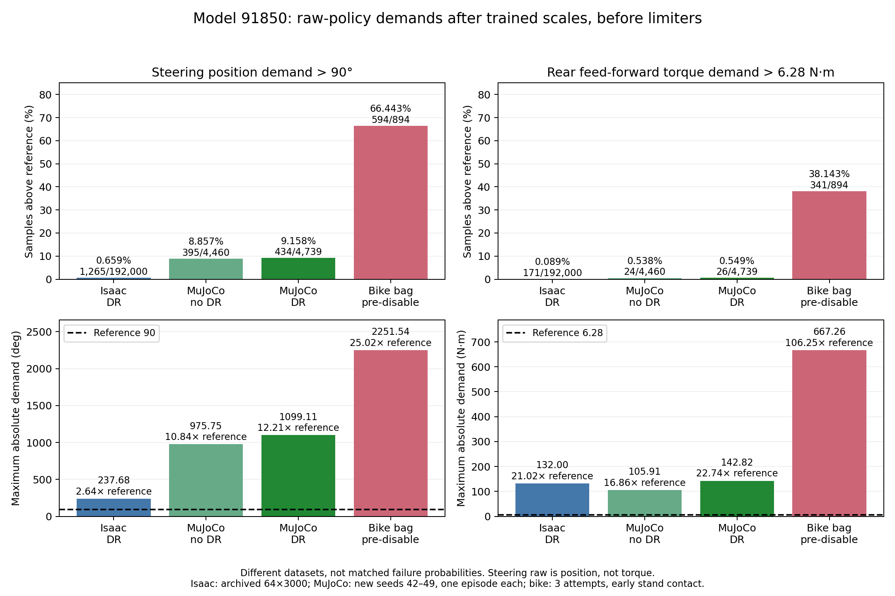
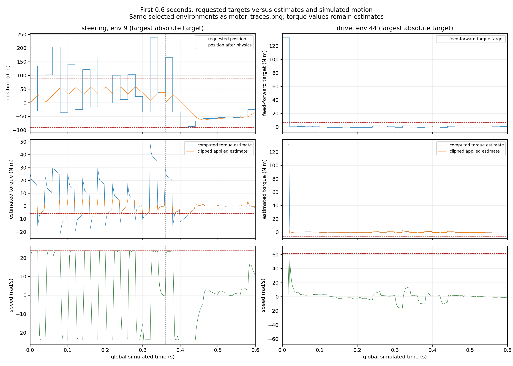
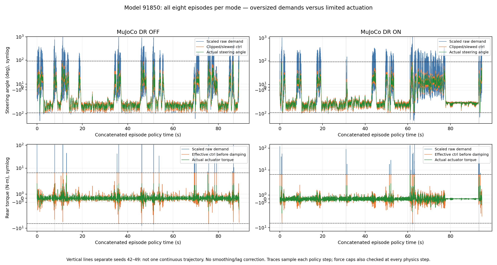
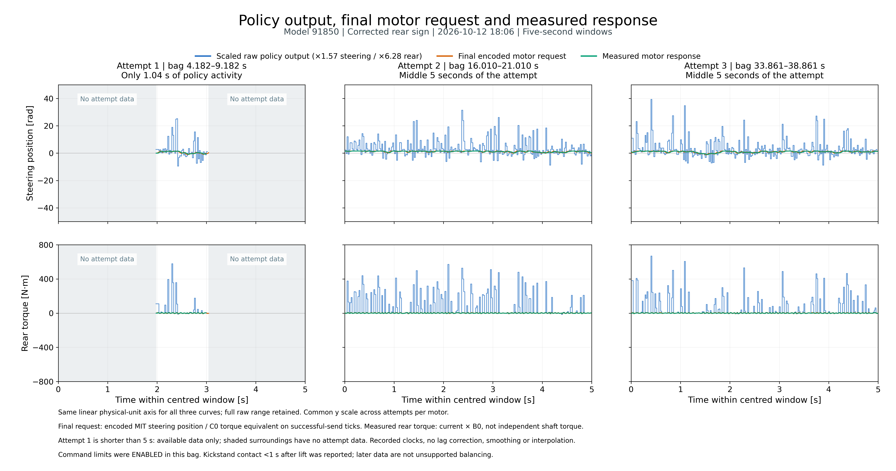

# Deployment Failure Analysis — Question 2: Did Policy Outputs Exceed Motor Limits?

Analyzed: 2026-10-16. Policy throughout: **09221945/model_91850**.

## Answer

**Yes. In Isaac Lab, MuJoCo and the real-bike recording, policy demands exceeded the configured steering range and rear torque reference. However, oversized policy demands are not the same as oversized torque actually delivered by a motor.**

The important differences are how often this happens, whether it is confined to startup, and what each downstream actuator path does with it. The recordings do not establish the complete real motors' torque–speed envelope or a unique cause of deployment failure.

## 1. What is being compared?

The actor outputs dimensionless, unbounded values. The trained action interface converts them into:

```text
steering position demand = raw_steer × 1.57 rad
rear feed-forward demand = raw_rear × 6.28 N·m
```

There is no direct steering-torque output or motor-speed output. Therefore:

- Compare scaled steering demands with the **±90° task/operating-range reference**, not directly with 5.6 N·m.
- Compare scaled rear feed-forward demands with **±6.28 N·m**.
- Evaluate steering torque through the PD calculation and actual force/feedback separately.
- Evaluate velocity through measured state or the rate required to track changing position targets, not by calling raw action a speed.

With those scales, the steering threshold corresponds to raw magnitude **(π/2)/1.57 ≈ 1.000507**, and the rear threshold to **1**. Thus testing steering raw magnitude >1 is slightly different from testing a demand beyond 90°. A **1e-5 tolerance in native rad/N·m units** is used for physical-demand counts.

The references come from the existing task and actuator configuration, discussed in [Question 1](01_motor_model_comparison.md). The 5.6/6.28 N·m values are stall-derived references, not established continuous ratings; the ±90° simulated/operating range is not independent certification of real mechanical stops. Exceeding these references is proven; an unconditional claim of exceeding the exact as-built hardware envelope is not.

## 2. Evidence and test conditions

| Dataset | Conditions | Policy samples |
|---|---|---:|
| Isaac Lab | Archived 2026-10-01 evaluation; 64 envs × 3,000 steps; seed 42; full DR; 50 Hz policy / 400 Hz physics | 192,000 |
| MuJoCo, no DR | New headless diagnostic; seeds 42–49; one episode per seed, at most 1,500 steps / 30 s; normal observation noise | 4,460 |
| MuJoCo, DR | Same protocol with DR enabled | 4,739 |
| Deployment | Corrected-sign `rosbag2_2026_10_12-18_06_07`; three powered attempts; MIT steering / C0 rear | 894 |

Isaac data were reanalyzed, **not rerun**. The bike data are from the existing validated CSV exports, **not a new deployment**. Both wheels were grounded and no manual disturbance was reported; kickstands caught the bike within less than one second. Much of the later bike activity is therefore stand-supported/post-loss-of-balance behavior, not successful unsupported balance.

The bike bag **predates disabling the steering clamp/slew and rear torque clamps**. Do not interpret its final commands as the current uncapped backend's commands.

MuJoCo uses the actual current viewer augmentation, environment and policy classes with the unchanged verified 0916 XML, compiled **in memory**. The XML-writing loader, GUI, ROS and CAN are not used. No dynamics/configuration source is changed. An `mj_step` wrapper delegates to the original function and records force/velocity after every call without modifying state. All **35,680 no-DR / 37,912 DR physics steps** were captured, not merely the last substep at 50 Hz.

These are **different operating datasets**, not controlled equal-length trials or matched probabilities of failure. No DR-superiority or universal policy-reliability claim follows from comparing these fractions.

## 3. How large and how frequent were the excessive demands?

| Platform | Steering demand >90° | Largest absolute steering demand | Rear demand >6.28 N·m | Largest absolute rear demand |
|---|---:|---:|---:|---:|
| Isaac Lab, DR | **1,265 / 192,000 = 0.659%** | **237.68°** | **171 / 192,000 = 0.0891%** | **132.00 N·m** |
| MuJoCo, no DR | **395 / 4,460 = 8.857%** | **975.75°** | **24 / 4,460 = 0.538%** | **105.91 N·m** |
| MuJoCo, DR | **434 / 4,739 = 9.158%** | **1,099.11°** | **26 / 4,739 = 0.549%** | **142.82 N·m** |
| Deployment bag | **594 / 894 = 66.443%** | **2,251.54°** | **341 / 894 = 38.143%** | **667.26 N·m** |

The peak rear demands are respectively **21.02×, 16.86×, 22.74× and 106.25×** the 6.28 N·m reference. Corresponding raw-action absolute maxima, steering/rear, are **2.64225/21.01950**, **10.84720/16.86465**, **12.21858/22.74228**, and **25.02981/106.25117**.



[Vector SVG](question_2_policy_limits/exceedance_comparison.svg) · [PDF](question_2_policy_limits/exceedance_comparison.pdf) · [Counts CSV](question_2_policy_limits/counts.csv).

Counts were recomputed from actual stored samples, not read off graph pixels. Isaac uses its recorded float32 processed targets; deployment and MuJoCo mathematical raw demands use the trained scales in float64. Tiny final-decimal rounding differences do not change the reported counts.

## 4. Startup versus repeated excessive demands

All observed first actions exceed both references: **171/171 Isaac episode beginnings**, **8/8 in each MuJoCo mode**, and **3/3 bike attempts**.

Excluding exactly the first policy sample of each episode/attempt:

| Dataset | Remaining samples | Steering exceedances | Rear exceedances | Maximum rear demand afterward |
|---|---:|---:|---:|---:|
| Isaac Lab | 191,829 | 1,094 (0.570%) | **0** | **2.765 N·m** |
| MuJoCo, no DR | 4,452 | 387 (8.693%) | **16 (0.359%)** | **67.575 N·m** |
| MuJoCo, DR | 4,731 | 426 (9.004%) | **18 (0.380%)** | **60.185 N·m** |
| Deployment bag | 891 | 591 (66.330%) | **338 (37.935%)** | **667.257 N·m** |

**The archived Isaac rear excess is entirely a startup phenomenon. The bike's excess is not.** Excluding one sample does not exclude all transient recovery; the distinction simply shows that repeated bike exceedances cannot be explained solely by the first action.

The three bike attempts individually have steering/rear exceedance counts **32/18 of 53**, **316/185 of 468**, and **246/138 of 373**. Their peak steering demands are **1,441.00° / 2,064.94° / 2,251.54°**, rear **578.18 / 581.68 / 667.26 N·m**.

Existing Isaac visualization clearly exposes the startup burst and the difference between request and diagnostic/motion:



The two columns deliberately use different selected environments: env 9 for the largest steering target and env 44 for the largest rear target. The torque curves are **implicit-actuator estimates**, not measured total solver torque.

## 5. Did excessive raw demands become excessive motor output?

### Archived Isaac Lab data: oversized targets and computed torque; actual total torque not measured

**Follow-up, 2026-10-16:** a fresh evaluation now captures solver-measured joint-axis effort, with [Isaac demand-versus-response figures and validation](isaac_actuation/README.md). The DR-on raw actions and actual motion exactly reproduce this archive. Rear joint-effort peaks are 13.133 N·m with DR and 11.858 N·m without DR, confined to episode-start intervals; this is a projected joint measurement, not an independently isolated motor-only torque sensor. The archive-only statements below describe what the original NPZ could establish, not the limits of the new follow-up.

- Raw/scaled target excess is established by the 192,000 samples above.
- At **1,536,000 physics samples per motor**, the uncapped computed steering torque estimate exceeds 5.6 N·m **4,335 times (0.282%)**, peaking at **48.274 N·m**. The rear computed estimate exceeds 6.28 **1,368 times**, peaking at **132.002 N·m**.
- The clipped diagnostic estimate never exceeds its 5.6/6.28 settings. But `ImplicitActuator.compute()` returns original targets, and the recorded rear PhysX feed-forward submission reaches **132.002 N·m**. These facts do **not** establish the total implicit-plus-external solver torque. Neither actual delivery of 132 N·m nor a guaranteed total 6.28 cap is proven by those estimates.
- Actual simulated joint speeds exceed the configured references in **671 steering / 608 rear** physics samples, maxima **24.274 / 92.511 rad/s**. Actual steering position peaks at **90.0056°**: small solver overshoot, not the demanded 237.68°.

Evidence: [original experiment report](../../../../isaaclab_train/reports/motor_limits_09221945_91850_2026-10-01/README.md), [all distributions](../../../../isaaclab_train/reports/motor_limits_09221945_91850_2026-10-01/limit_distributions.png), and [source NPZ](../../../../isaaclab_train/reports/motor_limits_09221945_91850_2026-10-01/motor_limit_samples.npz).

### MuJoCo: actual actuator torque stayed capped despite oversized raw demands

Across **all captured physics steps** in the new diagnostic:

| Mode | Physics samples per motor | Steering/rear actual torque maxima | Actual torque exceedances |
|---|---:|---:|---:|
| No DR | 35,680 | **5.6 / 6.28 N·m** | **0 / 0** |
| DR | 37,912 | **5.6 / 6.28 N·m** | **0 / 0** |

Here `data.actuator_force` is the simulated actuator force, with unit gear making it joint torque—not the Isaac diagnostic estimate. Steering stored controls stay within approximately ±1.5708 rad through clipping/slew. Rear stored `data.ctrl` can still contain 105.91/142.82 N·m, but the engine clamps the effective control before damping and the final force afterward. A large stored control is **not** proof of a large applied torque.



[SVG](question_2_policy_limits/mujoco_demand_vs_actuation.svg) · [PDF](question_2_policy_limits/mujoco_demand_vs_actuation.pdf). All eight episodes per mode are concatenated in seed order, with vertical reset boundaries; this is not one continuous trial. Symmetric-log axes retain large raw spikes while showing the limited signals. No smoothing or lag correction is applied. Lines of recorded policy-step force are supported by the separate all-physics-step force checks.

MuJoCo also manually clips velocity state after each physics step. Post-policy-interval sampled maxima are **16.070/61.6 rad/s** without DR and **23.9/61.6** with DR. The new instrumentation sees intervening **pre-manual-clamp** peaks **58.255/86.167** and **66.117/93.766 rad/s** respectively. These layers must not be conflated: hard state assignments contain what the policy sees; they are not a physical torque–speed envelope. Steering joint limits can also overshoot slightly (maximum no-DR angle **90.111°**), distinct from explicit target bounds.

The small run yields no-DR **0/8** and DR **3/8** timeouts (DR seeds **43, 44, 47** reach 30 s). Surviving episodes also begin with excessive raw demands. **Raw exceedance alone is therefore not sufficient evidence of failure**, and these seed-specific outcomes do not invalidate earlier successful balancing runs or the verified model geometry.

### Deployment: recorded outgoing commands stayed bounded; this is pre-disable evidence

The existing report retains **3,022 successful paired motor-submission ticks**, distinct from 894 policy samples. Final encoded targets have absolute maxima:

- Steering: **1.570794232 rad ≈89.99988°**.
- Rear C0 torque equivalent: **6.279900250 N·m**.
- Outgoing target exceedances: **0/3,022 for both references**.

Thus the historical bike did **not** receive literal 2,251°/667 N·m commands through this capped host path. It received clipped/slewed steering and clipped rear current-equivalent requests. Send flags establish host submission, not execution of every frame. Current-derived torque feedback is not an independently calibrated shaft-torque sensor, and steering total MIT PD protection is unverified.

Existing visualization overlays scaled raw demand, final encoded request, and response for each attempt:



[Full-attempt nine-panel graph](../deployment_20261012_180607/presentation_3x3/policy_to_motor_3x3.png) · [Graph definitions/conditions](../deployment_20261012_180607/presentation_motors_5s/README.md).

The first attempt is only about 1.04 s, so its five-second panel intentionally has blank surroundings. Most later data are stand-supported. Neither outgoing bounds nor these plots certify all physical velocity/torque limits.

Current source has subsequently commented out the three host restrictions. **The recorded bounded-output result must not be extrapolated to current uncapped operation.** No after-disable hardware trial is performed or analyzed in this task.

## 6. What about demanding motion faster than motor speed limits?

For exact tracking between consecutive policy position targets, required rate is `abs(target[k]-target[k-1])/dt`. Excluding episode resets:

| Dataset | Transitions requiring >23.9 rad/s | Maximum required rate |
|---|---:|---:|
| Isaac Lab | 1,385 / 191,829 = **0.722%** | **236.443 rad/s** |
| MuJoCo, no DR | 1,100 / 4,452 = **24.708%** | **448.851 rad/s** |
| MuJoCo, DR | 1,220 / 4,731 = **25.787%** | **518.555 rad/s** |
| Deployment bag | 818 / 891 = **91.807%** | **2,108.178 rad/s** |

Simulation uses its 20-ms policy interval; deployment uses actual bag-record policy timestamps. These are changes in the **unlimited demands**, not the slew-limited outgoing steering commands, measured speed, or proof that every target must be reached before the next update. A position controller can legitimately lag a moving target; exceeding this rate makes exact immediate tracking infeasible under that assumed bound, not necessarily the angle unreachable eventually.

## 7. Conclusions for deployment diagnosis

1. **Oversized policy demands exist in all three platforms.** They are not exclusive to the bike and do not, by themselves, prove an export/sign/unit bug.
2. **Their pattern differs substantially.** Archived Isaac rear bursts occur only on the first action; the failed bike bag has repeated large demands throughout active operation. Stand-supported/post-fall observations and different closed-loop dynamics confound causal interpretation.
3. **Downstream processing is decisive.** MuJoCo converts extreme requests into bounded actuator forces. The historical capped bike also bounded encoded commands; current uncapped source differs. Isaac's approximate torque plots cannot settle its total-force equivalence.
4. **A robust transfer must reproduce a safe, validated actuator mapping and realistic observation/plant response.** Arbitrarily removing the learned scales, adding post-hoc tanh, or removing protections is not demonstrated to fix the policy. Whether the learned startup burst is causally required remains an experiment, not a conclusion from these traces.

## Artifacts, reproduction and validation

- [Analysis script](question_2_policy_limits/analyze.py), [summary with input/source SHA-256s](question_2_policy_limits/summary.json), [counts CSV](question_2_policy_limits/counts.csv), [new raw MuJoCo policy/physics arrays](question_2_policy_limits/mujoco_samples.npz).
- The saved JSON defines every NPZ column and each episode's seed/begin/end/result. Motor order is steering/rear. All finite samples and all 16 episode outcomes are retained; no survivor selection.
- The explicit MuJoCo and deployment 91850 ONNX files have identical SHA-256 **`9232a0723df8806e8b5f6fb4e39a7a11ccb5af8bf058d9026eddb57dab8fd806`**. Replaying all 894 recorded observations through this ONNX matches recorded actions to maximum absolute difference **3.814697266e-6**. Wrong policy identity or an extra scale is not supported by this check.
- All input/source hashes checked before and after analysis match. No runtime source, model, original report, bag, checkpoint or progress record is changed. New artifacts only. MuJoCo **3.12.0**; the saved JSON also records NumPy version.
- Validation independently recomputed saved MuJoCo counts/peaks and checked all **73,592 physics samples** against force bounds; the last physics sample of every policy interval exactly matches its saved policy-step torque. All **16 episode ranges**, start counts and sample totals agree. Synthetic helper checks cover tolerance boundaries, startup/reset-transition exclusion and rejection of nonfinite input. **13 input/source hashes** remain unchanged; **19 report links** resolve; PNG/SVG/PDF/CSV/fences and Pyflakes checks pass. Both new figures and the referenced Isaac startup figure were visually inspected. These are analysis-integrity checks, not a new hardware test.
- Rerunning refuses to overwrite previous artifacts; select a fresh output directory:

```bash
PYTHONDONTWRITEBYTECODE=1 MPLCONFIGDIR=/tmp/trackstand_q2_mpl python3 \
  deploy/experiments/reports/20261015_deployment_failure_analysis/question_2_policy_limits/analyze.py \
  --output /tmp/trackstand_q2_reproduction_unique
```

This reproduces the new MuJoCo diagnostic and archive/CSV comparisons, not the old Isaac evaluation or a hardware run. NumPy, Matplotlib, MuJoCo and ONNX Runtime are required. Existing figures are linked in place, not regenerated.
