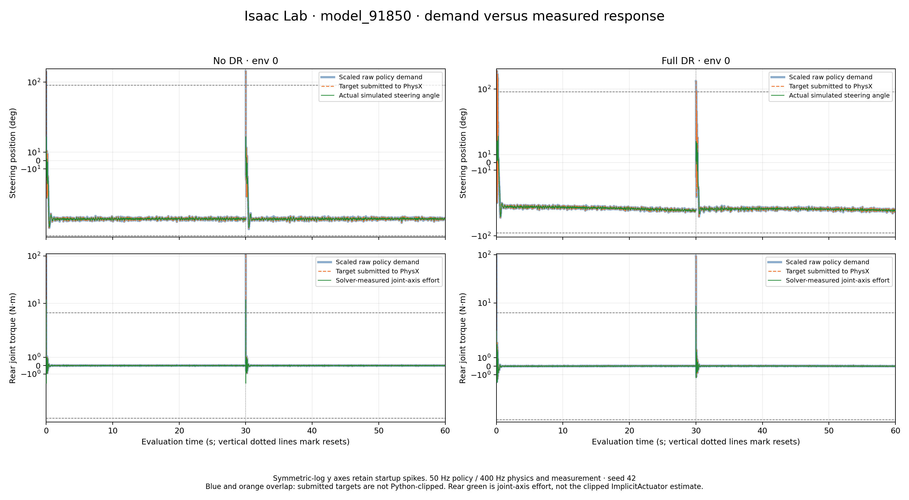
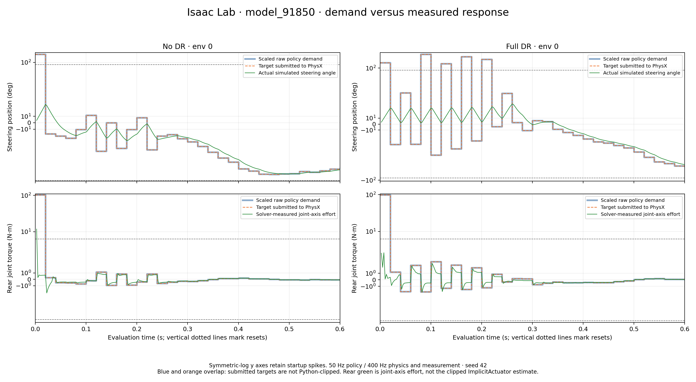

# Isaac Lab 91850 — Demand Versus Actual Response

Generated 2026-10-16 for `09221945/model_91850.pt`. These are **fresh evaluations with new solver-effort telemetry**, not a relabeling of the old clipped-torque diagnostic.

## Figures

Every figure has steering in the upper row, rear in the lower row, no DR on the left, and full DR on the right. The same environment is used for both motors within a column.

| Figure | Selection |
|---|---|
| [Full traces](isaac_demand_vs_actuation.png) | Env 0, complete 60-second evaluation, resets marked |
| [Startup detail](isaac_startup_demand_vs_actuation.png) | Env 0, first 0.6 seconds |
| [Tracking detail](isaac_tracking_detail.png) | Env 0, 0.5–5 seconds, linear axes |
| [Largest-demand startup](isaac_peak_startup_demand_vs_actuation.png) | First 0.6 seconds; env 2 without DR, env 44 with DR, selected by largest rear demand anywhere in each run |

All four figures also have matching `.svg` and `.pdf` files for presentations. The full/startup figures use symmetric-log y axes to retain large startup demands while showing the smaller responses. The tracking-detail figure uses linear axes. No smoothing, downsampling, time shifting, or signal clipping is applied; motion is not connected across automatic resets.





## Meaning of the lines

- **Blue:** raw actor output multiplied by **1.57 rad** for steering, **6.28 N·m** for the rear. Steering is displayed in degrees; CSVs retain radians.
- **Orange:** the target actually submitted to PhysX, captured after the action/actuator processing and before integration. This is the steering position target or rear feed-forward effort target. It overlaps blue because there is no Python-side action/target clamp in this Isaac path. This does **not** mean the implicit controller has no force limit.
- **Green, steering:** actual simulated joint angle after each physics step, not a target or torque estimate.
- **Green, rear:** **solver-measured active joint-axis effort**, obtained from `robot.root_view.get_dof_projected_joint_forces()` after each physics step and before automatic reset. This is not `robot.data.applied_torque` and is not its clipped diagnostic estimate.

Dashed horizontal references are ±90° and ±6.28 N·m. Commands are held over their actual time intervals; responses are timestamped at the end of the corresponding 2.5-ms physics step. Dotted vertical lines mark episode resets. The 60-second x axis is evaluation time, not one 60-second episode.

**Measurement boundary:** projected joint effort is the active component of the solver's incoming joint wrench. It includes the joint-axis effects represented by that solver measurement; it is not an independent sensor isolating motor-only shaft torque from every constraint/limit effect. The MuJoCo companion figure instead reads `data.actuator_force`. Therefore the green torque curves have clearly stated but not identical measurement boundaries across platforms.

The installed implementation is `omni.physics.tensors/api.py:1991` in `omni.physics.tensors-110.1.11+110.1.1.lx64.r.cp312.u7f4`. Its documented semantics are also described in the [Isaac Sim articulation joint sensor documentation](https://docs.isaacsim.omniverse.nvidia.com/6.2.0/sensors/isaacsim_sensors_physics_articulation_force.html).

## Evaluation and integrity checks

Each mode runs **64 environments × 3,000 policy steps**, seed **42**, deterministic actor inference, **50 Hz policy / 400 Hz physics**, eight physics steps per policy action. Standard terminations remain enabled; `--pure_survival` is not used. Observation white noise remains enabled in both modes. DR-on uses the full saved reset randomization, not a training ramp.

The recorder checks saved/current actions, observations, rewards, terminations, actuator configuration, physics dt, decimation, episode horizon, and (when DR is on) event configuration. Complete effective configurations are saved alongside the data. No training, deployment, MuJoCo, bicycle model, or evaluator source was modified for these runs. Each run checks **78 source/checkpoint files**, with **zero changes**.

The DR-on rerun's **raw actions, actual positions, and actual velocities are bit-for-bit identical** to `isaaclab_train/reports/motor_limits_09221945_91850_2026-10-01/motor_limit_samples.npz`. Thus the new sensor read did not change that recorded trajectory. The old archive did not contain the new projected-effort measurement.

Before using the sensor, [validate_effort_sensor.py](validate_effort_sensor.py) tested a separate free, fixed-base, unit-inertia rotor with no gravity, contacts, or rigid-body damping. Six cases cover positive/negative feed-forward, implicit drive alone, both together, oversized feed-forward, and saturated implicit drive. Across **24 physics samples**, measured torque agreed with `J × Δω / Δt` to **7.63e-6 N·m** maximum absolute error. A 20 N·m external feed-forward case measured approximately 20 N·m despite a 5.6 N·m implicit-drive limit; the saturated implicit-only case measured approximately 5.6 N·m. These are validation-stage results, not bicycle measurements. See [validation data](sensor_validation.json).

## What the added measurement shows

Statistics below use **all 1,536,000 physics samples per motor per mode**, not only the plotted environment.

| Metric | No DR | Full DR |
|---|---:|---:|
| Largest absolute scaled rear demand | 106.238 N·m | 132.002 N·m |
| Largest absolute measured rear joint effort | **11.858 N·m** | **13.133 N·m** |
| Rear samples exceeding 6.28 N·m by more than 0.01 N·m | **128** | **116** |
| Largest rear effort excluding each episode's first policy interval | 2.129 N·m | 2.532 N·m |
| Largest measured steering joint effort | 5.438 N·m | 5.608 N·m |
| Completed episodes | 128 | 129 |
| Timeout share of completed episodes | 100% | 58.9% |

All those material rear-effort exceedances occur during **the first 20-ms policy interval of an episode**. They are not sustained 106/132 N·m output, and the maximum request and maximum measured response need not occur at the same sample. The stored clipped diagnostic remains at or below approximately 5.6/6.28 N·m, illustrating why it must not be substituted for solver-measured effort. The DR steering excess over 5.6 N·m is less than 0.01 N·m; no material steering exceedance is claimed using that margin.

DR-on reproduces the earlier 129 completed episodes, 27.38-s mean episode length and 1.43° roll RMS. Its non-timeout terminations are yaw deviations, not `fallen`. These are evaluation outcomes, not proof of physical-bike readiness or a unique explanation for deployment failure.

## Data and reproduction

- [Summary and input hashes](summary.json); [verification](verification.json).
- Full data: `no_dr/motor_samples.npz`, `dr/motor_samples.npz`; motor order is `[steering, rear]`.
- Selected traces: [no-DR env 0 CSV](no_dr_env0_traces.csv), [DR env 0 CSV](dr_env0_traces.csv).
- Settings/results: each mode's `experiment.json`, `configuration_checks.json`, `effective_env.yaml`, `source_integrity.json`, and `eval.txt`; complete console logs are `no_dr_run.log` and `dr_run.log`.
- The evaluator also emits `torque_profile.png/.npz` inside each mode directory. **Those legacy outputs still use the clipped implicit-actuator diagnostic, not the new measured-effort data.** Use the figures linked above for this request.

Run from the repository root, choosing a **fresh output directory**:

```bash
cd isaaclab_train
~/IsaacLab/_isaac_sim/python.sh ../deploy/experiments/reports/20261015_deployment_failure_analysis/isaac_actuation/record_eval.py \
  --capture-dir /tmp/91850_actuation_dr_fresh \
  --task Trackstand-Balance-v0 --num_envs 64 --num_steps 3000 \
  --seed 42 --dr --headless --device cuda:0 agent.max_iterations=500000
```

Omit `--dr` for nominal physics. The checkpoint defaults to the original 91850 file; it is copied into the capture directory so evaluator-generated files do not overwrite training-run outputs. [plot.py](plot.py) expects sibling `dr/` and `no_dr/` captures and refuses to overwrite a previously completed figure bundle.
