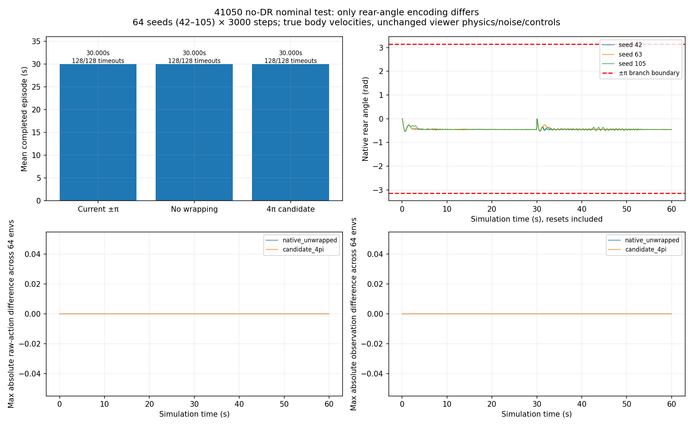
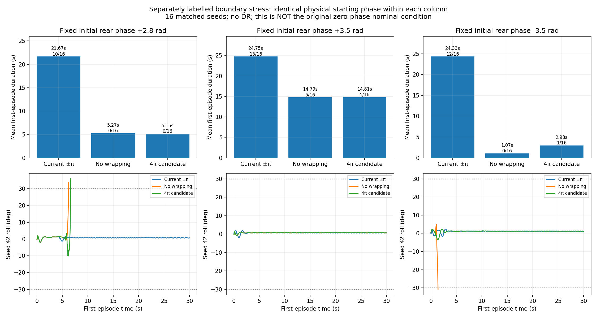
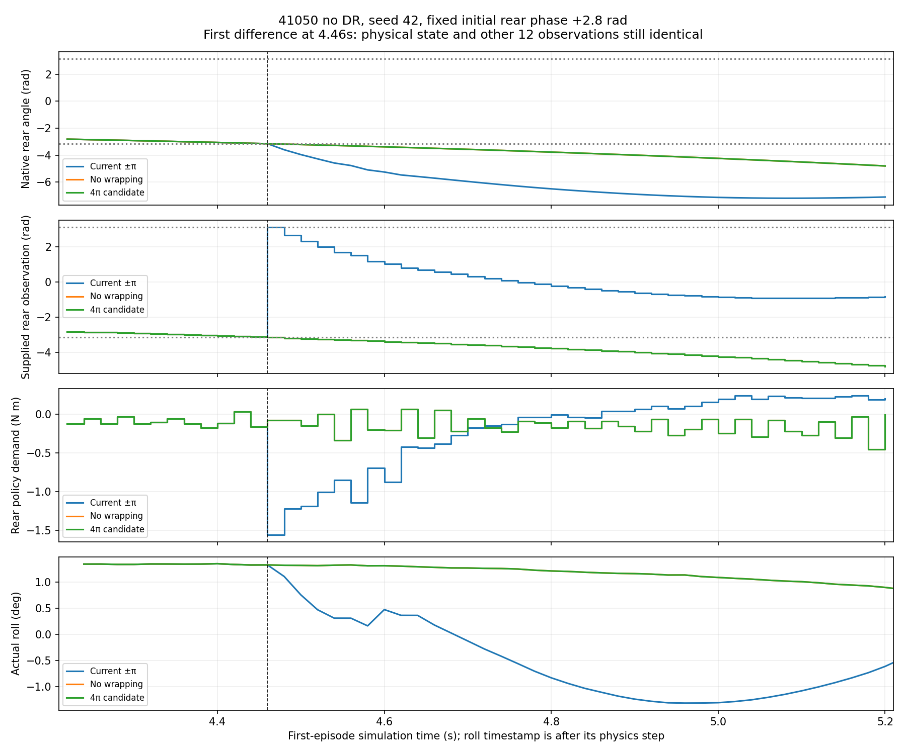

# Model 41050, no DR: does rear-angle wrapping materially affect balancing?

Date: 2026-10-16. Policy: **09171946 / model_41050**. These are fresh headless MuJoCo experiments using the current `run_deploy_viewer.py` augmentation and actual `BikeBalanceEnv`/`DeployedPolicy`, not the generic evaluator's older model_500 defaults.

## Conclusion

**In the reproduced perfect nominal evaluation, wrapping has exactly zero effect: all three variants produce bitwise-identical inputs, actions, motion and episode outcomes.** The rear angle never reaches ±π, so the different mappings never become different policy inputs.

**When a separately tested initial wheel phase leads to branch crossings, encoding choice has a substantial effect—but the existing ±π wrapping performs better than removing it for this policy.** These results do not support disabling wrapping as an automatic deployment fix.

## Controlled setup

- Same deterministic 41050 ONNX, current verified XML geometry, motor parameters, friction/contact configuration, true body-velocity observations and time-out/fallen termination rules throughout.
- Policy **50 Hz**, physics **400 Hz**, eight substeps/action; maximum episode **1,500 actions / 30 s**.
- **No DR.** Normal white observation noise remains enabled: gravity σ=0.001, angular velocity σ=0.0012 rad/s. Each environment has an independent RNG; the same seeds are used across encodings.
- Current nominal tire friction is **0.65**, floor pass-through **0.1**, contact solref **0.005/1.5**. These current viewer settings are preserved, not retuned to force a perfect result. The historical 41050 Isaac training used 100 Hz physics; this test concerns its successful current MuJoCo evaluation at 400 Hz.
- Only zero-based observation channel **8** (rear-wheel position) differs between each paired variant. The zero reference is not updated mid-episode. No motor/IMU sign, observation velocity estimator, controller, action cap/slew, geometry or termination change is made.

| Variant | Rear-angle observation from MuJoCo's native angle `q` |
|---|---|
| Current wrapped | `(q + π) % (2π) - π` |
| No additional wrapping | `q` |
| Candidate 4π branch | `(q + 2π) % (4π) - 2π` |

The last variant is motivated by the earlier Isaac backend probes; it is **not a validated general PhysX branch emulator**. MuJoCo's unbounded native coordinate is also **not an exact Isaac observation replica**.

Sources: [current viewer augmentation](../../../../../mujoco_sim2sim/scripts/run_deploy_viewer.py), [observation/reset/physics implementation](../../../../../mujoco_sim2sim/src/newbike_mujoco/env.py), [actual policy wrapper](../../../../../mujoco_sim2sim/src/newbike_mujoco/policy.py). Experiment implementation: [run.py](run.py).

## 1. The original perfect nominal condition

**64 independent environments, seeds 42–105, 3,000 actions/environment**, automatic reset after termination. Every episode starts with rear angle zero, exactly as the current no-DR environment specifies.

| Encoding | Completed episodes | Timeouts | Falls | Mean episode | Overall roll RMS |
|---|---:|---:|---:|---:|---:|
| Current ±π | 128 | 128 | 0 | 30.000 s | 0.624590° |
| No wrapping | 128 | 128 | 0 | 30.000 s | 0.624590° |
| Candidate 4π | 128 | 128 | 0 | 30.000 s | 0.624590° |

Across **192,000 policy frames per variant**, native rear angle stays in **[−0.744467, 0] rad**. There are **zero ±π branch crossings** and zero steering/rear demand exceedances. The maximum absolute raw actions are approximately **0.309407 / 0.044989**.

The full observation arrays, raw actions, physical qpos/qvel, roll samples, reset markers and termination flags are **bitwise identical**, not just similar aggregate scores. Thus the correct conclusion is **“wrapping is inactive and irrelevant in this nominal operating region”**, not “this policy is proven robust to wrapping jumps.”



## 2. Boundary stress tests, explicitly separate from the nominal condition

The perfect baseline cannot test a boundary it never reaches. I therefore also tested fixed initial native rear phases **+2.8, +3.5 and −3.5 rad**, keeping the root upright and all other reset settings unchanged. This is an intentional, deterministic initial-state stress—not DR and not the original zero-phase nominal reset.

For each phase: **16 matched seeds 42–57**, one complete episode/seed, up to 30 s. Within each phase, the initial physical state is identical across encodings. No extra observation/noise draw is made. Setting a nonzero initial wheel phase may affect wheel contact, but that physical phase is held identical within each encoding comparison.

Each cell below shows **mean first-episode duration; timeouts/16**:

| Initial rear phase | Current ±π | No wrapping | Candidate 4π |
|---|---:|---:|---:|
| +2.8 rad | **21.674 s; 10/16** | 5.265 s; 0/16 | 5.149 s; 0/16 |
| +3.5 rad | **24.754 s; 13/16** | 14.794 s; 5/16 | 14.814 s; 5/16 |
| −3.5 rad | **24.331 s; 12/16** | 1.066 s; 0/16 | 2.979 s; 1/16 |

So encoding **can matter a lot once the relevant angles occur**, but removing wrapping substantially worsens these tests rather than improving them. All three choices are less robust to some of these nonzero-phase starts than the original perfect zero-phase condition. This table is not a claim that any alternative matches the exact training contract or that ±π wrapping is universally optimal.



## 3. First-divergence evidence: the mapping itself changes the closed loop

The **+2.8 rad** test starts inside the common ±π branch, so all encodings initially produce exactly the same observations and actions. This avoids attributing its first divergence to different initial actions.

Example: **seed 42, 4.46 s / action index 223**. The native rear coordinate first moves below −π:

| Quantity | Current ±π | No wrapping / candidate 4π at this instant |
|---|---:|---:|
| Actual native rear angle | −3.150966 rad | −3.150966 rad |
| Supplied rear-angle observation | **+3.132220 rad** | **−3.150965 rad** |
| Raw steering action | −0.320292 | −0.397151 |
| Raw rear action | −0.248475 | −0.011987 |
| Scaled rear demand | approximately −1.560 N·m | approximately −0.0753 N·m |

At that instant, the **entire physical state and the other twelve observations remain bitwise identical**. All preceding actions and physical states also match. The alternative encoding changes the action; subsequent physical trajectories then diverge. These are real closed-loop runs, not merely fixed-record inference replays. Scaled demands are not a measurement of actual motor torque.

The same first-difference invariants were checked for **96 seed/phase/alternative comparisons**. The complete rows are in [first_encoding_differences.csv](results/first_encoding_differences.csv).



## What this does and does not establish

1. **Does wrapping materially affect the perfect 41050 no-DR evaluation? No:** not one input changes in the tested nominal region; performance is identical.
2. **Can wrapping materially affect 41050 when a branch is reached? Yes:** controlled boundary tests show large differences in commands and survival.
3. **Is removing wrapping a demonstrated fix? No:** current wrapping outperforms both alternatives in these stress cases. Treat the representation as a policy contract, not a setting that is inherently better when removed.
4. **Does this resolve 91850 or real-bike failure? No:** this is a different checkpoint and does not isolate the real bike's velocity-estimator, timing or actuation mismatches. It also does not independently test whether per-RC-episode re-zeroing is beneficial.

No source/configuration/model change was made to the runnable training, MuJoCo or deployment code. No hardware commands or new training were started. Existing progress records were preserved. The report-local environment subclass changes only the stated observation mapping, plus the explicitly labelled stress reset phase.

## Reproduction and artifacts

From repository root, with NumPy, MuJoCo, ONNX Runtime, Torch, Matplotlib and Pillow available:

```bash
MPLCONFIGDIR=/tmp/trackstand_wrap41050_mpl python3 \
  deploy/experiments/reports/20261015_deployment_failure_analysis/wrapping_41050_no_dr/run.py \
  --output /tmp/new_41050_wrapping_results
MPLCONFIGDIR=/tmp/trackstand_wrap41050_mpl python3 \
  deploy/experiments/reports/20261015_deployment_failure_analysis/wrapping_41050_no_dr/inspect_boundaries.py \
  --results /tmp/new_41050_wrapping_results
MPLCONFIGDIR=/tmp/trackstand_wrap41050_mpl python3 \
  deploy/experiments/reports/20261015_deployment_failure_analysis/wrapping_41050_no_dr/verify.py \
  --results /tmp/new_41050_wrapping_results
```

Use a fresh output path; collection refuses overwrite. With no output arguments, the scripts use this report's `results/` directory. Inspection/verification regenerate only their derived artifacts.

- [Numerical summary and all episode outcomes](results/summary.json), [comparison CSV](results/comparison.csv), [figure gallery](index.html).
- Twelve compressed NPZ captures in `results/` retain exact observations, raw actions, qpos/qvel before action, post-step roll, valid masks, starts and terminations. Stress traces are padded with NaN only where an environment has already terminated; statistics and checks use the valid mask.
- [Independent verification](results/verification.json) checks checkpoint-versus-ONNX replay, encoding reconstruction, episode lengths/counts, initial-state equivalence, and the wrapped subclass against the actual unmodified environment. [Source/model/record integrity](results/source_integrity.json) retains before hashes and confirms no changed protected files.
- Each graph also has SVG/PDF versions. Capture wall time was approximately 86 s; repeated postprocessing is separate.
- Checkpoint SHA256: `657a11875105177da79e6c198885a7428eae54034ea161317c43677dfe29cafb`; ONNX: `4de70e7cb3d183f265b3063298f41c0c82545e59bc23c071b0eaa54788e929b2`.
