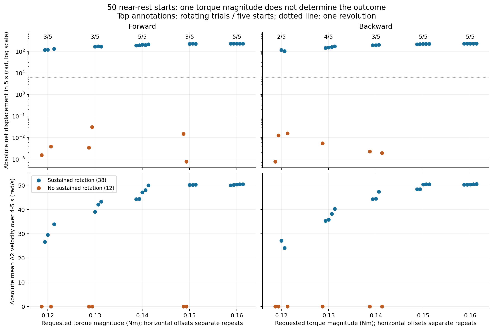
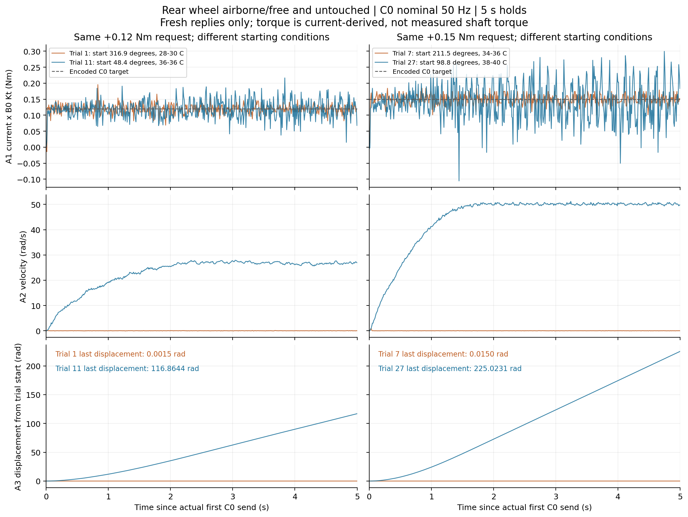

# Rear drive: 50 constant-torque starts, 2026-10-29 23:08

The new recording substantially strengthens the evidence for missing near-zero starting behavior in the rear
actuator model. Identical constant commands can produce either tiny displacement or many revolutions from near
rest. It does **not** identify one universal breakaway torque, establish cogging as the cause, or prove a faulty
or intrinsically random motor.

## Recording and scope

Inputs are the CSV, JSON, plan and summary with stem
[`20261029_230822_555944_drive_torque_threshold`](../../logs/20261029_230822_555944_drive_torque_threshold.json).
The main CSV contains **344,039 rows / 109,534,334 bytes**. The user confirms the rear wheel was airborne/free
and untouched throughout, without hand contact or repositioning between trials. This fixture confirmation is
user supplied; the CAN recording alone cannot establish it.

The actual run has **50 trials**, matching the updated plan now recorded in
[progress_record.md, §251](../../../../progress_record.md) and
[progress_record.txt](../../../../progress_record.txt), superseding §§248–249's 30-trial plan:

- Five repetitions of ascending magnitudes 0.12, 0.13, 0.14, 0.15 and 0.16 Nm, forward then backward at each level.
- Five-second constant C0 holds, nominal 50 Hz refresh; CF-disabled two-second coast between holds.
- Nominal A1/A2/A3 queries at 100 Hz each, AE at 5 Hz, B0/B4/CD at 1 Hz.
- Rear ID 1, TX 0x101, RX 0x001; gear ratio 1; torque and encoder signs -1. Positive project motion is forward.
- Measured B0 torque constant 0.30000001192092896 Nm/A. Native current is `-requested_Nm / Kt`, encoded as signed
  little-endian int32 milliamps. Actual torque magnitudes represented are approximately
  0.1200, 0.1299, 0.1401, 0.1500 and 0.1599 Nm.

The recording reports completion of all trials, confirmed disable, restored original watchdog, no restore
error and final fault 0. All four recorded runtime source hashes match the current adjacent experiment scripts.
The recorded settings agree with §251 and supersede §249's old defaults: feedback timeout 1 s, status timeout 2 s, query timeout
0.1 s, disable/mode timeouts 1 s, clock tolerance 50 ms, lateness warning threshold 100 ms with strict timing off.
These relaxed thresholds do not establish hard real-time execution. Actual observed timing is checked below.

All torque feedback in this report is **signed A1 Q-axis current multiplied by B0 Kt**. It is not an independent
shaft/net-torque measurement. AE bus current is not substituted for Q-axis current. Only fresh replies enter
feedback statistics; cached columns on unrelated CSV rows are not counted as new measurements.

## Outcomes: a sharp split, not one fixed threshold

| Requested magnitude (Nm) | Forward sustained rotation | Backward sustained rotation | Combined |
| ---: | ---: | ---: | ---: |
| 0.12 | 3/5 | 2/5 | 5/10 |
| 0.13 | 3/5 | 4/5 | 7/10 |
| 0.14 | 5/5 | 3/5 | 8/10 |
| 0.15 | 3/5 | 5/5 | 8/10 |
| 0.16 | 5/5 | 5/5 | 10/10 |

The 38 rotating trials have absolute net displacement **103.0567–231.6023 rad**. The other 12 have maximum
absolute excursion at most **0.0310631 rad** (1.780 degrees); small jolts/dither are retained. Classification
uses more than one revolution of net displacement, but the huge gap makes the count insensitive to any cutoff
between 0.032 and 103 rad. This is a descriptive grouping, not a fitted mechanical threshold.

**0.12 Nm can start the wheel. 0.15 Nm can fail to sustain rotation. 0.16 Nm succeeded in all ten tested starts.**
The last result is a sample observation, not a guarantee over other phases, temperatures, loads or future starts.
Forward 0.14 succeeded 5/5 while forward 0.15 succeeded 3/5, so a single deterministic function of commanded
torque magnitude cannot explain these trials. These are not matched-phase threshold sweeps.



## Same command, similar average current, radically different motion

| Trial | Requested torque (Nm) | Native starting phase (degrees) | A1-derived mean torque (Nm) | Last A3 displacement (rad) |
| ---: | ---: | ---: | ---: | ---: |
| 1 | +0.12 | 316.890 | +0.118835 | +0.001534 |
| 11 | +0.12 | 48.384 | +0.117780 | +116.864409 |
| 7 | +0.15 | 211.465 | +0.148900 | +0.014956 |
| 27 | +0.15 | 98.833 | +0.141558 | +225.023093 |

The C0 payloads are identical within each pair. The 12 nonrotating trials' absolute mean A1-derived torque
errors are only **0.000805–0.002392 Nm**. Missing/incorrectly encoded commands or a complete absence of commanded
average Q-axis current are therefore poor explanations for the move-versus-stall split. Good mean current
tracking does not establish instantaneous electromagnetic torque, calibrated shaft torque or net accelerating
torque; static losses, commutation and mechanical history are still unmeasured.

All starting A2 speeds have magnitude at most **0.062832 rad/s**. For the **49 inter-trial starts**, 49–50 A3
samples spanning 0.4843–0.4951 s of the preceding half-second show at most **one count** of position range
(0.000383495 rad). The first trial has only two pre-command A3 samples spanning 0.561 ms; its longer rest history
is not recorded. Thus residual rolling from the preceding hold is not supported as the explanation for the
large response differences. This conclusion is based on observed data, not an assumption that two seconds of
coasting must always stop the wheel.



Native phase differs between many successful and unsuccessful starts, making angle-dependent resistance a
plausible lead. It is not a demonstrated cogging map: +0.12 trial 11 moves at 48.384 degrees, whereas trial 31
does not at 49.702 degrees. Those phases are not identical, and temperature/history differ. Fixed ascending
levels, alternating signs, preceding motion and temperature rising **28–42 C** confound causal attribution.
Static friction, cogging/gear ripple, imbalance and current-to-torque/firmware history remain candidates.

## Current peaks do not identify breakaway torque

For all 38 rotating trials, the largest directional A1 torque peak occurs **after** the first one-radian A3
excursion, by at least **0.758 s**. Whole-hold peaks reach approximately 0.186–0.371 Nm, but these are largely
established-rotation measurements, not measured starting thresholds.

First-100-ms peak ranges overlap: **0.1215–0.1842 Nm** for rotating trials versus **0.1290–0.1698 Nm** otherwise.
Failed +0.12 trial 31 has an early peak 0.1683 Nm, larger than successful +0.12 trial 11's 0.1320 Nm. Therefore
the explanation "the wheel moves whenever a larger startup current spike occurs" is not supported generally.
A1 sampling near 100 Hz cannot resolve sub-10-ms current dynamics or identify the internal current-loop rate.

The last-second A1 torque standard deviation is **0.0269–0.0711 Nm** in rotating trials versus
**0.0079–0.0256 Nm** otherwise. This is sampled current variability; neither its true bandwidth nor its physical
cause is established. Do not erase it by presenting only average current tracking.

## Implications for the existing model and earlier doubts

1. The [October 20 fit](../drive_damping_20261020_154728/README.md) identified effective **moving drag near
   0.106 Nm over 1–8 rad/s**, with positive viscous slope unresolved. It did not measure static breakaway.
   [V1's current rear configuration](../../../../isaaclab_train/source/trackstand_rl/trackstand_rl/tasks/manager_based/trackstand/trackstand_bike/trackstand_rl_env_cfg_v1.py)
   sets provisional static friction equal to that dynamic friction, viscous friction zero, and controller
   Kp=Kd=0. The new stalled +0.12/+0.15 holds demonstrate behavior missing from this ideal torque plus fixed
   threshold approximation. They do not justify replacing both friction values with 0.16 or blindly adding
   a fixed torque offset. A1*Kt calibration and mechanical losses have not been separated.
2. The [seven identical-rate replays](../20261029_rear_replay_repeats/README.md) already showed large motion
   variation at nominal 50 Hz. This constant-command, near-rest run strengthens the resistance/actuation-state
   explanation. It does not establish intrinsic randomness, motor damage or a causal packet-rate effect.
3. This run only uses C0. It cannot rank C1 against MIT velocity feedback or identify their internal gains or
   processing frequencies. Velocity feedback is worth a controlled comparison because it can react to a stall;
   MIT Kp=0 with Kd>0 is proportional speed control, not PI. Integral action requires an actual velocity-error
   integral, sufficient torque authority and suitable implementation/validation.
4. A 50-Hz refresh of an unchanged five-second target is not a test of arbitrary 50-Hz RL action sequences.
   There is no 50/200-Hz controlled comparison here, and no proof that equalizing refresh and physics rates
   solves the deployment discrepancy.
5. Moving 0.12 trials have last-second mean speeds **24.14–33.87 rad/s**; 0.15/0.16 trials approach
   **48.34–50.46 rad/s**. The low-speed fit should not be assumed valid over this whole range. Terminal speed
   and current variation alone do not separate speed-dependent losses, electrical limitations or firmware.
6. The prior [CF-transition abort](../20261029_torque_threshold_mode_transition/README.md) was an overly strict
   mode check. The new run completes all 49 inter-trial transitions, recording old-mode replies followed by
   mode-0 status 2.496–3.273 ms after CF send. This is evidence that the script fix works in this run, not a
   measurement of the exact physical disable latency or general software bug freedom.
7. The newly updated records (§253) separately document a **loaded, high-speed torque-response gap** in the
   [full deployment report](../deployment_20261029_142732/README.md): for 29 samples with requests above 3 Nm,
   speed above 40 rad/s and torque directed with motion, mean magnitudes were 5.126 Nm requested versus
   1.414 Nm current-derived feedback. Those are the saved deployment analysis results, not measurements from
   this threshold recording. A low-torque airborne start experiment cannot resolve that high-demand behavior.
   A larger static-friction number alone is therefore not a justified complete rear-actuator repair.

## Additional telemetry discrepancy

After matching the first/last A3 timestamps within each hold and interpolating A2 to those exact boundaries,
trapezoidal integration of A2 is **1.364–1.565% smaller in magnitude than A3 displacement in all 38 rotating
trials**. The code and local protocol agree on A2's 0.01 rpm units and A3's 16,384 counts/revolution
([protocol text, pp. 5–6](../../../../tsinghua_bike_project/can_protocol.txt)). This is an unresolved small
velocity/position consistency issue; neither sensor is independently calibrated here. Asynchronous sampled
feedback and unknown firmware estimation are limitations. No correction factor is installed.

This discrepancy is far too small to explain the 0.03-versus-100-rad outcome gap. A3 single-turn versus
multi-turn-modulo fields differ by -1 count in 25,677 samples and 0 in 8,859; no larger mismatch is present.
The reported unwrapped motion uses the multi-turn field throughout, not a wrapped single-turn angle.

## Raw-data validation and remaining identification work

The analyzer independently decodes raw frames, verifies every encoded C0 command, A1/A2/A3 value, all 50 trial
summary counts/means/displacements and timing fields. There are **12,445 C0 commands**, **106,332 received query
outcomes**, **36 phase-boundary cancellations**, and no logged query timeouts. Socket-drop counters are blank,
so this report does not turn their absence into a measured zero-drop counter. Recorded faults are all zero;
sampled voltage is **20.13–20.22 V**. AE at 5 Hz cannot exclude brief voltage transients.

Raw input and runtime-source hashes are checked again by the separate verifier. The progress records were
updated concurrently during this analysis; their snapshot/current hash differences are retained in verification
metadata. Neither analysis script writes the progress records, and their existing changes are preserved.

Holds last **5.000061–5.000127 s**. The longest C0 inter-send gap is **28.843 ms**. Host send-call/kernel receipt
timestamps are not motor acquisition times or on-wire transmit timestamps. B3 readback 82.498 A applies to
position/speed modes, not documented C0 protection. B4 reads raw zero; its special physical semantics are not
established. The temporary 500-ms watchdog is restored to the recorded original disabled/5,000-ms setting.

The useful next identification step is repeated positive/negative starts at **matched physical phase and
temperature**, with randomized torque order and confirmed rest. Map successful sustained starts and separately
fit moving losses; validate on held-out starts. This can test phase dependence without treating five successes
as a universal guarantee. Add an independent current/torque or motion reference if separating firmware
estimation from mechanics is required. A matched velocity-loop comparison can then test whether feedback
actually reduces the observed motion variation. No new hardware operation or simulator run was performed here,
and no controller, motor setting, simulation coefficient or progress record was edited.

## Reproduce

```bash
python3 -B deploy/experiments/reports/20261029_230822_drive_torque_threshold/analyze.py
MPLCONFIGDIR=/tmp/trackstand-threshold-mpl python3 -B deploy/experiments/reports/20261029_230822_drive_torque_threshold/plot.py
python3 -B deploy/experiments/reports/20261029_230822_drive_torque_threshold/verify.py
```

Requires NumPy and Matplotlib; only this report directory is written. Plots retain fresh samples at actual
timestamps with no smoothing, fitted delays or response rescaling. Outcomes use fixed horizontal offsets only
to reveal the five repeats at each requested level. Original CSV line numbers accompany extracted traces.

[Statistics and input hashes](statistics.json) · [50 derived trials](trials.csv) · [Grouped outcomes](groups.csv) ·
[First 200 ms samples](startup_samples.csv) · [Four full traces](selected_trial_traces.csv) ·
[Comparison PDF](same_command_response.pdf) · [Outcomes PDF](trial_outcomes.pdf) · [Verification](verification.json)
