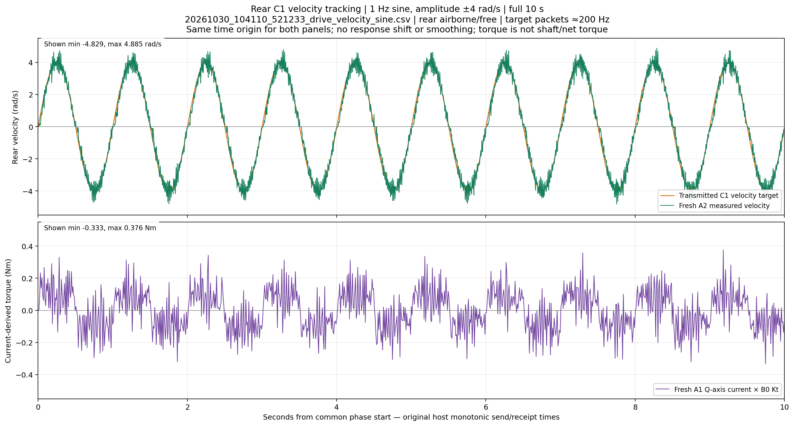
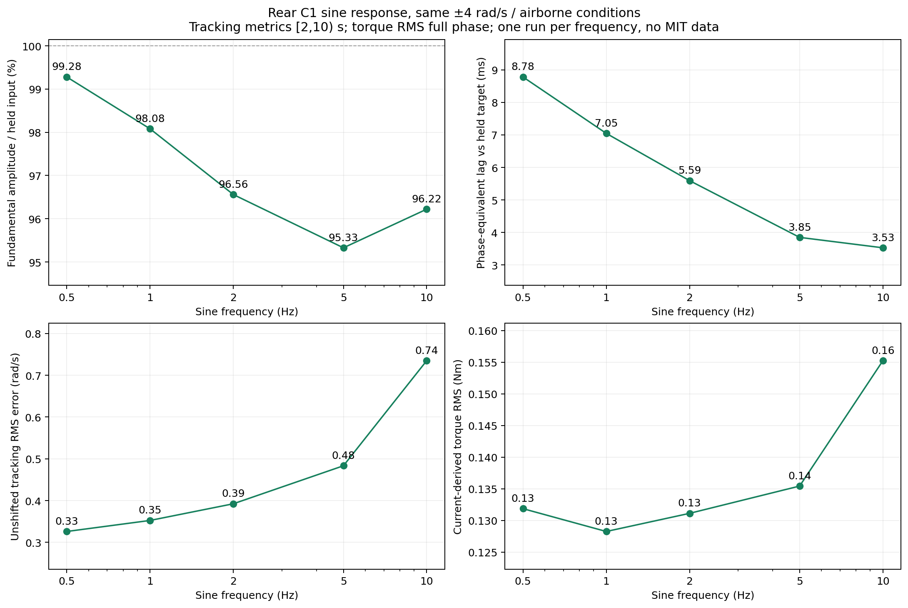

# Rear drive C1 velocity-sine response — October 30, 2026

**C1 tracks this ±4 rad/s airborne sine well through 10 Hz, but the response has measurable ripple, peak excursions and phase lag.** These five runs support C1 as a promising rear velocity-control candidate; they do not establish loaded balancing performance, across-run repeatability or superiority over rear MIT control, which was not tested here.

[1 Hz graph](c1_1hz_target_response.png) · [All graphs / zooms](index.html) · [Five-page PDF](all_runs.pdf) · [Zoom PDF](all_run_zooms.pdf) · [Metrics CSV](summary.csv) · [Full statistics](statistics.json)

## Inputs and conditions

All files are under `deploy/experiments/logs/`. Frequency and amplitude come from their saved JSON arguments and verified command payloads, not guessed filenames.

| Frequency | Recording prefix | Commands | Skipped packet slots |
|---:|---|---:|---:|
| 0.5 Hz | `20261030_103805_187108` | 1,998 | 2 |
| 1 Hz | `20261030_104110_521233` | 2,000 | 0 |
| 2 Hz | `20261030_104154_932459` | 2,000 | 0 |
| 5 Hz | `20261030_104208_835736` | 2,000 | 0 |
| 10 Hz | `20261030_104226_508475` | 2,000 | 0 |

The user confirmed **rear wheel fully airborne and free, no hand contact, identical power supply and firmware conditions for all five**. Each run completed approximately 10 seconds, with disabled/restored status true and no recorded driver fault. Recorded settings agree across every run:

- Rear ID **1**, host **0x101**, feedback **0x001**; encoder and torque signs **−1**, output-side gear ratio 1.
- Velocity amplitude **±4 rad/s** (±38.2 rpm), nominal target rate **200 Hz**. Achieved rates **199.80–200.003 Hz**; maximum packet intervals **6.19–10.90 ms** depending on run.
- B8 raw Kp **0.5**, B9 raw Ki **0.004999999888**. Their internal units/time convention remain undocumented; no MIT gain conversion was performed in these C1-only recordings.
- B0 Kt **0.300000011921 Nm/A**. B3 recorded ceiling **82.498 A**, B5 raw acceleration setting **0**. No B3, B5, origin or gain writes occur. B3 is a configured ceiling, not measured current.
- AE bus voltage **20.19–20.22 V** over these tests, maximum recorded temperature **34°C**. These logs show no large supply-voltage excursion in this low-demand regime.
- All five identify sender SHA256 `525f474cdc3459a7d692381bce385fd458ee9b44851e4c8f372ec1a69bb2c1e8`; it matches the archived [source snapshot](sender_source_snapshot.py.txt), verified against the live file at initial analysis.

## Requested graphs and matching timelines

Every frequency has a two-panel **full 10 s** figure, plus a three-cycle zoom:

| Frequency | Full graph | Zoom |
|---:|---|---|
| 1 Hz | [PNG](c1_1hz_target_response.png) / [SVG](c1_1hz_target_response.svg) / [PDF](c1_1hz_target_response.pdf) | [PNG](c1_1hz_zoom.png) |
| 0.5 Hz | [PNG](c1_0p5hz_target_response.png) / [SVG](c1_0p5hz_target_response.svg) / [PDF](c1_0p5hz_target_response.pdf) | [PNG](c1_0p5hz_zoom.png) |
| 2 Hz | [PNG](c1_2hz_target_response.png) / [SVG](c1_2hz_target_response.svg) / [PDF](c1_2hz_target_response.pdf) | [PNG](c1_2hz_zoom.png) |
| 5 Hz | [PNG](c1_5hz_target_response.png) / [SVG](c1_5hz_target_response.svg) / [PDF](c1_5hz_target_response.pdf) | [PNG](c1_5hz_zoom.png) |
| 10 Hz | [PNG](c1_10hz_target_response.png) / [SVG](c1_10hz_target_response.svg) / [PDF](c1_10hz_target_response.pdf) | [PNG](c1_10hz_zoom.png) |

The top panel overlays the **actual transmitted encoded C1 target**, drawn as a held step, with **fresh A2 velocity replies**. The bottom panel uses **fresh A1 current × B0 Kt**, signed into the same forward-positive convention. Cached measurements repeated in command/query rows are not counted as new samples.

Both panels use **one common phase-start monotonic origin**, reconstructed from command timestamps and `phase_elapsed_s`. Torque is not independently zeroed at its first sample; response curves are not shifted to make them align. Original asynchronous send/receipt times are retained. All finite samples fit the common **±5.5 rad/s / ±0.55 Nm** axes, with minima/maxima labelled and lower-right legends. No smoothing, fitted amplitude correction or time shift is applied to plotted traces. Gaps above 50 ms break curves; none is bridged with invented data.



## Quantitative tracking

Metrics use the common **2–10 s** window to exclude startup; torque peaks below use the complete phase. The response's fundamental sine amplitude is fitted separately from high-frequency ripple.

| Sine Hz | Fitted response amplitude | Response / held-target amplitude | Phase-equivalent lag vs held target | Unshifted RMS speed error | Peak absolute torque estimate |
|---:|---:|---:|---:|---:|---:|
| 0.5 | 3.971 rad/s | **99.28%** | **8.78 ms** | **0.326 rad/s** | **0.409 Nm** |
| 1 | 3.923 rad/s | **98.08%** | **7.05 ms** | **0.352 rad/s** | **0.376 Nm** |
| 2 | 3.862 rad/s | **96.56%** | **5.59 ms** | **0.392 rad/s** | **0.435 Nm** |
| 5 | 3.809 rad/s | **95.33%** | **3.85 ms** | **0.483 rad/s** | **0.419 Nm** |
| 10 | 3.833 rad/s | **96.22%** | **3.53 ms** | **0.735 rad/s** | **0.463 Nm** |



**Amplitude is maintained, but instantaneous precision is weaker than that amplitude ratio alone suggests.** Peak absolute measured velocity reaches **4.825 / 4.885 / 4.835 / 4.447 / 4.230 rad/s** for 0.5/1/2/5/10 Hz: excursions **20.6 / 22.1 / 20.9 / 11.2 / 5.7%** beyond the requested amplitude. These are individual measured peaks, not fitted sine amplitudes or a step-response overshoot percentage. The 1 Hz zoom shows small rapid velocity oscillations superimposed on the main sine. Nonfundamental residual RMS is approximately **0.28–0.32 rad/s** across the runs. Their cause could involve controller/friction behavior or velocity-estimator effects; this recording alone does not isolate it.

RMS tracking error rises from **8.1% to 18.4% of the 4 rad/s amplitude** between 0.5 and 10 Hz. The 10 Hz zoom exposes the phase difference and 20 target updates per period that the full-length graph can hide. A slightly higher fitted gain at 10 than 5 Hz is not proof of an improved response at higher frequency: there is only one run per frequency and the plant is not perfectly linear.

### Delay definition matters

The lag column is the **phase difference divided by angular frequency**, comparing the response fundamental with the **actual held transmitted target**. It includes feedback/host timestamps and dynamics; it is **not** an identified motor-internal delay or a universal fixed latency. Its variation with frequency rules against treating all five numbers as measurements of one pure delay.

Against the ideal continuously varying sine instead, phase-equivalent lag is **11.29 / 9.56 / 8.11 / 6.36 / 6.04 ms**. The approximately **2.5 ms** difference mainly reflects the 200 Hz target's zero-order hold. The report computes the held input's harmonic coefficients by exact integration of its actual packet timestamps rather than pretending sampled commands are a continuous sine.

The additional automatic C1 velocity-reply stream gives similar amplitudes and phase-equivalent lags **8.22 / 6.48 / 5.48 / 3.84 / 3.02 ms**. It is the same motor encoder/firmware estimate at different reply times, not an independent sensor. The modest differences illustrate why host-receipt timing should not be presented as precise internal firmware latency.

## Torque response and what this establishes

Torque-estimate RMS is **0.132 / 0.128 / 0.131 / 0.135 / 0.155 Nm**, with sampled absolute peaks **0.376–0.463 Nm**. The traces include ripple and sign reversals; they are neither commanded torque nor proof that motor current is physically discontinuous. With velocity control, the firmware varies current to respond to velocity error, acceleration and load. Here the recorded current-derived effort remains modest—at most about **7.4% of the configured 6.28 Nm maximum**. The B3 ceiling is much higher than the current actually observed; those quantities must not be confused.

**Conclusion for these tests:** C1 successfully produces the requested back-and-forth low-speed motion at all five frequencies, with near-full fundamental amplitude and relatively small phase-equivalent lag. It is a useful, experimentally supported candidate for further velocity-control work. Ripple and instantaneous peak/error behavior remain worth characterizing.

**What cannot be concluded:** this is one ten-second run at each frequency, on an airborne wheel, only ±4 rad/s and below 0.47 Nm sampled torque. It does not validate ground-loaded balance, full-speed torque availability, peak-torque duration or repeatability across identical repeated runs. It also cannot show C1 beating rear MIT control: no rear MIT run is included, and earlier steering-MIT tests used another motor and different conditions.

Next useful comparisons are repeated identical 1/5/10 Hz runs and the same grounded/supported load conditions, followed by a rear MIT experiment once the gain-unit convention is resolved. If using C1 in training/deployment, match its identified closed-loop response and PI behavior; v2's existing MIT-equivalent P velocity controller is not automatically the same plant. Do not tune raw B8/B9 on the assumption their undocumented units have been established by these curves.

## Numerical checks and reproduction

`analyze.py` independently decodes **every C1 command**, fresh A2/C1 velocity reply and A1 current reply from the raw payloads, checks signs/units and Kt, reconstructs sine targets, verifies command/skipped counts and zero driver faults, and checks all input hashes. Read-only B3/B5/gain/origin behavior is also checked. Every plotted native sample is exported in `c1_<frequency>hz_samples.csv`; per-run details, original settings and timing distributions are in `statistics.json`.

There is no resampled feedback in the graphs. Steady RMS compares measured A2 samples with the most recent transmitted target at each sample time. Sin/cos/DC least squares provides the measured fundamental; the target fundamental is exactly integrated across held packet segments over the same integer-period window. Source archives and the ten original CSV/JSON files remain unchanged; no controller, ROS, CAN, simulator or policy inference was run for the analysis.

```bash
MPLCONFIGDIR=/tmp/trackstand_c1_sine_plot_cache python3 \
  deploy/experiments/reports/20261030_drive_c1_velocity_sine/analyze.py
```

Requires NumPy and Matplotlib. Inputs are explicitly listed so future uploaded runs do not silently enter this report. [verification.json](verification.json) and [protected input hashes](protected_input_hashes.json) retain the checks; the gallery includes all PNG/SVG/PDF exports, with five-page PDFs for the full runs and zooms.
