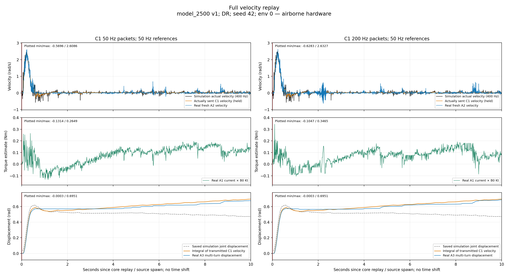

# Rear C1 tracking of policy-generated velocity — October 31, 2026

**Both runs reproduce the large startup movement reasonably well. Neither establishes precise tracking of the small settling waveform.** The 50-Hz run has less reported low-speed error/ripple than the 200-Hz run, but one run each, starting at different rotor angles, cannot isolate packet frequency as the cause. Calling the complete stationary-balancing velocity behavior faithfully reproduced would be premature.

[Figure gallery](index.html) · [All figures PDF](all_figures.pdf) · [Full comparison](comparison_full.png) · [Startup](comparison_startup.png) · [Settling](comparison_settling.png) · [Encoder averages](settling_encoder_100ms.png) · [Count plateaus](low_speed_count_plateaus.png) · [Metrics CSV](summary.csv) · [Exact statistics](statistics.json)

## Data, conditions and provenance

- Found exactly six new files: CSV/JSON/reference for `20261031_223709_716988_50hz_drive_velocity_replay` and `20261031_223442_378454_200hz_drive_velocity_replay` in `deploy/experiments/logs/`.
- User confirmed identical airborne/free rear wheel, supported frame, no hand contact or setting changes.
- Source: **model_2500**, v1, DR, seed 42, env 0, first episode, seconds 0–10; 400-Hz native states and 50-Hz references. There is no source reset in this window. V1 outputs **torque**; the resulting simulated velocity is used as a **new C1 reference**. This is not a trained-v2 velocity-action replay.
- Both reference copies have SHA256 `4c689c772a67e73054fa7999a20f5483df615d770a275b25169fee0efa2f49bf`; all 500 held target levels are identical across the rates, after decoding every actual command. At 200 Hz each level is resent four times; no interpolation or new between-boundary reference exists.
- Both runs completed and confirmed CF disable / CD restoration. No recorded driver fault, skipped core command, gain/current-limit/acceleration/origin write, or source/helper hash mismatch. Core commands **500/2,000** at **50.00047/200.00049 Hz**. Maximum core command lateness **0.136/0.127 ms**: the observed tracking mismatch is not explained by a large host packet stall.
- Raw B8/B9 **0.5/0.005**, Kt **0.300000012 Nm/A**, B3 **82.498 A configured ceiling**, B5 raw **0**. Gain units/internal PI timing remain unknown. B3 is not measured current, and its raw ceiling is not evidence of that much delivered torque.
- Recorded supply **20.20–20.22 V**; maximum temperature **32°C**. Maximum current-derived effort **0.2649/0.3465 Nm** at 50/200 Hz. These are low-demand tests, not envelope/thermal validation.
- Initial multi-turn counts **-6208283/-6206497** differ. Separate software origins and core-start A3 snapshots remove displacement offset, but do not physically match cogging/friction phase. One successive run at each rate does not prove repeatability or a causal rate advantage.

## Aligned plots and calculation

Every graph uses the recorded core-start monotonic origin. Native simulation velocity is black, actual held encoded C1 target orange and fresh A2 velocity blue. A1 current × B0 gives electromagnetic torque estimate, not independent shaft torque. Fresh A3 gives multi-turn displacement; cached copies in command/query rows are excluded from response statistics.

All raw graphs are unsmoothed, unshifted and retain actual asynchronous sample times. Red t=0 lines mark replay/source start; zooms beginning at t=2 do not represent a new spawn. Legends are lower-right, scales are shared across the two rate columns, and each panel labels its plotted minimum/maximum. No finite sample in its time window is clipped by the axes.

| C1 packets Hz | Full 0–10 s RMS error | Startup 0–2 s RMS error | Settling 2–10 s RMS error | Settling target RMS | Settling correlation | Apparent startup lag ms |
| ---: | ---: | ---: | ---: | ---: | ---: | ---: |
| 50 | 0.0823 | 0.1514 | 0.0523 | 0.0295 | 0.147 | 3.5 |
| 200 | 0.1004 | 0.1463 | 0.0851 | 0.0296 | 0.074 | 5.0 |

Errors/speeds are rad/s. Primary RMS compares each fresh A2 velocity with the **latest actually transmitted encoded target**, without compensating delay. Small settling targets make peak-normalized full-run error misleading. The 50/200-Hz settling 95th-percentile absolute errors are **0.0796/0.1403 rad/s**; target RMS is only about 0.030 rad/s. Absolute errors within 0.1 rad/s cover **97.2/92.8%** of settling samples. That threshold is descriptive, not an established balance-performance pass criterion.

Comparing directly to the full native simulation curve gives all-window RMS **0.1097/0.1222 rad/s**. This comparison includes 400→50-Hz reference sampling effects, so it must not all be attributed to the motor.



## Startup, settling and apparent delay

The initial large forward velocity bump has startup correlation **0.973/0.975**. Actual sampled peak speed reaches **2.609/2.633 rad/s**, versus a transmitted-target peak around **2.324 rad/s** and native simulation peak **2.484 rad/s**. This is clear coarse motion reproduction, with ripple and individual peak excursions rather than perfect tracking.

The lag values minimize shifted held-target RMS on **0.1–1.0 s**, scanning −50 to +100 ms in 0.5-ms increments. Positive means response behind the command. They describe this transient's best apparent shift, not motor-internal pure latency, an invariant delay, or 0.5-ms measurement precision. All main metrics/graphs retain the original delay. Individual peak-time differences are not substituted for controller latency.

After 2 s, the command is very small and its detailed waveform is weakly correlated with A2. Reported real speed RMS is **0.0512/0.0849 rad/s**, against target RMS **0.0295/0.0296**. Good reproduction of the big bump alone is insufficient to claim precise tiny back-and-forth control.

A2 spikes may contain firmware velocity-estimator noise, not only true physical velocity fluctuation. Therefore the supplementary plot differentiates fresh A3 over five actual encoder intervals (~100 ms), and compares it with the exact target integral over those same intervals. This is explicitly an average, not a replacement for the raw trace or an independent sensor. Settling average-speed RMS errors remain **0.0270/0.0318 rad/s**, with correlations **0.245/0.157**. Thus poor fine waveform correspondence is not explained solely by isolated A2 spikes, although shared encoder/firmware/timestamp limitations remain.

### Stronger low-speed evidence: unchanged position counts

| Packets Hz | Core interval s | Unchanged-count duration s | Travel required by C1 velocity rad | Equivalent encoder counts required | Actual count change |
| ---: | ---: | ---: | ---: | ---: | ---: |
| 50 | 6.306–7.048 | 0.742 | 0.012291 | 32.0 | 0 |
| 200 | 2.831–3.513 | 0.681 | 0.013372 | 34.9 | 0 |

These are fresh A3 CAN replies with identical decoded multi-turn counts, not repeated cached rows. One encoder count is **0.0003835 rad**; the missing commanded travel is tens of counts, so sub-count resolution alone is insufficient to explain it. Current-derived torque varies through **0.0768–0.1917 Nm** in the 50-Hz example and **0.0090–0.1017 Nm** in the 200-Hz example. The staircase motion and torque buildup support intermittent near-zero motion/friction plus servo dynamics as explanations. They do not independently identify friction coefficients, firmware PI state or motor-internal acquisition times. The dedicated plateau graph uses a clearly labelled local origin, not a new episode/spawn.

## Displacement: compare to the velocity actually commanded

The source's saved position ends at **0.471063 rad**, while its own saved velocity integrates to **0.687817 rad**. The 50-Hz held reference integrates to approximately **0.694907 rad**. These are already different before hardware is involved. We do not invent a physical cause or blame C1 for that source-side numerical/quantity discrepancy.

Actually transmitted target integrals are **0.695116/0.695097 rad**. Real A3 travel ends at **0.674185/0.685689 rad**, at **9.999320/9.996700 s**. Errors relative to the command integral at each last A3 time are **-0.020916/-0.009335 rad**. The integrated motion is fairly close, despite the imperfect fine speed waveform.

The graphs show saved simulation joint angle (grey dashed), the integral of the C1 velocity actually sent (orange), and actual A3 travel (blue). The orange curve is a kinematic diagnostic, not a position command sent to C1. Core-start zero snapshots are about **3.85/3.34 ms** old, which is documented rather than silently treated as simultaneous.

## Assessment and next decisions

1. **Promising for the large transient and overall travel, not yet a precise match of the complete stationary-balancing waveform.** A 0.05–0.09-rad/s error is small compared with the big startup bump but larger than these tiny settling targets. No closed-loop tolerance proving this adequate for balance has been established.
2. **200-Hz resending has no demonstrated advantage here.** The 50-Hz run has smaller full/settling A2 error, while startup errors are similar. Different starting rotor phases, one run each and possible estimator/low-speed nonlinearities prevent claiming that 50 Hz is intrinsically superior.
3. **Most plausible fine-tracking limits are near-zero friction/stick-slip and C1 servo/velocity-estimation dynamics.** These are candidate explanations, not separately identified causes. The low-demand torque, stable recorded supply and clean host timing make torque-cap saturation, large supply sag or a major host packet stall poor explanations for this pair.
4. **Next useful test:** repeat this same reference at matched marked rotor phase, especially repeat the small 2–10-s segment; use identical supported loaded conditions as a separate comparison. Do not increase gains or change friction solely to force an apparent match. This replay still does not identify whether a simulated P approximation is sufficient or whether PI/delay/nonlinear dynamics must be modeled.

## Reproduce and inspect exact data

```bash
MPLCONFIGDIR=/tmp/trackstand_c1_velocity_replay_plot python3 \
  deploy/experiments/reports/20261031_drive_c1_velocity_replay/analyze.py
python3 deploy/experiments/reports/20261031_drive_c1_velocity_replay/verify.py
```

CSV exports retain each plotted native sample and actual sent target. `statistics.json` records windows, timing, settings, quantization, lag and encoder-average definitions. `protected_input_hashes.json`/`verification.json` check that raw inputs and existing controllers remain unchanged. `runtime_snapshot/` preserves the exact matched sender/helper source. No hardware, simulation, policy or controller modification was performed for this analysis.
