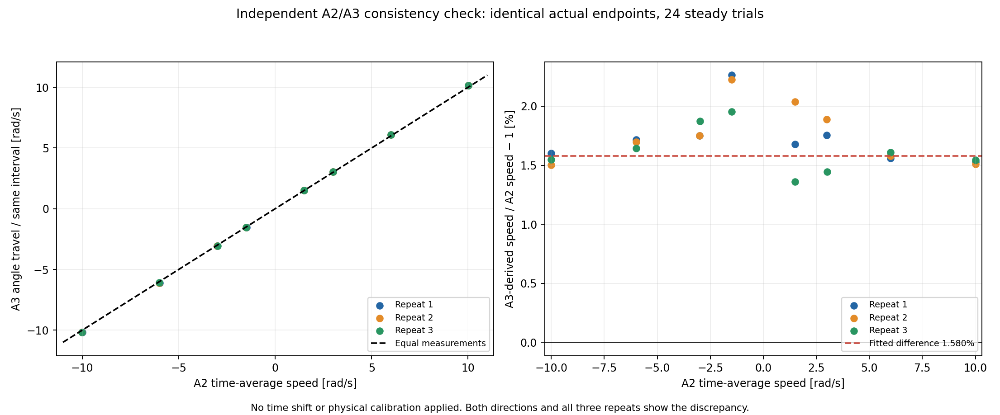
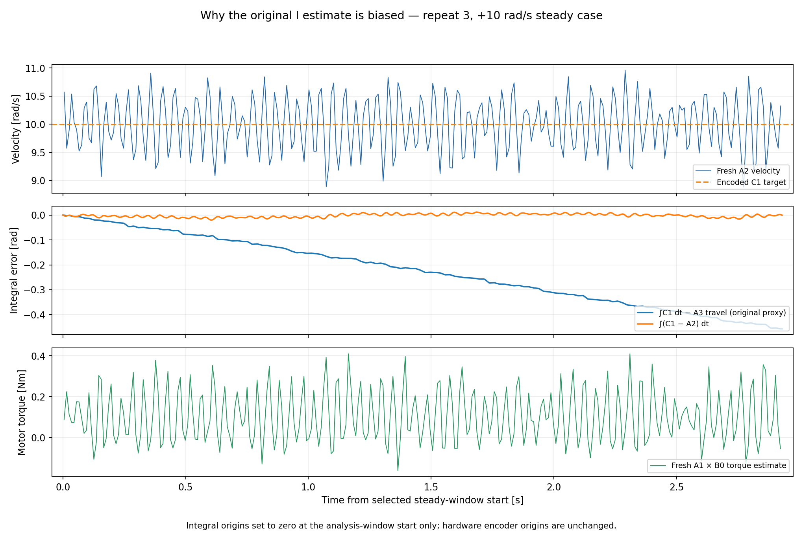
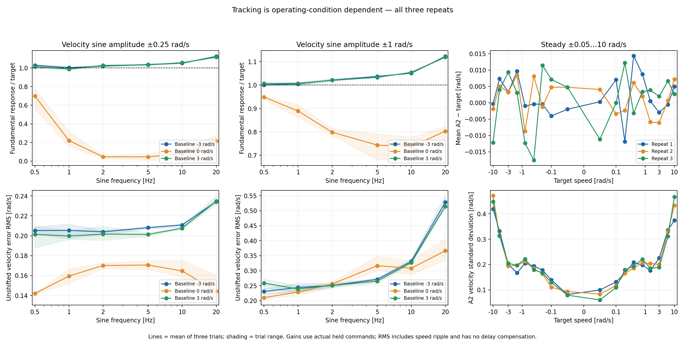
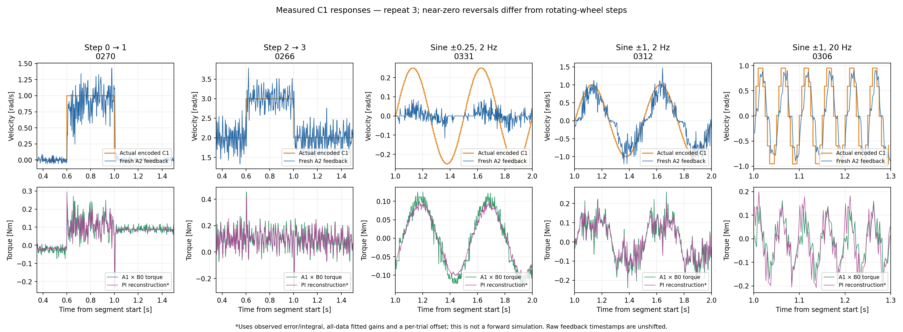

# Rear C1 velocity-loop identification — 2026-11-01

**A defensible initial simulation velocity-P gain is approximately 0.30 Nm/(rad/s).**
An A2-consistent time-domain fit also gives **I ≈3.26 Nm/rad**. Treat this pair as a
starting model for validation, not a fully identified C1 implementation. P varies
with method/condition; I has larger systematic uncertainty. Raw B8/B9 register
units remain unknown.

[Figure gallery](index.html) · [Review PDF](review_figures.pdf) ·
[Reviewed fits](review_statistics.json) · [Raw-packet audit](capture_audit.json) ·
[Independent numerical verification](numerical_verification.json)

## Recording and experimental coverage

Inputs: CSV, JSON and plan CSV under `../../logs/`, with stem
`20261101_154126_577381_drive_c1_kp_identify`.
The user confirmed the rear wheel was airborne/free throughout, with no contact
and unchanged supply/firmware settings. This covers the unloaded assembly, not
response under tyre load or real balancing.

| Item | Recorded result |
|---|---|
| Duration / completion | 1,194.021 s (19 min 54 s); all 342 segments completed |
| Cases | 54 steady, 120 step, 108 sine, 60 zero-speed phases; three repeats |
| Steady targets | ±0.05, 0.1, 0.2, 0.4, 0.8, 1.5, 3, 6, 10 rad/s |
| Steps | Baselines −6, −2, 0, 2, 6; perturbations ±0.1, 0.25, 0.5, 1 rad/s |
| Sines | Baselines −3, 0, 3; amplitudes 0.25/1 rad/s; frequencies 0.5–20 Hz |
| C1 packets | 238,799/238,800 planned; one logged skipped slot; median interval 5.000 ms |
| Timing | Packet gap p99 5.061 ms, max 9.030 ms; max logged lateness 4.332 ms |
| Fresh A1/A2 | Steady median ≈99.35 Hz each; dynamic ≈389.8 Hz each; configured 100/400 Hz |
| Fresh A3 / AE | Approximately 49.85 / 10 Hz |
| Raw B8 / B9 | 0.5 / 0.0049999999; unchanged in all 1,243 replies per register |
| B0 torque constant | 0.3000000119 Nm/A |
| Supply / temperature | AE: 20.17–20.22 V; 30–44 °C |
| Largest queried speed / torque | 12.688 rad/s / 3.817 Nm (A1 current × B0) |
| Driver faults | All 11,944 AE/CF replies had fault byte 0 |
| Cleanup | CF eventually reports mode 0; original CD restored and read back |

Every raw command matches its planned target at the recorded sample time.
Independent decoding reproduces all feedback units/signs, the initial multi-turn
origin and signed rollover handling, with zero error at stored precision.
No B1/B3/B5/B8/B9 writes occurred. Only C1 commands and temporary CD watchdog
configuration were sent with data. Shutdown CF initially returned mode 3, then
mode 0 about 51 ms later; the script correctly waited. Original B3 was 82.498 A
and was unchanged. Queried current stayed below both that ceiling and the
experiment's 6.28 Nm guard. These are host timestamps and queried feedback,
not independent measurements of CAN arrival or unqueried peaks.

## Fitted equation and physical units

For forward-positive signs, `e = encoded_C1_target − A2_velocity`:

```text
forward_current ≈ P_current × e + I_current × ∫e dt + per-trial offset
torque_estimate = B0_Kt × forward_current
P_torque [Nm/(rad/s)] = Kt × P_current [A/(rad/s)]
I_torque [Nm/rad]     = Kt × I_current [A/rad]
```

The offset accommodates unknown integral history; it does not reset the firmware
integrator. CSV `current_a` retains native A1 sign; `current_torque_nm` and report
current fits use the verified forward-positive sign (−1). A1 uses signed int32
×0.001 A; A2/C1 use signed int32 ×0.01 rpm; A3 multi-turn uses bytes 3–6, signed
int32 ×2π/16384 rad. This agrees with the local [CAN protocol](../../../../tsinghua_bike_project/can_protocol.txt).
Torque here is a current-derived electromagnetic estimate, not measured shaft torque.

Time fits jointly estimate P/I with equal weight per complete dynamic trial.
Repeat 1 trains, repeat 2 selects apparent delay, and repeat 3 tests before the
all-data refit. Frequency fits independently use the current/error complex harmonic
plus optional first-order lag and timing offset. They retain 76/108 sines with
sufficiently resolved coherent error. Steady torque/error is **not** used as P:
a PI loop can sustain nonzero torque with almost zero average speed error.

| Method | P, Nm/(rad/s) | I, Nm/rad | Interpretation |
|---|---:|---:|---|
| Original time fit: ∫target − A3 travel | 0.3043 | 0.0739 | I biased by the A2/A3 inconsistency below |
| Frequency fit: A2 error harmonic | 0.2739 | 2.9488 | Independent method; unresolved sensor/current lag remains |
| Time fit: integrate A2 error consistently | **0.3079** | **3.2586** | Preferred simple time-domain starting model |
| Diagnostic: A3 scale adjusted from repeat 1 | 0.3108 | 3.4767 | Analysis-only probe, not hardware calibration |
| Zero-baseline time fit with original A3 | 0.3048 | 3.7862 | Removes moving-baseline drift; retains zero-crossing effects |
| Zero-baseline frequency fit | 0.3505 | 3.5238 | Shows remaining condition/model dependence |

For the A2-consistent fit, conditional 95% whole-trial bootstrap intervals are
P **0.3011–0.3146**, I **3.1250–3.3502**. These exclude systematic sensor/model
uncertainty. The broader P method/condition spread is roughly **0.27–0.35**;
that range is not a confidence interval. I is less universal: A2-integral fits
restricted to moving baselines yield about **1.50–2.57 Nm/rad**, versus **3.54**
at baseline zero.

A2-consistent P/I per repeat are **0.30790/3.26213**, **0.31003/3.26806**,
**0.30572/3.24755**. Untouched-repeat current reconstruction improves from the
original time fit's R² **0.686 →0.827**, RMS **0.1523 →0.1130 A**
(≈0.0457 →0.0339 Nm). Scores remove a per-trial mean offset; these are not full
absolute-torque forward-prediction scores. Independent least-squares/integral
calculations reproduce the reviewed results in [verification](numerical_verification.json).

Selected apparent alignment is +1 ms in the time fit, −1 ms plus 2.5 ms lag in
the full frequency fit. **Neither is a measured firmware-loop delay.** Filtering
and asynchronous host reception can enter those parameters; negative alignment
does not mean anticipation. Firmware sampling, filtering and anti-windup are
not identified by this experiment.

## Important finding: the original A3 integral proxy drifts



At identical actual endpoints in 24 steady trials with |speed| ≥1 rad/s, A3 travel
is **1.0158045 ×** integrated A2 velocity: approximately **1.58% higher**. Repeat
slopes are 1.0160095, 1.0156707 and 1.0157335; both directions show it.
The original fit mixes instantaneous A2 error with accumulated A3 error.
At a moving baseline the discrepancy creates artificial integral drift,
driving I toward zero despite tiny mean A2 tracking error.



Integrating A2 for both terms improves held-out current reconstruction. Rescaling
A3 **only in a diagnostic fit**, using repeat 1 steady data, gives similar results.
Raw CSVs, encoder conversion and runtime code are unchanged. The original
automated `quality_notes` screen did not catch this issue; **its I=0.0739 estimate
must not be treated as identified firmware I**.

This does not identify which physical measurement is wrong or why. Mark the wheel,
independently measure several full revolutions and elapsed time, and compare A3
counts, integrated A2 speed and external timing before changing either conversion.

## Tracking depends on the operating condition



All 54 steady mean A2 errors are within **0.01754 rad/s**, but fresh A2 standard
deviation ranges **0.0606–0.4720 rad/s**. A correct mean does not imply a smooth
instantaneous response. Sine metrics average three repeats and use actual held,
encoded C1 targets; RMS has no time shift or delay compensation.

| Baseline / sine amplitude / frequency | Fundamental response / target | A2 error RMS |
|---|---:|---:|
| 0 / ±0.25 rad/s / 2 Hz | **0.047** | **0.170 rad/s** |
| 0 / ±1 rad/s / 2 Hz | 0.798 | 0.256 rad/s |
| +3 / ±0.25 rad/s / 2 Hz | 1.027 | 0.202 rad/s |
| −3 / ±0.25 rad/s / 2 Hz | 1.019 | 0.204 rad/s |
| 0 / ±1 rad/s / 20 Hz | 0.803 | 0.366 rad/s |

For the small zero-centred 2-Hz command, repeat 3 A3 angle spans only **0.002684 rad**
over the analysis window; perfect integration of the intended sine spans about
0.03979 rad. Thus small measured angle travel corroborates the weak A2 response.
Friction/stiction effects are plausible, but the experiment does not uniquely
identify the mechanism or firmware nonlinearities. The earlier successful policy
velocity replay covered one trajectory, not every small zero-crossing command.



Model overlays reconstruct current using observed feedback and a fitted trial
offset. They are not forward simulated motor trajectories.

## Simulation implications and next step

1. Start validation around **velocity P=0.30 Nm/(rad/s)**, retaining sensitivity
   tests around 0.27–0.35. This maps to IdealPD controller `damping`, or MIT
   velocity-only `Kd` with position `Kp=0`; it is not passive viscous friction.
2. For a provisional C1 PI model, P≈0.31/I≈3.3 are better starting values than
   interpreting raw B8=0.5/B9=0.005 as SI gains. Validate held-out complete responses
   before training; these numbers alone do not reproduce C1 at every condition.
3. Plain IdealPD has no integral state and cannot reproduce the full PI law.
   Retain separately measured plant losses: integral torque compensates friction,
   it does not remove friction. Illustratively, a pure-P gain of 0.30 opposing
   constant 0.106 Nm friction has error 0.106/0.30≈0.353 rad/s; friction is not
   established as constant at all speeds.
4. Resolve the existing [v2 400-Hz numerical oscillation](../../../../isaaclab_train/reports/20261027_v2_pretraining_audit/rear_velocity_loop_stability.png)
   before increasing gain or beginning long training. A coefficient change does
   not close the timestep/inertia issue. Compare the same held targets and
   feedback definitions in a forward simulator against saved step/sine/policy
   responses, including near-zero reversals.
5. Externally check the A2/A3 scale discrepancy first. This run does not establish
   the real torque-speed envelope, a complete motor model or loaded balance performance.

**No deployment/training/firmware configuration changed. No new motor or simulator
run was performed. Raw inputs were preserved.**

## Reproduction and artifacts

From the repository root, with NumPy and Matplotlib:

```bash
REPORT=deploy/experiments/reports/20261101_drive_c1_kp_identification
CACHE=/tmp/trackstand_c1_review_cache
python3 deploy/experiments/analyze_drive_c1_kp.py \
  deploy/experiments/logs/20261101_154126_577381_drive_c1_kp_identify.csv \
  --output-dir /tmp/trackstand_c1_original_fit
# statistics.json here preserves that original fit unchanged.
python3 "$REPORT/review_analysis.py" --cache "$CACHE"
python3 "$REPORT/audit_capture.py"
python3 "$REPORT/verify_analysis.py" --cache "$CACHE"
python3 "$REPORT/plot_review.py" --cache "$CACHE"
```

The cache is derived from raw CSV data and checked against its hash. Original
[automated report](automated_README.md), [statistics](statistics.json) and
[figures PDF](all_figures.pdf) remain as baseline results.
Reviewed tables include [gains](gain_method_comparison.csv),
[all 108 sine trials](sine_tracking_by_trial.csv), [tracking summaries](tracking_summary.csv),
[A2/A3 consistency](velocity_position_consistency.csv) and
[phase packet/query rates](capture_phase_rates.csv). The manifest records source
and analysis artifact hashes.
