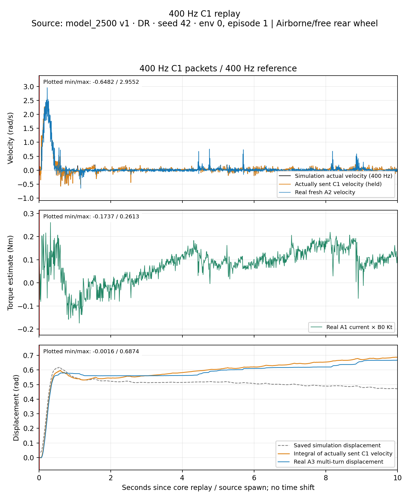

# Rear C1 velocity replay — 400 Hz, November 1, 2026

**The 400 Hz run completed and reproduced the main startup movement, with the best full-run agreement with the original simulation curve among these three recordings. It still does not precisely reproduce the small settling movements.** This comparison changes reference sampling as well as packet frequency; it does not prove that 400 Hz inherently improves the motor controller.

[400 Hz graph](replay_400hz.png) · [Three-rate comparison](comparison_full.png) · [Startup](comparison_startup.png) · [Settling](comparison_settling.png) · [HTML gallery](index.html) · [All figures PDF](all_figures.pdf) · [Metrics CSV](summary.csv) · [Exact statistics](statistics.json) · [Independent verification](verification.json)

## Data and conditions

The three newly uploaded files are CSV/JSON/reference for `20261101_134940_221417_400hz_drive_velocity_replay` under `deploy/experiments/logs/`. The user confirmed the same airborne/free rear wheel, no hand contact, unchanged firmware settings and power supply as the earlier 50/200 Hz tests.

The source remains **Trackstand-Balance-v1 model_2500, DR, seed 42, env 0, episode 1, seconds 0–10**. The v1 policy produces rear torque; its resulting simulated velocity becomes a new C1 reference. This is not a trained v2 policy test, a loaded bicycle test or a balancing success.

- The new reference has all **4,001 native 400 Hz states**, including the endpoint. Its bytes exactly match the full-rate simulation CSV. The old references contain 501 states at 50 Hz. There is no reset, stitching, amplitude change or interpolation in the command preparation.
- All C1 packets were decoded independently: rear ID **1**, native sign **−1**, signed little-endian int32 in **0.01 rpm**. Positive user velocity means forward. Every sent target matches its recorded reference sample; maximum C1 rounding error is **0.000524 rad/s**.
- The 400 Hz run completed its **1 s zero-speed → 10 s core → 1 s zero-speed** sequence, confirmed CF disable and restored CD. All recorded fault bytes are **0**; the previously reported fault 32 did not occur in this recording. Per-opcode reply counts match transmitted command/query counts over the full recording.
- Raw B8/B9 **0.5/0.005**, Kt **0.300000012 Nm/A**, B3 **82.498 A**, B5 raw **0**, and original CD settings match the earlier runs. B3 is a configured ceiling, not measured current. No gain/current-limit/acceleration/origin write was found. CD was temporarily enabled at 500 ms and restored.
- New core supply readings: **20.20–20.21 V**; maximum temperature **34°C**. Peak current-derived torque **0.2613 Nm**, far below the experiment's 6.28 Nm stop threshold. The data do not indicate that threshold caused the mismatch; the motor's complete physical envelope is not identified.

## How to read the graphs

The plot format follows the earlier report: velocity, current-derived torque and displacement in aligned rows; replay rates in aligned columns. Black is the native simulated velocity, orange the actually transmitted encoded C1 target, blue fresh real A2/A3 feedback and green A1 current × B0 Kt. The grey dashed position curve is the saved simulation joint displacement. The orange position curve is an integral of the C1 velocity actually sent, **not a position command**.

All panels retain original host timestamps, with no fitted shift or smoothing. Red t=0 marks source spawn/core start; settling zooms do not denote a new spawn. Legends are lower-right; panels label their plotted min/max, and comparison rows share scales. PNG/SVG/PDF exports and an HTML gallery are provided. Encoder-average diagnostics are explicitly labelled averages, separate from the raw plots.



## Tracking results

Primary errors compare each **fresh A2 reply** with the latest actually transmitted encoded target, without delay compensation. Units are rad/s.

| C1 packets / reference Hz | Full 0–10 s RMS error | Startup 0–2 s RMS error | Settling 2–10 s RMS error | Settling target RMS | Settling correlation |
| --- | ---: | ---: | ---: | ---: | ---: |
| 50 / 50 | 0.0823 | 0.1514 | 0.0523 | 0.0295 | 0.147 |
| 200 / 50 | 0.1004 | 0.1463 | 0.0851 | 0.0296 | 0.074 |
| **400 / 400** | **0.0956** | **0.1716** | **0.0640** | **0.0442** | **0.094** |

The 400 Hz run's error against its own command is between the earlier runs overall and during settling; its startup error is larger. The new dense reference contains variations discarded by the old 50 Hz sampling, so the target waveforms differ despite coming from the same episode.

For agreement with the **same original native simulation velocity curve**, using linear interpolation only at asynchronous feedback receipt times:

| C1 packets Hz | Full RMS error | Startup RMS error | Settling RMS error |
| ---: | ---: | ---: | ---: |
| 50 | 0.1097 | 0.2138 | 0.0601 |
| 200 | 0.1222 | 0.2020 | 0.0919 |
| **400** | **0.0960** | **0.1744** | **0.0630** |

The 400 Hz run has **12.5%/21.4% lower full-run native-curve RMS error** than the 50/200 Hz recordings. Most of that advantage appears in startup; settling is still slightly worse than the old 50 Hz run. This supports removing the former downsampling discrepancy, rather than a blanket claim that the motor now tracks more precisely.

### Startup and delay

The 400 Hz startup correlation with the sent target is **0.968**. The broad velocity bump is reproduced, but the maximum reported A2 speed is **2.955 rad/s at t=0.232 s**, versus native/command maximum **2.484 rad/s**. This is about **19% above the maximum reference value**; A2 is a firmware velocity estimate, so this single sampled peak is not an independently measured shaft-speed peak.

Best apparent startup lags are **3.5 / 5.0 / 5.0 ms** for 50/200/400 Hz. These minimize shifted held-target RMS on **0.1–1.0 s**, scanning −50 to +100 ms in 0.5 ms steps. They are descriptive correlation/alignment estimates, not isolated motor-internal latency or 0.5 ms measurement accuracy. No shift is applied to the main graphs or error tables.

### Small settling movements remain the limitation

At 400 Hz, settling error RMS **0.0640 rad/s** exceeds target RMS **0.0442 rad/s**, with correlation only **0.094**. The 95th-percentile absolute error is **0.1079 rad/s**, and **94.2%** of samples are within 0.1 rad/s. That descriptive tolerance has not been validated as sufficient for balancing.

This is not only an A2-spike conclusion. Fresh A3 displacement over five actual encoder intervals (~100 ms) gives settling RMS errors **0.0270 / 0.0318 / 0.0336 rad/s** for 50/200/400 Hz. The new run has no advantage on this averaged diagnostic.

The longest new unchanged-count interval is **2.591936–3.214501 s**, lasting **0.622564 s**. Fresh A3 replies show **zero count change**, while the sent velocity implies **0.011414 rad, or 29.76 encoder counts**, of net travel. A1-derived torque varies from **−0.0165 to +0.0747 Nm**. This supports intermittent near-zero motion/servo dynamics as a real limitation beyond single-count resolution. It does not separately identify static friction, cogging, internal PI behavior, estimator noise or acquisition delay.

## Packet timing and command delivery

- Core sends: **3,994 / 4,000**, achieved **399.400 Hz**; six slots skipped (**0.15%**), without aborting or stretching the ten-second replay.
- Missing source times: **1.0800, 1.0825, 1.0875, 1.0900, 1.5550, 1.5625 s**. No core source sample was transmitted twice. Every sent payload matches the correct saved reference sample.
- Maximum command interval **7.653 ms**; maximum CSV-logged schedule lateness **5.308 ms**. Median lateness **0.074 ms**, 99th percentile **0.148 ms**. The JSON's pre-send estimate is slightly smaller than CSV send-stamp lateness; this report uses CSV timestamps for that metric.
- All skipped slots are **before t=2 s**. They cannot explain the later unchanged-count plateau or settling mismatch. The peak A2 speed at t=0.232 s also precedes these skips.
- Core fresh A2 replies: **3,894**, approximately **389.39 Hz**; A1 **993**, A3 **499**, AE **100**. These are nominal query schedules with asynchronous replies, not exact motor acquisition rates. The old A2 streams were about 197.5 Hz, another comparison difference.

The host sustained this short 400 Hz run with a few missed deadlines. These logs do not establish exact wire arrival times, prove CAN saturation or guarantee that the Pi can sustain this schedule during full ROS deployment.

## Displacement and reference correctness

The 400 Hz commands integrate to **0.687254 rad** over the full core. Last fresh A3 travel is **0.666515 rad at t=9.996289 s**; relative to the command integral at that same time, the difference is **−0.020688 rad**, approximately 3% of the full commanded travel. Overall travel is reasonably close even though the fine speed waveform is not.

The source itself ends at saved joint displacement **0.471063 rad**, while its native velocity integrates to **0.687817 rad**. That source-side position/velocity discrepancy already exists before replay and remains unresolved. Do not attribute the full real-vs-saved-position gap to C1. This experiment commands velocity; compare accumulated real travel with the velocity actually transmitted as well as displaying the source position.

The first multi-turn count is **−210**, different from both earlier runs. Each run records its software origin and core-start snapshot correctly, but this does not physically match rotor/cogging phase. The new core-start A3 snapshot is **15.22 ms** old; that age is retained rather than presented as a simultaneous measurement.

## Assessment and next step

1. **400 Hz reference preparation and replay worked.** Downsampling no longer explains missing within-20-ms command variations, except the six explicitly recorded missed slots and small C1 quantization.
2. **Large startup and net motion are reproduced reasonably; precise near-zero tracking is still unproven.** Higher sending frequency alone did not remove the low-speed limitation.
3. **Most plausible remaining limits are near-zero friction/cogging combined with C1 PI and velocity-estimator dynamics.** Their individual contributions are not identified. Gross torque-threshold clipping, recorded supply collapse and later packet stalls have little support here.
4. **A causal rate ranking is not justified.** One run per rate, changed 50→400 Hz reference, changed A2 polling rate, different physical starting phase and a changed sender version are confounds, despite matching recorded motor configuration and user-confirmed fixture/supply conditions.
5. **Next discriminating test:** repeat the same full 400 Hz reference several times at a marked common starting rotor phase with unchanged settings. If testing rate effects, state explicitly whether targets are resampled or merely resent. A separately supported loaded replay remains necessary before extrapolating airborne results to balancing. Do not fit simulation/controller gains solely to this single recording or call this a PI-model validation.

## Reproduce

```bash
MPLCONFIGDIR=/tmp/c1_velocity_400_analysis_mpl python3 \
  deploy/experiments/reports/20261101_drive_c1_velocity_replay_400hz/analyze.py
python3 deploy/experiments/reports/20261101_drive_c1_velocity_replay_400hz/verify.py
```

The analyzer exports fresh command/A2/A1/A3 samples, encoder averages, plateau intervals, lag scans and exact metrics into this directory. The original October 31 report, logs, references, controllers and progress records are protected by hashes and unchanged. No hardware or simulator operation was performed for this analysis.
