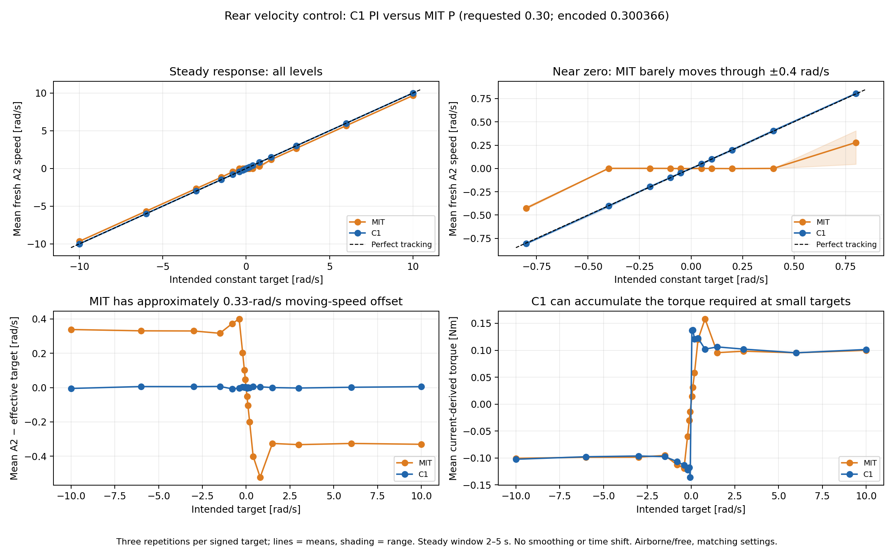
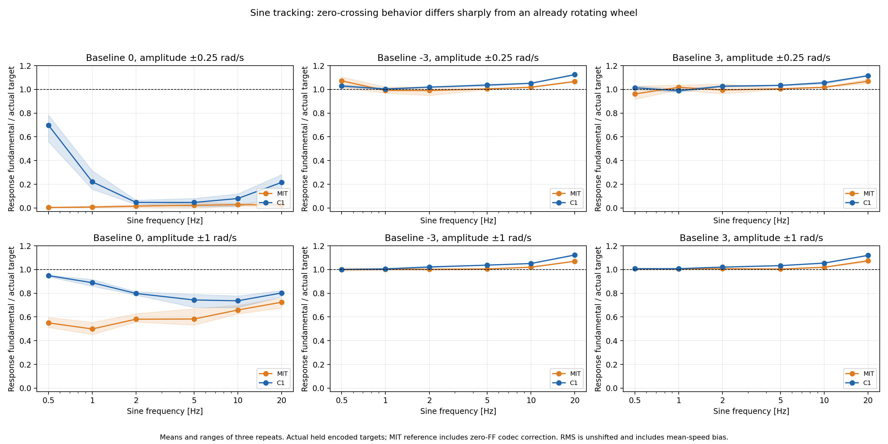
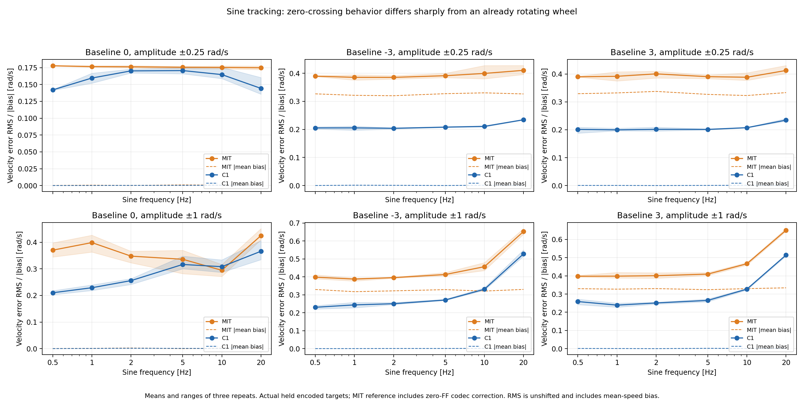
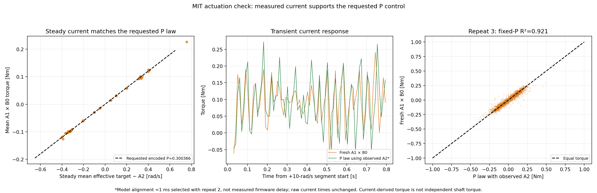
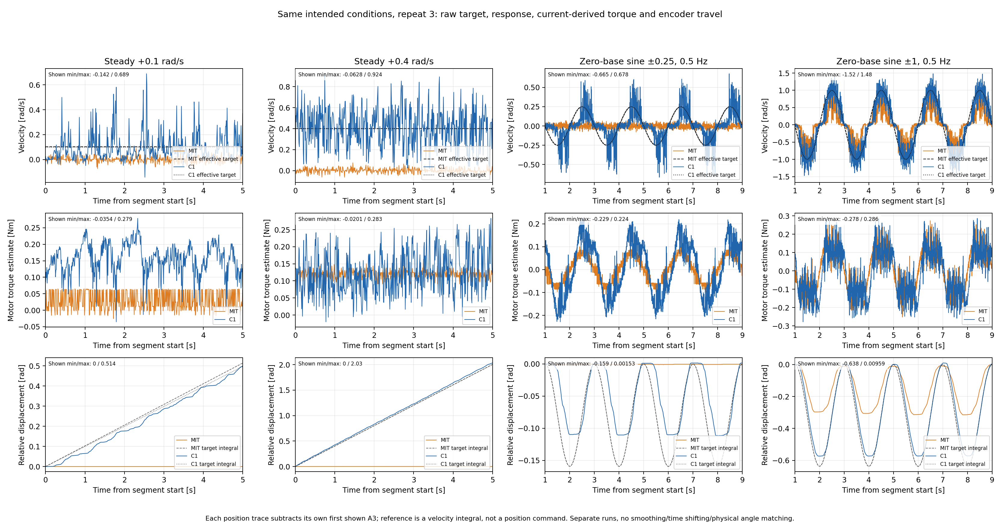

# Rear MIT velocity P=0.30 versus C1 PI — 2026-11-01

**MIT works approximately as the requested P controller, but it is substantially
worse at producing small desired movements.** The expectation of only a small
loss is supported at larger steady speeds; it does not hold near zero.

[Figure gallery](index.html) · [Five-page PDF](all_figures.pdf) ·
[All statistics](statistics.json) · [Raw-packet audit](raw_audit.json) ·
[Current-law check](current_response_fit.json) · [Independent verification](verification.json)

## Data and comparability

The new three files have stem **`20261101_212240_940924_drive_mit_velocity_test`**
under `../../logs/`. Baseline: **`20261101_154126_577381_drive_c1_kp_identify`**.
The user confirmed identical airborne/free conditions, no hand contact and
unchanged supply/firmware settings. Both campaigns completed **342 segments,
three repetitions, about 1,194 seconds**: 54 steady, 120 step, 108 sine and 60
active-zero cases. Comparing every plan row confirms the intended waveforms,
condition order, durations and seed match; only mode/name labels differ.

| Check | MIT | C1 |
|---|---:|---:|
| CSV rows | 2,034,117 | 2,034,518 |
| Motion packets / planned 238,800 | 238,798 | 238,799 |
| Skipped slots | 2 | 1 |
| Median packet interval | 4.99958 ms | 4.99976 ms |
| Maximum packet interval | 12.244 ms | 9.030 ms |
| Fresh dynamic A1/A2 rates, about | 389.6 Hz each | 389.8 Hz each |
| Fresh steady A1/A2 rates, about | 99.34 Hz each | 99.35 Hz each |
| AE supply range | 20.18–20.23 V | 20.17–20.22 V |
| Temperature range | 30–44 °C | 30–44 °C |
| Highest queried absolute speed | 10.540 rad/s | 12.688 rad/s |
| Highest A1-current-derived torque | 3.2433 Nm | 3.8166 Nm |
| Driver fault byte | All 0 | All 0 |
| Completion / disable / restore | Confirmed | Confirmed |

MIT sent only motion ID **0x501**, with **position Kp code 0**, **Kd code 246**
(`0.3003663004 Nm/(rad/s)`) and zero integral. F0 was verified at **±95.5 rad,
±13 rad/s, ±18 Nm**, then restored to the original **±45-rad/s velocity range**.
No velocity/torque F1 endpoint code was observed. B0 Kt is
**0.3000000119 Nm/A** in both runs; B8/B9/B3/B5 readbacks match, without writes.
The original CD was also restored. Actual source/helper hashes match disk.

All command and fresh feedback fields were independently decoded from raw bytes.
Stored-versus-decoded errors are zero at stored precision. MIT's intended target
is compared with its **torque-equivalent effective target**:

```text
effective target = decoded forward-positive wire velocity − native wire FF / encoded Kd
```

This accounts for the documented zero-feedforward encoding correction. Its
maximum remaining quantization error is **0.00317454 rad/s**, versus C1's
**0.00052359 rad/s**. That is much smaller than the approximately 0.33-rad/s
moving-speed bias and cannot explain the missing low-speed travel by itself.
F1/current estimates are not independent shaft-torque sensors; host receipt
times are not exact motor acquisition times or firmware-loop timing.

F1's **position** field reaches an encoding endpoint in **10,126/238,799** replies
(4.24%). It must not be used as continuous multi-turn wheel position; this report
uses **A3** for travel, A2 for speed and A1 for current-derived torque. Position
Kp is zero throughout. **22 of the 24** tiny steady holds have no F1 position
endpoint samples at all and still barely move. This telemetry limitation does
not explain their shared tracking failure; no velocity/torque endpoint was seen.

## 1. Small steady targets often produce essentially no movement

The table averages three repetitions for each positive intended target. Native
negative-direction results are retained in the CSV and show the same near-zero
failure. Values are fresh A2 measurements in rad/s.

| Intended target | C1 mean speed | MIT mean speed | MIT interpretation |
|---:|---:|---:|---|
| +0.05 | +0.04775 | +0.00027 | Essentially stationary |
| +0.10 | +0.10122 | −0.00020 | Essentially stationary; reported small fluctuations |
| +0.20 | +0.19935 | −0.00162 | Essentially stationary |
| +0.40 | +0.40576 | +0.00061 | Essentially stationary |
| +0.80 | +0.80467 | +0.27889 | Strong shortfall/intermittent low-speed behavior |
| +1.50 | +1.49951 | +1.17422 | About 0.33-rad/s shortfall |
| +3.00 | +2.99763 | +2.66568 | About 11% below intended speed |
| +6.00 | +6.00226 | +5.67581 | About 5.4% below intended speed |
| +10.00 | +10.00494 | +9.67094 | About 3.3% below intended speed |

During the 2–5-s measurement windows of **all 24 MIT holds at ±0.05, ±0.1,
±0.2 and ±0.4 rad/s**, A3 ranges are **at most one count**, 0.000383495 rad.
This is strong encoder evidence of almost no displacement, not merely noisy A2.
For ±0.4 rad/s, commanded travel over approximately three seconds would be about
1.2 rad, orders of magnitude larger. These levels do not establish an exact
static-friction threshold: rotor phase and the current-to-shaft-torque relation
are not independently calibrated.



**RMS alone can be misleading.** At +0.05 rad/s, MIT's A2 RMS error is about
0.055 rad/s, smaller than C1's 0.082 rad/s because C1 has more instantaneous
ripple. Nevertheless, C1 generates the requested average travel and MIT barely
moves. Both displacement/mean bias and waveform error matter for balancing.

## 2. Slow small reversals deteriorate dramatically

Sine gains below are the measured A2 fundamental divided by the actual held
effective target's fundamental, averaged across three repeats. RMS errors are
unshifted; they include both waveform error and mean-speed bias.

| Baseline | Sine amplitude | Frequency | C1 gain | MIT gain | C1 / MIT RMS error rad/s |
|---:|---:|---:|---:|---:|---:|
| 0 | ±0.25 rad/s | 0.5 Hz | 69.8% | **0.37%** | 0.142 /0.178 |
| 0 | ±0.25 rad/s | 1 Hz | 22.1% | **0.77%** | 0.160 /0.177 |
| 0 | ±0.25 rad/s | 2 Hz | 4.70% | 1.55% | 0.170 /0.176 |
| 0 | ±1 rad/s | 0.5 Hz | 94.9% | **55.0%** | 0.210 /0.371 |
| 0 | ±1 rad/s | 1 Hz | 88.9% | **49.9%** | 0.229 /0.399 |
| 0 | ±1 rad/s | 2 Hz | 79.8% | **58.1%** | 0.256 /0.348 |
| 0 | ±1 rad/s | 10 Hz | 73.6% | 65.8% | 0.308 /0.295 |
| +3 rad/s | ±0.25 rad/s | 2 Hz | 102.7% | 99.5% | 0.202 /0.400 |
| +3 rad/s | ±1 rad/s | 2 Hz | 102.0% | 100.7% | 0.251 /0.401 |

For the ±0.25-rad/s, 0.5-Hz zero-centred sine, C1's A3 position range across the
three repeats is **0.07862–0.11313 rad**. MIT's range is only
**0.000767–0.001534 rad**, approximately 2–4 counts. The loss is also visible
in encoder travel. At 2 Hz both controllers already track that tiny sine poorly;
the clearer MIT/C1 separation is at slower reversals where C1's integral can act.



Around ±3-rad/s baselines, MIT often reproduces the **incremental sine amplitude**
well. That does not mean absolute tracking is accurate: for the +3-baseline
±0.25-rad/s 2-Hz case, MIT's mean speed bias is **−0.3376 rad/s**. A nearly correct
sine superimposed on the wrong mean speed still has a large total error.
MIT is not worse on every individual metric: the zero-baseline ±1-rad/s 10-Hz
case has slightly lower unshifted RMS error despite lower response amplitude.
That does not resolve the large steady bias and missing tiny low-frequency motion.



Phase-equivalent lags are exported only where the measured response is resolved
and has gain ≥0.1; reporting a precise delay for an almost stationary response
would be misleading. They remain descriptive host-signal phase alignments, not
isolated firmware delay. No raw plot or primary error uses a fitted time shift.

## 3. The motor current supports the requested P law

This is not evidence that the script forgot the gain or accidentally activated
position control. All **238,798** outgoing MIT packets have Kp=0 and Kd code 246.
Measured **steady mean current-derived torque** versus mean speed error yields
**0.29860 Nm/(rad/s)**, close to encoded **0.3003663**. Using the encoded gain
without fitting gives only **0.002416 Nm RMS** discrepancy in those steady means.

Across 228 dynamic trials, a P-plus-global-offset fit to current and observed A2
uses repeat 1 to train, repeat 2 to select alignment and untouched repeat 3 to
test. Its effective P is **0.27910 Nm/(rad/s)**, offset **0.0000863 Nm**, apparent
alignment **1 ms**. The fitted model's repeat-3 R² is **0.92568**, RMS **0.02907 Nm**;
the **fixed encoded gain** with zero offset still gives **R²=0.92059**, RMS
**0.03005 Nm**. Fitting/measurement/filter dependence remains; the dynamic 0.279
must not be treated as a precise replacement for the firmware-requested gain.
These current reconstructions are not forward plant simulations.



The mechanism is consistent with the observations:

- At target +0.05 rad/s, near-zero measured speed gives approximately
  **0.30×0.05=0.015 Nm**. Actual mean current-derived torque is **0.01447 Nm**;
  it does not accumulate while the wheel stays still. C1's mean is **0.13648 Nm**
  while producing the small average speed.
- At +0.4 rad/s, MIT produces mean estimated torque **0.12003 Nm**, yet almost
  no encoder travel. Near-zero resisting effects are substantial. Static
  friction/cogging and possible driver deadband are not separately identified.
- At +3 rad/s, MIT's mean moving torque is **0.09826 Nm**. Sustaining about
  0.10 Nm through gain 0.30 requires roughly **0.33 rad/s speed error**, agreeing
  with the measured shortfall. Integral control can maintain compensating torque
  with much smaller average error; pure P cannot do that without another term.

The approximately **1.58% A3/A2 consistency discrepancy** appears in both runs
(new checked slopes about 1.01577/1.01580). It remains externally uncalibrated,
but cannot explain missing motion by thousands of encoder counts at small holds.
The raw measured feedback, not a fitted scaling correction, is used throughout.



## Conclusion and next experiment

1. **The expectation is condition-dependent.** At 10 rad/s, a roughly 3.3% steady
   speed loss could reasonably be called small. At ±0.05–0.4 rad/s the desired
   motion is almost absent; for trackstand's fine corrections that is a major
   limitation of the tested **Kd≈0.30, P-only** setting.
2. The most strongly supported explanation is **pure-P velocity control opposing
   near-zero resistance without integral accumulation**, rather than missing
   commands, a gross gain/sign/encoding error, velocity/torque encoding-range clipping, recorded supply
   collapse or a driver fault. The exact resistance mechanism remains unresolved.
3. A larger Kd can produce more torque for a small error and reduce moving-speed
   bias. Compare **0.30, 0.60 and 1.0**, optionally higher after examining results,
   on the **same small target subset**, with an identical fixed velocity range
   and fixture/settings. The existing full ±10-rad/s plan can exceed the 6.28-Nm
   guard with a larger gain; do not infer gain effects from mismatched subsets.
4. Higher P alone may still leave the smallest commands stuck. If precise desired
   velocity tracking is required, compare an identified integral or friction
   compensation term after validating it. Retain the real plant losses in the
   simulator. This dataset does not authorize a gain/firmware/controller switch.
5. This does not prove MIT velocity actions cannot balance: a newly trained
   closed-loop policy might compensate for a modeled offset by issuing larger
   targets. That requires faithful simulation and loaded validation; it is not
   established by this airborne identification campaign.

These are matched test conditions, not a randomized controller crossover.
Initial multi-turn counts differ (**102131 MIT /−19813 C1**), so physical rotor
phase was not matched. C1 has undocumented internal filtering/timing and only
approximately matched effective P, and command quantization differs. These
limitations prevent attributing every numerical difference solely to I.

## Reproduction and artifacts

From the repository root, with NumPy and Matplotlib:

```bash
REPORT=deploy/experiments/reports/20261101_rear_mit_vs_c1_velocity
CACHE=/tmp/trackstand_mit_c1_cache
python3 "$REPORT/analyze.py" --cache "$CACHE"
python3 "$REPORT/check_response.py" --cache "$CACHE"
python3 "$REPORT/plot.py" --cache "$CACHE"
python3 "$REPORT/verify.py" --cache "$CACHE"
```

The cache is optional derived storage selected by the required flag; raw source
hashes are checked before reuse. All raw data, existing C1 reports, collectors,
deployment/training configurations and progress records remain unchanged.
No motor, firmware or simulator operation was performed for this analysis.

An independent pass reconstructs **31,510 plotted response samples** directly
from the original payloads and timestamps (maximum numerical difference
4.44e-16), reproduces **378** baseline metrics from the previous C1 report and
cross-checks the dynamic regression with a separate least-squares calculation.

Tables: [all 684 trial metrics](all_trial_metrics.csv), [steady](steady_summary.csv),
[sine](sine_summary.csv), [step increments](step_summary.csv),
[same-endpoint encoder checks](encoder_steady_checks.csv), [phase rates](capture_phase_rates.csv)
and [native plotted response samples](plotted_response_samples.csv).
