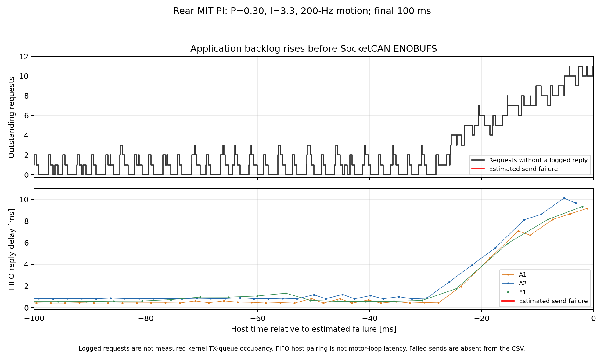

# MIT PI stopped by SocketCAN ENOBUFS — 2026-11-02

**The immediate failure was a CAN transmit queue/resource error. The leading
explanation is a brief MCP251x/SPI transmit-service delay overflowing a small
queue, aggravated by the script terminating immediately on this error.** The
driver delay's underlying cause is not identified by these recordings.

Inputs: `../../logs/20261102_103508_240825_drive_mit_velocity_test` CSV/JSON/plan;
user-supplied [CAN snapshot](pi_can_status.txt). [Exact statistics](statistics.json),
[last second of raw log](last_second.csv), [backlog plot PDF](queue_backlog.pdf).

## Evidence from the recording

- Source hash matches the current script. P=0.30 Nm/(rad/s), I=3.3 Nm/rad,
  MIT packets 200 Hz, dynamic A1/A2 queries each 400 Hz. The capture has
  **219,103 rows**, **35,303 motion commands**, **67 complete segments** and a
  partial 68th. Failure is about **176.59 s after log startup**, approximately
  **10:38:04.862 local time**; the phase-finally timestamp estimates the time.
- Failure occurs **0.52636 s** into `mit_velocity_pi_step_r1_0067`.
  Its baseline is zero; the planned −1-rad/s pulse starts at 0.6 s and had
  **not yet been sent**. The last successfully submitted MIT target is zero,
  measured speed **−0.02932 rad/s**, I torque **+0.022706 Nm**, estimated total
  torque **+0.031739 Nm**. Last fresh A1-derived torque is **+0.021900 Nm**.
- Across the entire partial capture, fresh A1 torque peaks at **3.2100 Nm**,
  estimated total at **3.7029 Nm**, absolute A2 speed at **11.7108 rad/s** and I
  at **0.4263 Nm**. No anti-windup-limited updates. All **1,768 AE/CF fault bytes
  are zero**, and recorded F1 statuses are active/fault-free. Last AE: **20.21 V,
  42 °C**, 20.4 ms before failure. This does not support a recorded PI runaway,
  torque-limit stop or motor-driver fault; between-sample behavior is unobserved.
- Last A1/A2/F1 replies arrive **1.11/3.16/1.98 ms** before failure. Incoming
  feedback had not been absent for a long interval. The last full phase sends
  320 commands with no skipped slots; the partial phase sends 106 with no skips,
  maximum lateness **0.185 ms**. Only three slots are skipped in the whole run.
- In the last five seconds, the application submits **1,042.2 frames/s** and
  receives **1,040.0 frames/s**, approximately 2,082 frames/s including replies.
  Using logged frame lengths and conservative classical-CAN stuffing/overhead,
  this traffic accounts for about **19.6% of a 1-Mbit/s bus**. It excludes other
  traffic, retransmissions and error frames; it is not a physical bus-load probe.
  Hence line bandwidth exhaustion by the recorded normal traffic is unlikely.
- All **11 requests awaiting replies at termination** were submitted within the
  final **10.26 ms**: four A1, four A2, two MIT/F1 and one A3. FIFO host pairing
  shows a late spike to about **9–10 ms**, versus typical sub-1-ms A1/A2/F1
  delays. This supports a short backlog, not a slowly growing memory leak.
  Outstanding application requests are **not** direct kernel queue occupancy;
  indistinguishable replies also limit interpretation of FIFO timing.



## What ENOBUFS and this adapter imply

Linux's [CAN transmit implementation](https://github.com/torvalds/linux/blob/master/net/can/af_can.c)
explicitly associates ENOBUFS with a full driver queue. The
[send manual](https://man7.org/linux/man-pages/man2/send.2.html) describes a full
interface output queue, potentially due to stopped transmission or transient
congestion. This is different from the Python CSV writer's queue-full exception,
which has different code and error text.

The snapshot identifies **MCP251x on SPI, qlen=10, bitrate=1,000,000**. Upstream
[MCP251x code](https://github.com/torvalds/linux/blob/master/drivers/net/can/spi/mcp251x.c)
stops the netdevice queue for an in-flight transmission, schedules SPI work and
wakes it on completion handling. SPI/interrupt/workqueue delays can therefore
create a host backlog even while average CAN wire load is modest. The Pi's exact
kernel version and driver trace were not captured, so a specific IRQ/SPI fault
is not proven. Queue length at the failure was not recorded; 10 is the supplied
snapshot's value.

The snapshot has **TX=1/RX=2**, whereas the CSV contains over 100,000 successful
host sends/replies. It does not represent the run's accumulated counters. Its
current ERROR-ACTIVE/zero-error status cannot rule out a previous bus-off or
interface disturbance. `restart-ms=0` means automatic bus-off restart is disabled,
as documented by [SocketCAN](https://docs.kernel.org/networking/can.html).

## Ranking and script contribution

1. **Most supported:** a short transmit-service backlog with little queue
   headroom. The 400+400-Hz state queries are the dominant added traffic beyond
   the 200-Hz motion stream; query groups are submitted close together.
2. **Still possible:** an SPI/interrupt/controller stall, physical CAN disturbance
   or ACK loss. Need kernel logs and same-session CAN counters before any reset
   to distinguish these from ordinary transient congestion.
3. **Poorly supported:** PI instability, whole-bus bandwidth exhaustion from this
   traffic, RAM/disk exhaustion or a progressively growing user-space queue.
   The motor state, timing, load estimate and exact exception point elsewhere.

Adding I changes MIT payload values but **does not increase motion frequency or
packet size**. The previous P-only campaign completed the same query rates.
That does not establish identical driver/CPU/physical bus conditions each time.

The shared [send path](../../drive_velocity_sine.py) calls nonblocking
`bus.send()` once. It records TX only after success and does not retry ENOBUFS.
The exact rejected opcode is consequently absent; after the last A1 query, the
next due A2 is a likely rejected send, not a proven one. The
[cleanup path](../../drive_mit_velocity_test.py) retries `disable()` immediately
but catches no ENOBUFS inside that loop, so both attempts can fail before the
queue drains. Both execution and cleanup record errno 105.

**Consequences actually recorded:** `disable_confirmed=false`,
`disabled_and_restored=false`, pending restore **CD00881300**. Temporary watchdog
is **CD01F40100** (500 ms); its eventual physical stop is not observed here.
There is no post-failure confirmed CF disable. F0 already equalled ±13 rad/s at
startup and was not changed in this run; do not assume ±45 is its saved original.

## Next checks and mitigation

- With the motor independently disabled, try modest transmit headroom:
  `sudo ip link set can0 txqueuelen 100`. Confirm the result with
  `ip -details -statistics link show can0`. This tests transient congestion;
  growing the queue indefinitely can retain stale motion commands and will not
  repair a bus/controller stall. Existing `ros2_ws` documentation/configuration
  uses 1,000, but this experiment does not apply that setting automatically.
- Independently compare `--dynamic-feedback-rate 200`, retaining
  `--packet-rate 200` and the same gains/targets. This cuts nominal TX from about
  1,062 to 662 frames/s; it changes measurement sampling, not the nominal I or
  motion update rate. Change one factor at a time when testing the cause.
- At recurrence, preserve `ip -details -statistics link show can0` and kernel
  messages **before resetting**. SPI failures, bus-off/ACK errors or rising
  drops distinguish persistent faults from transient queue pressure.
- Code improvement to implement separately: bounded ENOBUFS handling/backoff,
  lower priority for skipped state queries, fresh motion targets rather than
  replaying old packets, and disable retries that wait for transmit recovery.
  Logging the failing opcode and same-session interface state would close the
  diagnostic gap. Broad exception suppression is not a remedy.

No runtime/controller code, gains, settings or existing records were changed.
This analysis opened no CAN interface and ran no motor or simulator.

## Reproduce

From the repository root, using NumPy/Matplotlib:

```bash
python3 deploy/experiments/reports/20261102_mit_pi_enobufs/analyze.py
python3 deploy/experiments/reports/20261102_mit_pi_enobufs/plot.py
```
