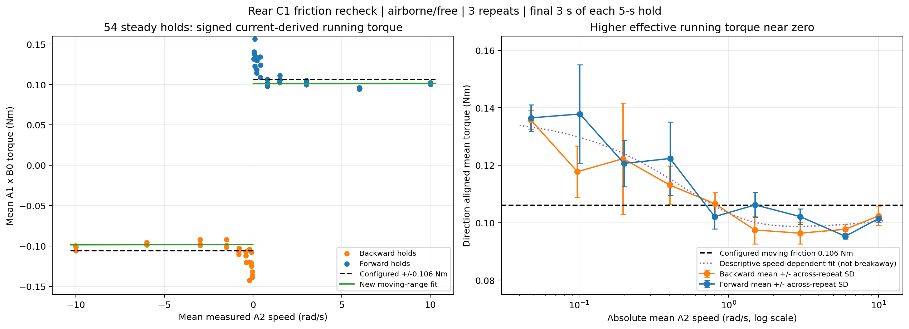
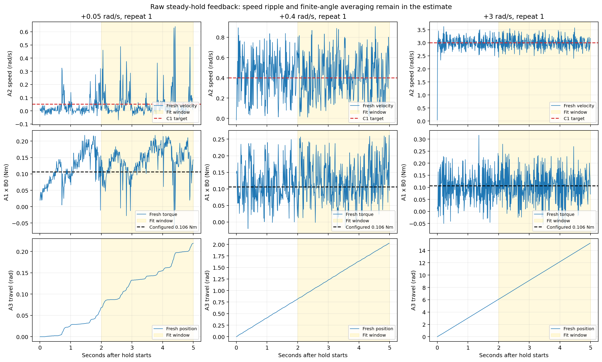

# Rear friction recheck using the comprehensive C1 campaign — 2026-11-02

**The moderate-speed moving-drag estimate remains about 0.10 Nm. The new fit is
approximately 6% below the configured 0.106 Nm; a positive viscous coefficient
is still not resolved. The more important missing behavior is greater effective
running resistance near zero, where a single constant-friction law fits poorly.**

[Figure gallery](index.html) · [Statistics](statistics.json) ·
[Independent verification](verification.json) · [All 54 holds](steady_holds.csv)

## Source, conditions and calculation

Source: `deploy/experiments/logs/20261101_154126_577381_drive_c1_kp_identify`
CSV/JSON/plan, the previously analyzed comprehensive C1 campaign. The user already
confirmed rear wheel airborne/free throughout, no hand contact, and unchanged
supply/firmware. This reanalysis uses that confirmation; it adds no hardware test.
All 342 segments completed. Only the **54 steady holds** are used for the friction
fit: nine speed magnitudes, both directions, three repeats. Steps/sines are not
silently treated as steady motion because their torque includes acceleration.

The script rereads all **2,034,518 CSV rows**, independently decodes A1/A2/A3,
and checks the logged conversions. A1 current and A2 speed both have native sign
−1 relative to forward-positive coordinates. Torque estimate is
`tau = -A1_int32 * 0.001 A * B0_Kt`, with **Kt=0.3000000119 Nm/A**;
speed is `omega = -A2_int32 * 0.01 rpm * 2*pi/60`. A3 uses signed multi-turn
counts, 16384 counts/revolution. There is no extra gearbox-ratio factor.

Each hold lasts 5 s: discard the first 2 s, then average **fresh received A1 and
A2 replies separately over [2,5) s**. Retained: **16,094 A1 / 16,092 A2** replies.
Cached state on command/query rows is never counted as fresh feedback. Each
complete hold contributes one equally weighted fitting point, not hundreds of
independent repetitions. The separate verifier reproduces those means from raw
bytes to **2.78e-17 Nm / 1.78e-15 rad/s** and reproduces the coefficients through
independent normal equations. All previously saved C1 mean torques match.

For approximately steady unloaded motion:

```text
J * domega/dt = electromagnetic_torque - running_losses
mean(torque) ≈ B * mean(omega) + Tc * sign(mean(omega)) + bias
```

`B` has units **Nm·s/rad**; `Tc` and bias have units **Nm**. The bias permits a
small directional/current offset; it is not an identified physical mechanism.
This balance assumes the mean inertial contribution is small. No unknown wheel
inertia is invented or subtracted. Moving-window speed trends and endpoint
differences are retained in the hold table.

The main moving-range fit uses **24 holds at ±1.5, ±3, ±6 and ±10 rad/s**.
This separates clearly moving conditions from near-zero cases dominated by
intermittent motion. The speed threshold is a stated analysis choice, not a
physical discontinuity. Every excluded low-speed hold remains in the tables,
figures, full-range fits and sensitivity analysis.

## Coefficients compared with the existing configuration

| Quantity | Current v1/v2 configuration | New moving-range estimate |
|---|---:|---:|
| Coulomb-like moving friction, Nm | 0.106 | **0.0997018** |
| Passive viscous coefficient B, Nm·s/rad | 0.0 | **0.0000260482** |
| Fitted bias, Nm | No bias term | +0.00139168 |
| Static friction threshold, Nm | 0.106, provisional | **Not identified** |

The moving-friction coefficient changes by **−5.94%**. Forcing **B=0** gives
**Tc=0.0998353 Nm**, nearly identical fitting error: **0.00411564 Nm RMS** versus
**0.00411477 Nm RMS** with free B. The configured unbiased 0.106-Nm model has
**0.00754183 Nm RMS** error on these same 24 means.

The original October 20 sweep gave **B=0**, **Tc=0.1060247 Nm**, offset
0.0008466 Nm from 19 longer holds at 1–8 rad/s. The new overlapping-range fit,
using available 1.5/3/6-rad/s holds, gives physical **B=0, Tc=0.0991613 Nm**.
The speed grids are different, so this is a range check, not an exact matched test.
The old sweep temporarily used B3 about **0.999 A**; this C1 campaign retained
**82.498 A**. Timing, temperature, controller operation and rotor phases also
differ. Their contribution to the 6% shift is not isolated.

Conditional 95% bootstrap intervals, resampling whole holds within each signed
speed level (5,000 draws, seed 42), are:

- **B: −0.00030964 to +0.00037025 Nm·s/rad**, including zero.
- **Tc: 0.0972693 to 0.1020575 Nm**.

These describe variation in this recording, not calibrated physical confidence
bounds. Shared torque-scale errors, finite rotor-phase coverage and other
systematics are excluded. A negative unconstrained B is an estimator/model
diagnostic, never a parameter to install as passive negative damping.

## Near-zero behavior is not captured by 0.106 Nm everywhere

Both directions and all three repeats pooled; each row contains six hold means:

| Target magnitude, rad/s | Mean direction-aligned torque, Nm |
|---:|---:|
| 0.05 | **0.136136** |
| 0.10 | **0.127776** |
| 0.20 | **0.121457** |
| 0.40 | **0.117699** |
| 0.80 | 0.104337 |
| 1.50 | 0.101805 |
| 3.00 | 0.099211 |
| 6.00 | 0.096468 |
| 10.00 | 0.101857 |

At 0.05 rad/s the mean exceeds 0.106 Nm by **28.4%**. The fresh A2 speed SD
there is **0.061–0.100 rad/s**, and A3 travels only **0.134–0.171 rad** during
each fit window. A3 shows intermittent motion in the example below. Such small
travel does not average over complete wheel/rotor cycles. Friction/stiction,
angle-dependent cogging/imbalance, controller dynamics and speed-estimation
effects can contribute; this recording does not uniquely separate them.

Fitting the simple B/Tc/bias law to all 54 holds gives **negative B=−0.00259624**,
showing that one constant-plus-positive-viscous law misses the decreasing
low-speed torque. Enforcing B>=0 then gives **B=0, Tc=0.111861 Nm**, a compromise
that overpredicts moderate-speed loss and underpredicts the smallest-speed loss.
It is not a better universal friction coefficient.



The dotted curve is an optional descriptive fit,
`tau = B*omega + sign(omega)*(Tc + A*exp(-abs(omega)/vs)) + bias`:
**B=0.000260744, Tc=0.0978309, A=0.0390126, vs=0.496180 rad/s**.
Across held-out repeats it reduces mean all-range torque error RMS from
**0.016531 Nm** for the configured constant to **0.008746 Nm**. This supports a
speed-dependent effective running-torque curve in this dataset. It does **not**
identify static breakaway, establish Stribeck friction as the unique cause, or
prove that the fitted low-speed asymptote is a valid static threshold.



## Robustness checks and practical conclusion

- Later moving-window starts from 2.0 through 4.0 s give **Tc=0.09826–0.09970 Nm**;
  B remains small but changes with the averaging window. Time-weighting A1/A2
  over identical actual endpoints gives **Tc=0.0996048**, B=0.0000414521.
- Repeat-only moving fits give Tc **0.101640 / 0.097055 / 0.100412 Nm**. B is
  **−0.0000161 / +0.0002797 / −0.0001855**, reinforcing the unresolved slope.
- Direction-only moving fits give slopes **−0.0005729 forward / +0.0006244 backward**.
  They confound direction, offset and finite sampling; a universal positive B
  cannot be inferred from one direction alone.
- Using A3-derived average speed over the same endpoints instead gives
  **Tc=0.0996053**, B=0.0000406766. The previously observed A2/A3 discrepancy
  does not explain the main low-speed excess. No sensor scale was corrected.
- Supply **20.17–20.22 V**, temperature **30–44 C**, all **11,944 AE/CF fault
  bytes zero**. These checks do not independently calibrate current or shaft torque.

For a simple moderate-speed plant, **moving friction approximately 0.100 Nm and
B=0 as an unresolved-slope baseline** are defensible. The existing 0.106 Nm is
close; changing that scalar alone will not reproduce the near-zero motion.
Do not increase the universal moving coefficient to 0.136 Nm, and do not treat
the tiny positive fitted B as precisely identified. Static friction remains
undetermined; setting static equal to moving friction is still provisional.

To improve near-zero fidelity, first validate a speed/phase-dependent plant
against held-out low-speed steps and identical replay targets, with current and
encoder calibration and sufficient rotation coverage. A calibrated breakaway
test is needed for static friction. These estimates include assembly losses;
they do not isolate intrinsic motor damping, loaded tyre resistance or electrical
torque-speed behavior. A1*Kt remains a current-derived electromagnetic estimate,
not an independently measured shaft-torque signal.

**No actuator parameters, controller gains, firmware, deployment code or progress
records were modified.** All 118 protected existing files match their initial
hashes, including the v2 1200-Hz default and prior uncommitted work.

## Reproduce and artifacts

From repository root, with NumPy/Matplotlib; no ROS, CAN or simulator required:

```bash
MPLCONFIGDIR=/tmp/trackstand_friction_mpl python3 -B \
  deploy/experiments/reports/20261102_rear_friction_recheck/analyze.py
python3 -B deploy/experiments/reports/20261102_rear_friction_recheck/verify.py
```

The hash-checked derived stream cache defaults to `/tmp/trackstand_c1_friction_recheck_cache`.
Use `--cache /tmp/new_cache` to rebuild it from raw bytes. The CSV/JSON source and
all prior reports are read only.

- [Fit sensitivity](fit_sensitivity.csv), [direction fits](moving_direction_fits.csv),
  [bootstrap draws](moving_bootstrap_draws.csv), [held-out repeat errors](held_out_repeat_errors.csv).
- [Both-direction speed table](torque_by_speed_both_directions.csv),
  [direction-specific table](torque_by_speed_and_direction.csv),
  [native plotted samples](plotted_native_samples.csv).
- Curve: [SVG](rear_friction_curve.svg) / [PDF](rear_friction_curve.pdf).
  Examples: [SVG](steady_feedback_examples.svg) / [PDF](steady_feedback_examples.pdf).
- [Analysis source](analyze.py), [independent verifier](verify.py),
  [preservation hashes](preservation_before.json), [artifact manifest](manifest.json).
