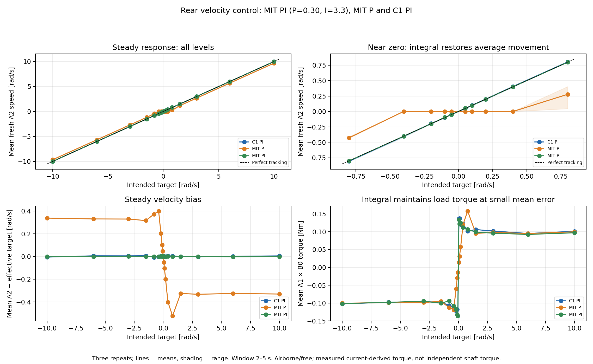
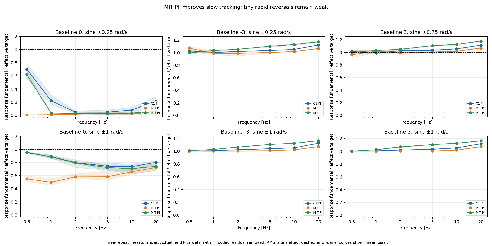
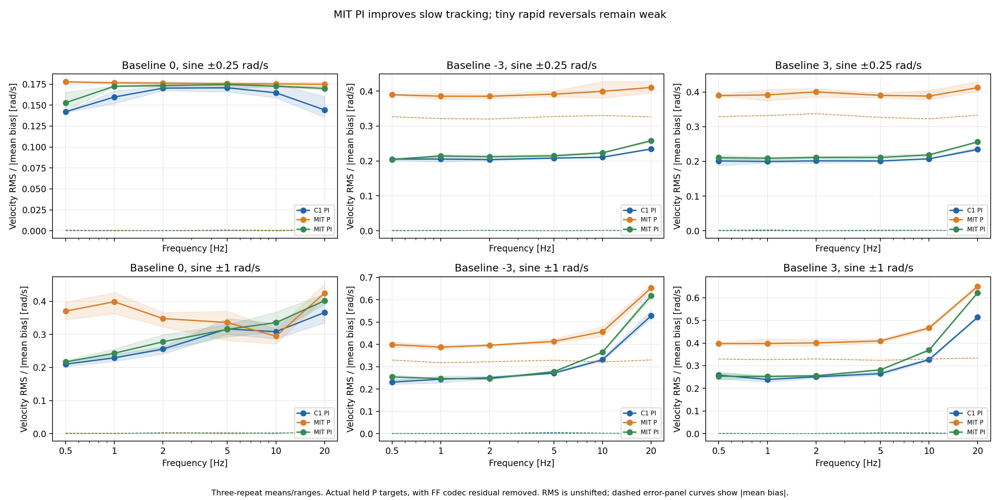
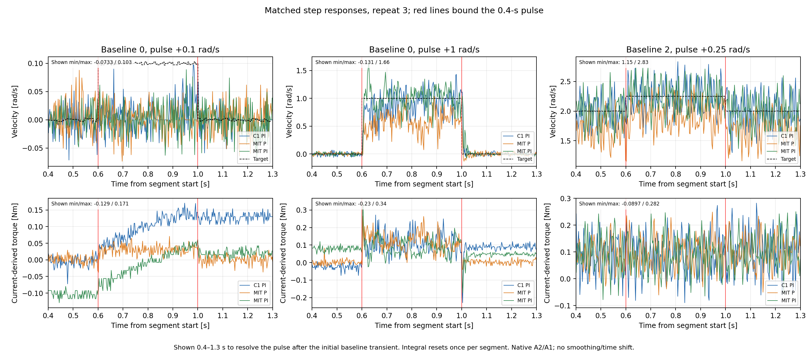
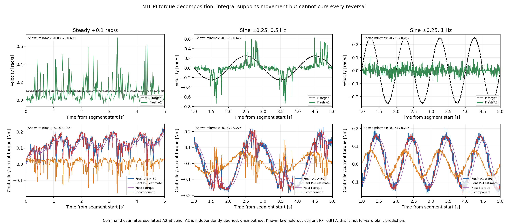
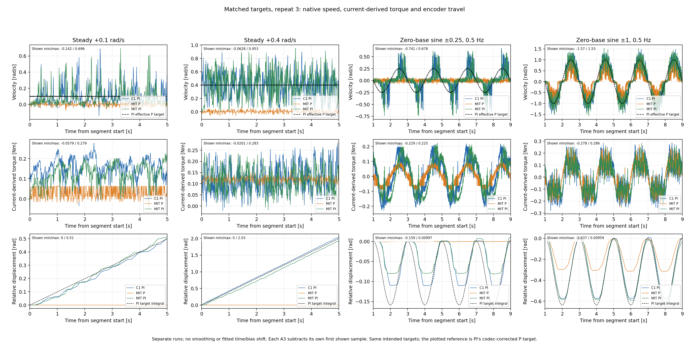

# Rear MIT PI versus P-only and C1 — 2026-11-02

**Adding host integral substantially improves MIT velocity tracking. It removes
the persistent steady-speed deficit and restores small average movements. Overall
performance is now close to C1 in this airborne suite, but tiny rapid reversals
remain poorly tracked.** This is an improvement over P-only, not proof of precise
tracking at every operating point or successful loaded deployment.

[Graph gallery](index.html) · [Six-page PDF](all_figures.pdf) ·
[Statistics](statistics.json) · [Raw audit](raw_audit.json) ·
[Current-law check](current_response_fit.json) · [Independent verification](verification.json)

## Inputs, controller and completed-run audit

New three-file stem: **`20261102_104627_769455_drive_mit_velocity_test`**, under
`../../logs/`. References: P-only **`20261101_212240_940924_drive_mit_velocity_test`**
and C1 **`20261101_154126_577381_drive_c1_kp_identify`**. The user confirmed the
same rear-airborne/free conditions, supply and motor settings, with no CAN
configuration changes after restarting the bike. All three intended plans match:
seed 42, three repeats, 342 segments: 54 holds, 120 steps, 108 sines, 60 active zeros.
These are generated test signals, not a recorded balancing policy episode.
The targets are evaluated at packet times, nominally 200 Hz; this is not the
separate validation of targets held between 50-Hz policy updates.

| Check | Completed MIT PI run |
|---|---:|
| Segment time / completed segments | 1,194.0212 s / 342 |
| CSV rows | 2,032,503 |
| MIT packets / planned | 238,792 / 238,800 |
| Skipped slots | 8, approximately 0.00335% |
| Packet interval median / p99 / maximum | 4.99894 / 5.09109 / 12.71254 ms |
| Maximum logged lateness | 7.80131 ms |
| All AE/CF fault bytes | 11,944 replies, all zero |
| F1 statuses | 238,793 replies, active/fault-free |
| Queried peak absolute A2 speed | 12.12759 rad/s |
| Peak A1 × B0 torque | 3.27870 Nm |
| Peak command-side P+I estimate | 3.79634 Nm |
| Maximum absolute host I torque | 0.43190 Nm |
| Anti-windup-limited updates | 0 |
| F1 position / velocity / torque endpoints | 0 / 0 / 0 |
| AE voltage / temperature | 20.12–20.21 V / 30–44 °C |
| Completion, confirmed disable, restoration | All confirmed |

Every outgoing packet has **position Kp=0**, **velocity Kd code 246**
(0.3003663004 Nm/(rad/s)). Host Ki is **3.3 Nm/rad**, updating at the nominal
200-Hz packet rate from the latest A2. Actual query-rate tables are saved;
nominal A1/A2 queries remain 100 Hz each steady/zero and 400 Hz each dynamic.
Host scheduling/receipt rates do not measure the firmware-loop rate.

The original/applied F0 was already **±95.5 rad / ±13 rad/s / ±18 Nm**.
Only CD was written: 500-ms watchdog enabled, then original **CD00881300**
restored after CF transitioned from mode 5 to confirmed mode 0. B3/B5/B8/B9
readbacks remained unchanged: 82.498 A / raw 0 / 0.5 / 0.004999999888; Kt is
0.300000011921 Nm/A. Runtime source/helper hashes match the capture.

The earlier ENOBUFS failure did not recur in this recording, with unchanged CAN
configuration reported by the user. One successful run does not identify the
previous queue/driver disturbance or prove it cannot recur.

## 1. Steady tracking: the P-only deficit is largely removed

Fresh A2 means below average three repeats, using the same **2–5-s** window.
Targets and speeds are in rad/s. Negative-direction results show the same broad
improvement and are included in the [complete table](steady_summary.csv).

| Intended target | MIT P | MIT PI | C1 PI |
|---:|---:|---:|---:|
| +0.05 | +0.00027 | **+0.05217** | +0.04775 |
| +0.10 | −0.00020 | **+0.09700** | +0.10122 |
| +0.20 | −0.00162 | **+0.19934** | +0.19935 |
| +0.40 | +0.00061 | **+0.40079** | +0.40576 |
| +0.80 | +0.27888 | **+0.79998** | +0.80468 |
| +1.50 | +1.17422 | **+1.49977** | +1.49951 |
| +3.00 | +2.66568 | **+2.99986** | +2.99763 |
| +6.00 | +5.67581 | **+5.99710** | +6.00226 |
| +10.00 | +9.67093 | **+9.99908** | +10.00494 |

All 54 PI holds have absolute mean error **≤0.011143 rad/s** relative to their
actual effective targets. This is an absolute bound; percentage error can still
be appreciable at the smallest target in an individual repeat.

The improvement is also present in A3, rather than only in the speed estimate.
For all 24 holds at ±0.05/0.1/0.2/0.4, P-only A3 range was at most **one count**,
0.000383495 rad. PI ranges are **0.14880–1.24137 rad**, corroborating actual
encoder travel. At +0.05, mean current-derived torque rises from P-only
**0.01447 Nm** to PI **0.13363 Nm**, close to C1's **0.13648 Nm**. Integral builds
and maintains load-compensating torque even when average velocity error is small.



**Accurate average does not mean smooth motion.** PI's within-hold A2 standard
deviation spans **0.0876–0.3606 rad/s**. Raw traces and A3 plateaus show that tiny
motions can remain intermittent. A2 estimator effects and physical motion are
not separately measured; do not infer shaft vibration directly from A2 alone.

## 2. Sines: large improvement over P-only, with a persistent near-zero weakness

Gain is measured velocity fundamental / actual held effective-target fundamental.
Each entry averages three repeats. No fitted shift or smoothing is applied to
primary plots or RMS errors.

| Baseline | Amplitude | Hz | MIT P gain | MIT PI gain | C1 gain |
|---:|---:|---:|---:|---:|---:|
| 0 | ±0.25 | 0.5 | 0.37% | **61.8%** | 69.8% |
| 0 | ±0.25 | 1 | 0.77% | **3.44%** | 22.1% |
| 0 | ±0.25 | 2 | 1.55% | **2.79%** | 4.70% |
| 0 | ±1 | 0.5 | 55.0% | **95.7%** | 94.9% |
| 0 | ±1 | 1 | 49.9% | **88.3%** | 88.9% |
| 0 | ±1 | 2 | 58.1% | **79.4%** | 79.8% |
| 0 | ±1 | 5 | 58.3% | **72.2%** | 74.3% |
| 0 | ±1 | 10 | 65.8% | **70.7%** | 73.6% |
| 0 | ±1 | 20 | 72.4% | **74.0%** | 80.3% |
| +3 | ±0.25 | 2 | 99.5% | **104.8%** | 102.7% |
| +3 | ±1 | 2 | 100.7% | **107.0%** | 102.0% |



At zero-baseline ±0.25 / 0.5 Hz, PI's A3 range is **0.08629–0.09664 rad** versus
P-only **0.000767–0.001534 rad**. At **1 Hz**, PI remains weak: A3 range only
**0.002684–0.003451 rad**, versus C1 **0.01189–0.02301 rad**. This remaining
deficit is corroborated by angle travel, not solely an A2 harmonic calculation.
Both controllers struggle with the tiny 2-Hz reversal. Around a rotating-wheel
baseline, incremental tracking is much better; PI also removes the mean bias
that made P-only's apparently good sine amplitude misleading.

P-only is not worse on every metric. For zero-baseline ±1 / 10 Hz, its RMS
**0.29475 rad/s** is smaller than PI's **0.33579**, despite lower amplitude.
Controller ranking depends on amplitude, bias, ripple and phase, not one score.



## 3. Steps and overall error

These are equal-weight means of each trial's RMS, not pooled-sample RMS. Steady
uses 2–5 s, steps the 0.6–1.0-s pulse, sines the post-settling window. They
characterize this particular suite, not an application-weighted deployment score.

| Trial group | MIT P RMS | MIT PI RMS | C1 RMS | PI reduction from P-only |
|---|---:|---:|---:|---:|
| Steady | 0.32370 | **0.21132** | 0.21407 | 34.7% |
| Steps | 0.39911 | **0.24650** | 0.26798 | 38.2% |
| Sines | 0.37206 | **0.26374** | 0.24622 | 29.1% |

PI's step average is better than C1 here; its sine average is approximately
**7.1% worse**. This does not establish universal superiority for either.

Small pulses remain difficult: at zero baseline with a +0.1-rad/s, 0.4-s pulse,
PI's mean incremental response is **20.1%**, C1 **23.2%**, using the last 0.15 s
of baseline and pulse. For +1-rad/s pulses, PI reaches **100.4%**, C1 **98.1%**
and P-only **65.5%**. Integral resets once at segment start, not at pulse edges;
the pre-pulse integral/physical state can matter. The step figure displays
**0.4–1.3 s**, avoiding the large initial baseline transient so pulses are readable.



**A measured history effect helps explain the small-pulse variability.** In the
three +0.1-rad/s step trials, baseline speed was already near zero before the
pulse, but retained integral torque differed after braking the preceding motion:

| Repeat | Speed at segment start rad/s | I just before pulse Nm | A3 travel during pulse rad |
|---:|---:|---:|---:|
| 1 | −6.3848 | +0.07235 | 0.02723 |
| 2 | +2.0745 | −0.03136 | 0.00230 |
| 3 | +5.8716 | −0.10286 | 0.00153 |

The ideal 0.4-s pulse would travel 0.04 rad. In repeat 3, the initially negative
integral opposes the positive pulse; it ends at only +0.02167 Nm. The plotted
current confirms this sign/history effect. Resetting once at segment start
does not make the integral zero again after braking to zero speed. This is an
observed controller/plant history effect, not proof of a gain/encoding bug or a
uniquely mechanical cause. See [all three history records](small_step_history.csv).
An exact C1-versus-host-PI attribution needs better control of initial physical
state and integral history; merely reaching zero speed does not ensure both.

## 4. The integral reaches the motor as intended

Raw packet audit confirms each command's Kp/Kd bits, native signs, FF code and
the full torque equation. The host requests `I = 3.3 × retained_error_integral`.
The codec cancels **only FF quantization residual**, preserving that I torque:

```text
residual_native = encoded_native_FF + I                  # rear SIGN = -1
effective_P_target = forward_wire_velocity - residual_native / encoded_Kd
estimated_user_torque = encoded_Kd*(effective_P_target - measured_speed) + I
```

Maximum effective-target quantization error is **0.003174600 rad/s**. All integral
first packets reset to zero; final states match phase metadata. No anti-windup
limiting occurs, so software I saturation does not explain weak tiny reversals.
Sample-time reconstruction of integration is approximate: the maximum difference
is 0.000595 rad because public timestamps differ from the private update clock.
This is not used to change any logged state or feedback unit.

Using fresh A1 and observed A2 with the **known encoded P plus logged I**, the
held-out repeat-3 current reconstruction has **R²=0.91678, RMS 0.03154 Nm**.
Ignoring I in that same calculation gives **R²=0.22143, RMS 0.09647 Nm**.
This supports the integral torque being applied, rather than merely logged.

An optional equal-trial-weight fit gives P coefficient **0.24320 Nm/(rad/s)**,
I-torque multiplier **0.99124**, offset **−0.0000951 Nm**; held-out fitted R²
**0.93121**. The I multiplier references torque that already includes Ki=3.3;
it is not a new integral gain. Do not reinterpret the fitted P as an exact
firmware gain: filtered/asynchronous feedback and the simplified reconstruction
remain relevant. Repeat 1 trains, repeat 2 selects the **1-ms apparent alignment**,
repeat 3 tests. That alignment is not isolated firmware latency. These models
reconstruct current using measured feedback; they do not predict plant motion.



The decomposition figure shows unsmoothed native times. The command-side P+I
estimate uses cached speed at send time; queried A1 need not coincide exactly,
since the motor applies P against its own instantaneous internal feedback.

## Interpretation and next evidence

The dominant P-only steady deficit is consistent with resistance needing a
nonzero torque while pure P requires an error to produce it. Host I supplies
that torque, restoring small average motion. It does not remove physical
resistance, current dynamics or every reversal limitation.

For the remaining tiny fast demands, stiction/cogging or driver/estimator
nonlinearities and controller history are plausible. Sine integral contribution
also decreases with frequency. This dataset does not isolate a unique mechanism.
C1's internal PI timing, filtering, anti-windup and state persistence differ from
host-I/motor-P, and its effective gains were only estimated, not exactly matched.
Initial counts/physical rotor phase are not controlled across recordings.

The A3/A2 consistency slope remains approximately **1.01565 PI**, versus
**1.01577 P / 1.01580 C1** at larger steady speeds. No calibration correction
has been applied. Current-derived torque is not an independent shaft-torque
measurement; receipt timestamps are not synchronized motor acquisition times.

**Conclusion:** PI is a useful, measured improvement and is broadly C1-like over
this suite. Its small rapid corrections are still unqualified for trackstand.
Next, validate the exact policy-like held velocity sequence and then a defined
supported loaded test. Tuning P/I on matched small commands can be investigated;
neither a higher command rate nor these airborne averages alone establishes
successful balance. No runtime controller, simulator, policy or firmware setting
was changed during this analysis.



## Reproduce and verification

From the repository root, with NumPy/Matplotlib:

```bash
REPORT=deploy/experiments/reports/20261102_rear_mit_pi_vs_c1_velocity
CACHE=/tmp/trackstand_mit_pi_cache
python3 -B "$REPORT/analyze.py" --cache "$CACHE"
python3 -B "$REPORT/check_response.py" --cache "$CACHE"
python3 -B "$REPORT/plot.py" --cache "$CACHE"
python3 -B "$REPORT/verify.py" --cache "$CACHE"
```

The scripts reuse the previous report's read-only baseline extraction/metric
functions and hash-checked derived caches when available, otherwise rebuild
them. Existing reports and raw captures remain unchanged.

Independent checks reconstruct **47,254 plotted response samples** directly from
raw payloads/timestamps (maximum numerical difference **4.44e−16**), reproduce
**all 684 previous baseline trial metrics**, and independently solve the dynamic
current regression. Nine raw input hashes and final preservation/artifact checks
are retained with the report. No motor, CAN interface, simulator or training run
was started.

Tables: [all 1,026 trial metrics](all_trial_metrics.csv), [steady](steady_summary.csv),
[sine](sine_summary.csv), [steps](step_summary.csv), [rates](capture_phase_rates.csv),
[encoder checks](encoder_steady_checks.csv), [native plotted samples](plotted_response_samples.csv).
