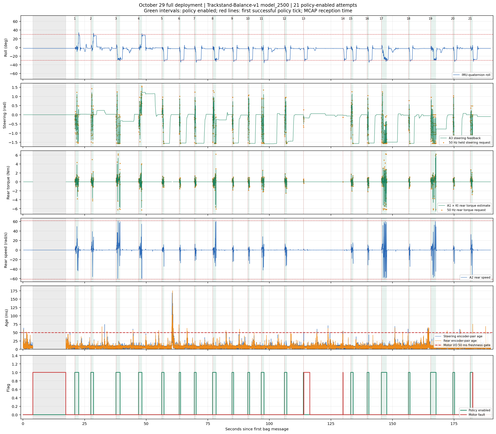
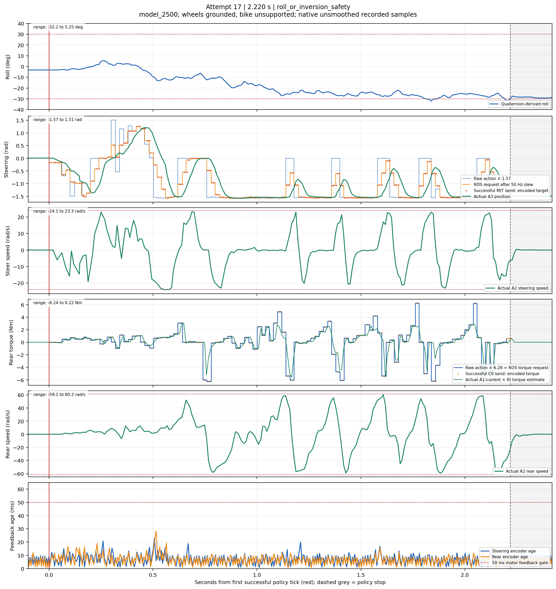
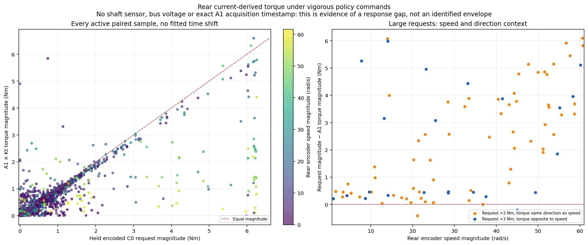
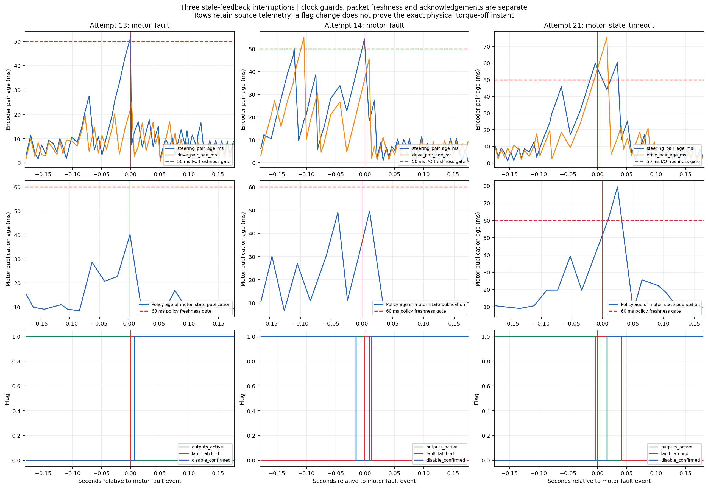

# October 29 deployment analysis — Trackstand-Balance-v1, model_2500

The policy/export and observation-to-command conversions are consistent in this recording. The bike nevertheless enters a much more aggressive closed-loop trajectory than the saved Isaac evaluation: large steering reversals, appreciable steering tracking error, and rear torque requests that are not fully reflected in current feedback at high wheel speeds. Three attempts also have separate, demonstrable feedback interruptions. **This supports investigating the effective actuator/measurement dynamics before another policy-only change; it does not establish a defective motor or one exclusive cause of falling.**

[Open graph gallery](index.html) · [All 21 attempts, PDF](all_attempts.pdf) · [Attempt table](episodes.csv) · [Full numerical results](statistics.json)

## Concatenated motor targets and responses

[PNG](concatenated_motor_target_response.png) · [SVG](concatenated_motor_target_response.svg) · [PDF](concatenated_motor_target_response.pdf)

Two aligned panels concatenate **all 21 policy-enabled attempts**, removing only the pauses between them. Red vertical lines and attempt numbers mark every start. Steering shows the successfully sent MIT position target after the policy's slew limiter and A3 position feedback, in **rad**, on a **±1.75 rad** axis. Rear shows encoded C0 torque targets and A1-current-derived torque feedback, in **Nm**, on a **±7 Nm** axis. Every finite sample fits within these scales. Curves are drawn separately for each attempt; no artificial reset connection, time rescaling, smoothing or fitted delay is introduced.

The shared axis totals **21.992 s** of MCAP-reception intervals. This differs slightly from the **22.022 s** sum of source-clock durations elsewhere in this report; each retains its own original timestamp convention. Targets stop at their last recorded successful send; the plot does not extrapolate commands after a motor disable. Attempt 14 is genuinely very short and is not stretched for readability. Rear torque remains a current-derived estimate rather than an independent shaft measurement.

Regenerate with `MPLCONFIGDIR=/tmp/trackstand_bag_plot_cache python3 deploy/experiments/reports/deployment_20261029_142732/plot_concatenated.py`. Native plotted samples, attempt boundaries and checks are saved beside the figures as `concatenated_motor_samples.csv`, `concatenated_attempt_boundaries.csv` and `concatenated_verification.json`. The earlier 28-figure manifest refers to the original analysis; this is one additional two-panel figure.

### Previous deployment in the same format: October 12, 18:06

[PNG](20261012_180607_concatenated_motor_target_response.png) · [SVG](20261012_180607_concatenated_motor_target_response.svg) · [PDF](20261012_180607_concatenated_motor_target_response.pdf)

The preceding corrected-sign **model_91850** deployment, `rosbag2_2026_10_12-18_06_07`, has **three policy-enabled attempts**, concatenated over **17.895 s** of recorded time. This uses exactly the same two-panel layout, colors, physical units and red attempt-start markers as the October 29 figure. Steering compares final successfully sent MIT targets after the historical host slew with A3 feedback; rear compares final encoded C0 targets after historical clipping/damping with A1 × Kt. These are **motor-bound targets**, not the older model's unbounded scaled raw actions. No present-day action processing or sign correction is applied retroactively.

The steering axis is **±1.75 rad**. The rear axis is **±8 Nm**, accommodating the recorded feedback range **−6.903 to +7.233 Nm** without clipping; the October 29 figure uses ±7 Nm. Pauses between attempts are removed, original timing within attempts is retained, and curves break across recording gaps above 50 ms. The full intervals run from each first balancing event to its next non-balancing event, matching the October 29 boundary convention rather than cropping to first/last action timestamps.

**The user reported kickstand contact within less than one second after release in this older recording. Later sustained motion is supported failed behavior, not evidence of successful balancing.** The plot states this caveat directly. This is the latest deployment preceding October 29, not the earlier October 12 12:06 recording before rear-sign correction.

All new files remain directly in this report directory. `previous_20261012_180607_data.npz` and `previous_20261012_180607_details.json.gz` archive a fresh CRC-checked decode of the original bag: **112,856 messages**, no decoder issues, counts and SHA256 matching the original report. The older report and original bag remain unchanged. `20261012_180607_concatenated_motor_samples.csv`, `20261012_180607_concatenated_attempt_boundaries.csv` and `20261012_180607_concatenated_verification.json` retain the plotted values and provenance. Regenerate using:

```bash
MPLCONFIGDIR=/tmp/trackstand_bag_plot_cache python3 deploy/experiments/reports/deployment_20261029_142732/plot_concatenated.py --previous
```

## Recording and physical conditions

- Input: `deploy/experiments/logs/rosbag2_2026_10_29-14_27_32/rosbag2_2026_10_29-14_27_32_0.mcap`.
- Duration **189.861 s**, **290,281 messages**, **149,263,060 bytes**. MCAP messages were decoded with chunk CRC validation; counts match `metadata.yaml`; the decoder reports no stream/schema issues. SHA256: `b6cf3bbbe0840d08bbf0cb5ab2e677e841275c362ffec4b18a801e63455e3ec3`.
- Recorded status identifies **Trackstand-Balance-v1**, DR-trained run **2026-10-21_11-18-29**, **model_2500.onnx**, SHA256 `d9701945b48e62fec14ea3258cf4255b0c7541d530eb8ec7789a770e9a5a63b2`. This is not model_91850 or model_41050.
- User confirmed both wheels were grounded and the bike unsupported during balancing, with no setting changes. User observed approximately **1–2 s balancing, then falling**, vigorous motion, and qualitative improvement over the preceding deployment. The front wheel was **physically straight at the motor-I/O restart**.
- `/trackstand/kickstands_status` contains **zero messages**. RC/up commands do not measure when support physically disappears or when a stand contacts the ground. Enabled durations below are **software intervals**, not certified unsupported survival times. No external body position, video, shaft torque, raw CAN frames or CPU/bus-load counters are present.

## What happened in the recording



There are **21 policy-enabled attempts**, **1,101 successful inferences**, and about **22.02 s** of enabled policy intervals in total.

| Stop recorded by the policy | Count | Duration / interpretation |
|---|---:|---|
| `roll_or_inversion_safety` | **17** | **0.581–2.220 s**, median **1.001 s**, mean **1.087 s** |
| `motor_fault` following stale steering feedback | **2** | Attempts **13: 0.218 s**, **14: 0.039 s** |
| `motor_state_timeout` with stale motor feedback | **1** | Attempt **21: 1.023 s** |
| RC commanded down | **1** | Attempt **19: 2.260 s**; censored by operator, not recorded as a fall |

The roll guard uses `abs(gravity_y) > sin(0.5236)` or upward projected gravity. With pitch, this is not exactly an Euler-roll threshold of 30°. Do not count all 21 stops as falls. The individual traces show lean growth and oscillatory motor action before many of the roll stops.

Before the attempts, at **bag time 4.008 s**, motor I/O reports:

> MIT motor I/O stopped: system clock sampling delayed; CAN feedback age is uncertain

The local `SocketCan.receive()` guard rejects a host clock-offset sampling bracket longer than **1 ms**. This message proves that guard stopped this I/O instance; it does **not** prove CAN congestion, an actual system-clock step, or a motor fault. I/O restarts at about **17.37 s** and completes its steering B1/F1 initialization. User confirmation that steering was straight makes an incorrectly chosen startup zero a weak explanation here.

## Observation and policy contract: checks that passed

All checks are numerical, using **every one of the 1,101 samples**, not selected screenshots. See [contract_checks.json](contract_checks.json) and [policy_samples.csv](policy_samples.csv).

| Check | Result |
|---|---|
| All 11 observations reconstructed independently from nearby recorded sensor messages | Maximum absolute mismatch **2.25e-7** for IMU channels, **1.89e-6** for encoder/trigonometric channels |
| Recorded observations replayed through the bundled model_2500 ONNX | **Exactly the recorded actions**, maximum absolute difference **0** |
| ONNX checked against recorded Isaac actor outputs on 2,048 saved simulation observations | Maximum absolute difference **2.38e-7** |
| Raw steering range | **−0.996885 to +0.995702** |
| Raw rear range | **−0.996870 to +0.991389** |
| Steering scale, clip and 50 Hz slew reconstructed | Published steering request differs by at most **2.78e-17 rad** |
| Rear action × 6.28 reconstructed | Published rear request differs by **0 Nm** |
| Successful MIT target encoding | Target quantization error at most **4.58e-5 rad** |
| Successful rear C0 encoding | Torque quantization error at most **0.000150 Nm** |

The recorded policy inputs are `gravity_y/z`, body angular velocity xyz, steering/rear position, steering/rear speed, and steering sine/cosine. Gravity comes from the normalized published quaternion; gyro is used in **rad/s**. Position/speed are in **rad/rad/s**. There is no inferred linear velocity input. Rear telemetry is continuous startup-relative A3 position; each episode subtracts its own rear reference and applies the intended **4π branch in [−2π,+2π]**. Every initial rear-angle observation is **0**. Steering retains the fixed straight reference; initial steering positions range from **−0.0683 to +0.0280 rad**.

The following flow is actually in effect:

```text
Steering: bounded Beta mean × 1.57 rad
          → clip ±1.57 rad
          → maximum change ±0.478 rad per 50 Hz policy tick
          → /motor_command
          → repeated absolute MIT targets, nominal 200 Hz
          → motor's internal PD (requested Kp=10, Kd=0.2; desired speed/FF torque=0)

Rear:     bounded Beta mean × 6.28 Nm
          → /motor_command
          → ±6.28 Nm host cap; added damping = 0
          → native current = −torque / measured Kt
          → signed integer-mA C0, nominal 200 Hz
```

Both encoder and torque signs recorded by the restarted node are **−1** for each motor; IDs are rear **1**, steering **2**. The native MIT position transformation and rear torque/current sign inversion also pass numerical checks. The MCAP does not independently measure physical left/right or forward/back, so this verifies the implemented convention, not a new physical sign calibration.

The steering slew affects **48.41%** of policy outputs. Backend target clipping activates **zero** times because inputs already respect the contract. Wire quantization gives Kp **10.01221**, Kd **0.2002442**, native desired speed **+0.010989 rad/s** and feedforward **+0.004396 Nm** for requested zeros; these tiny offsets are encoding resolution, not a large hidden command.

These checks substantially lower the likelihood of wrong model selection, unbounded v0 actions, an extra action scale, incorrect observation ordering, missing rear rebasing or the previous ±π wrapping error. They cannot certify the IMU's physical mounting, fused attitude under acceleration, firmware dynamics or current-to-shaft-torque accuracy.

## Steering response: a substantial tracking and timing gap



Across active feedback samples, causal comparison of A3 position with the **last successfully recorded encoded MIT target**, without a fitted time shift, gives **23.81° RMS position difference**. Most individual roll-terminated attempts are approximately **20–29° RMS**, with peak differences around **45–55°**. Target values before the first successful send and feedback after output disable are excluded; attempt 14 has no eligible tracking pair and is reported as unavailable.

The steering peak measured speed is **24.08 rad/s**. **14.07%** of active feedback samples exceed **90% of the nominal 23.9 rad/s limit**. The policy frequently asks for direction changes at a speed the real mechanism must work hard to follow. **37.97%** of raw steering actions have magnitude at least **0.95**.

A separate 0–100 ms alignment scan, at 1 ms increments, excludes each attempt's first 100 ms and final 10 ms. It finds a best steering offset of **30 ms**: RMS changes from **24.61° to 8.09°** on that common 1,836-sample subset. **This is apparent target-versus-reported-response alignment, not a measured motor-internal latency.** It includes physical dynamics, encoder age, publication and scheduling delays. Main plots retain original times and no fitted shifts.

The PD equation itself explains why high-speed tracking need not be instantaneous: with requested speed zero, `Kd × 23.9 = 4.78 Nm`; at Kp 10, a **0.478 rad / 27.4°** position error supplies an equal proportional term. This is an illustrative equilibrium balance of terms, not an identification of the measured transient or its external load.

For context, the already-saved **same-model Isaac400 DR evaluation** has steering target-to-substep-end-position RMS **1.72° over all steps**, or **5.37° in the first two seconds of each episode**. Near-endpoint steering actions occupy **0.124% overall / 1.595% in those initial two seconds**, versus **37.97% on this bike**. These are different closed-loop trajectories and sampling rates: they establish a large behavioral gap, **not** an isolated motor-quality comparison. Supported replay successes on older/gentler inputs likewise do not guarantee tracking of today's sequence on a freely balancing bike.

## Rear response: high speed and large torque demands matter



Peak active rear encoder speed is **60.70 rad/s**, close to the nominal 61.6 rad/s speed limit. Encoder speed is wheel rotation, not measured bike forward speed; without external motion tracking, this bag cannot distinguish rolling speed from slip.

The overall unshifted rear request-versus-current-torque RMS difference is **0.757 Nm**. The more important feature is its dependence on demand and speed:

| Condition, no fitted shift | Samples | Mean absolute requested torque | Mean absolute current-derived torque |
|---|---:|---:|---:|
| Request magnitude >3 Nm | 88 | **5.023 Nm** | **2.750 Nm** |
| Request >3 Nm, wheel speed >40 rad/s, torque in direction of rotation | 29 | **5.126 Nm** | **1.414 Nm** |

The high-speed gap persists with assumed comparison offsets of **0/5/10/15 ms**: mean request remains **5.12–5.26 Nm**, current-derived torque **1.08–1.41 Nm**. This is evidence that a flat, instantly available ±6.28 Nm actuator model is not demonstrated by this deployment. Possible mechanisms include speed-dependent voltage/current headroom, firmware/current response, and rapid transients. **This is not enough to identify a torque-speed curve or prove which mechanism caused the gap.** Bus voltage, firmware current-slope/protection settings and exact current-sample acquisition time are missing.

At the 5 ms best aggregate rear alignment, small requests (≤1 Nm) have **0.170 Nm RMS** current-torque error; large requests (>3 Nm) have **2.965 Nm RMS**. Aggregate apparent rear alignment is **5 ms**, again not a calibrated internal delay.

All torque feedback here is **A1/C0 measured Q-axis current × measured B0 torque constant**, signed into policy coordinates. It is not an independent shaft sensor and is not net torque after passive friction/contact load. Brief peaks are **6.009 Nm steering / 6.595 Nm rear**; **20 steering / 2 rear active samples** exceed their simulation caps of 5.6/6.28 Nm. Do not interpret those current estimates as certified shaft-torque or rated-duration violations. F0's ±18 Nm encoding range does not establish the physical total steering PD-torque cap.

The older low-torque airborne rear repeatability/threshold concerns remain relevant to identification, but do not by themselves explain these loaded high-speed, multi-Nm requests. Do not directly fit the unloaded drag model to this freely rolling/leaning bike.

## Timing and the three feedback stops



| Active measurement | Median | 95th percentile | Maximum |
|---|---:|---:|---:|
| Policy interval | **20.02 ms** | **21.03 ms** | **35.96 ms** |
| ONNX inference duration | **0.340 ms** | **0.605 ms** | **11.40 ms** |
| Policy-reported IMU input age | **18.23 ms** | **21.36 ms** | **49.98 ms** |
| Policy age of motor-state publication | **10.08 ms** | **19.85 ms** | **55.57 ms** |
| Actual MIT send interval reported on successful-send rows | **5.42 ms** | **7.77 ms** | **16.04 ms** |

Policy inference is effectively **50 Hz** during the substantive attempts. Recorded successful motor-send rates during the 17 roll-terminated intervals are about **165–178 Hz**, despite the **200 Hz configuration**. The code schedules subsequent MIT sends relative to completion, and the source-logged intervals confirm jitter. Published telemetry is not an independent on-wire capture; no claim is made that every actual send was necessarily recorded.

At the three faults, nearest control telemetry shows:

| Attempt | First I/O fault time, bag seconds | Steering/rear encoder-pair age | Policy's first stop |
|---|---:|---|---|
| 13 | **113.999** | **51.60 / 22.31 ms** | `motor_fault` |
| 14 | **129.900** | **54.35 / 36.35 ms** | `motor_fault` |
| 21 | **182.549** | **59.85 / 52.15 ms** | `motor_state_timeout` |

I/O reports `active_feedback_unavailable` and initiates disable; disable acknowledgements follow. These are **three interruptions**, not nine separate failures just because an event reason repeats. They explain those stops, **not all 17 roll-related stops**.

Motor-state age in the policy is time since **ROS publication**, not time since encoder acquisition. `motor_state` timestamps a fresh publication containing cached A3/A2 values; motor-control diagnostics separately report those values' ages. IMU age is based on the older host-parsed gyro/quaternion channel, also not physical acquisition/fusion latency. The saved training observation code has its explicit latency-buffer application commented out. Sensor bias/noise DR therefore must not be described as training on the measured runtime delays.

There is avoidable traffic: **93,950 RC Bool publications (~495 Hz)** and **80,292 motor-command publications (~423 Hz)**, although only **1,101 are enabled policy commands**. Source inspection explains this: `rc_kickstand` publishes every confirmed receiver frame; every down Bool makes the policy publish another disable command. The 97-field motor-control topic and frequent status JSON add diagnostic work. This suggests a load optimization target; **CPU overload, CAN saturation and packet loss are not established by this bag**. No overflow/bus-error diagnostic is recorded.

## Suspected explanations, ordered by support

1. **Effective closed-loop dynamics and timing differ from training — strongest overall explanation.** The action/observation contract passes, but the real loop has delayed state, roughly 30 ms apparent steering alignment, large steering tracking differences and repeated high-speed demands. Those can change the next observation and drive the policy into endpoint-heavy actions. This is a policy–plant compatibility issue, not evidence that one component alone is faulty.
2. **Rear large-command/high-speed actuation is less ideal than the model — strong localized evidence.** Current feedback substantially undershoots large motoring-direction requests at high wheel speed. A flat torque cap plus measured low-speed friction cannot reproduce every relevant voltage/current/firmware behavior. Traction and contact dynamics may also contribute; the bag cannot isolate them.
3. **Host scheduling/freshness handling — proven contributor to particular interruptions.** The 1 ms clock-sampling guard stops the first I/O instance; later stale pairs stop three attempts. They are worth fixing/characterizing but cannot explain every roll stop. Raising guard thresholds alone would hide symptoms without improving stability.
4. **Initial attitude/IMU calibration or real contact geometry — possible, not identified.** Initial reported roll is consistently negative (**−3.33° to −1.27°, median −2.68°**). This can be actual stand-supported lean or a mounting/fusion bias. It is within the saved DR roll range ±0.1 rad; its existence alone is not proof of bad calibration. The front-straight confirmation and small initial encoder angles weaken the steering-zero hypothesis.
5. **Wrong export, unbounded actions or a simple scale/rebase bug — little support in this bag.** Offline actor replay and every observation/command reconstruction pass. Physical sign/attitude truth still requires external reference if a direction is questioned.

## Recommended next steps

1. **Replay today's actual vigorous steering sequence under normal front-wheel load with the frame independently supported.** Use the identical timed pre-slew and post-slew target levels in simulation and hardware, with matching MIT gains. Record A3/A2, A1/F1, actual send intervals and sample ages. This separates command filtering, motor response and feedback latency from policy feedback. Existing gentle/supported tests do not cover today's full demand history.
2. **Identify rear response in the range actually demanded.** Extend controlled repeatability/current-response measurements beyond breakaway-only conclusions, including response versus speed and command direction. Record bus voltage, Q-axis current, firmware B4/protection settings and wheel motion. Use supported conditions and the experiment's reviewed motor/current limits. External video/markers are needed to tell wheel slip from frame motion in a grounded test.
3. **Measure/clean up runtime timing.** Stop redundant RC-down motor-command publications while retaining a deliberate RC heartbeat/deadman; reduce nonessential telemetry work; inspect query scheduling and clock-offset sampling. Record CPU scheduling and CAN error/drop counters. Verify the existing 50/60 ms freshness gates under load before further unsupported trials. No controller code was changed for this analysis.
4. **Make training reflect the measured plant, then assess retraining.** Introduce measured state/actuator delay and actuator dynamics or an empirically justified envelope, and validate with identical-target replay first. If rapid reversals remain unrealistic, train with a justified command-bandwidth/action-change cost. Avoid arbitrary damping, gain, friction or direction changes merely to suppress one trace; arbitrary additional clipping changes the trained contract.
5. **Check attitude independently.** Measure upright/known small tilts and gyro axes against a physical reference, record effective IMU mounting/fusion configuration, and synchronize video/support release if survival time is to be claimed. The existing quaternion stream alone cannot certify true lean under all accelerations.

## Files, method and reproducibility

- [Graph gallery](index.html): overview, durations, all **21 six-panel attempt plots**, 11-input examples, stale-feedback zooms, timing, saved-simulation distributions and rear response. Each figure has **PNG/SVG/PDF**, with a **21-page combined PDF**. Legends sit lower-right; attempt panels retain native samples, red starts, grey stops and numerical ranges. No smoothing, bias removal, amplitude fitting or response time shifting is applied to the demand/response traces.
- [episodes.csv](episodes.csv), [policy_samples.csv](policy_samples.csv), [rear_response_pairs.csv](rear_response_pairs.csv), [rear_response_conditioned.csv](rear_response_conditioned.csv), [observation distribution comparison](observation_distribution_comparison.csv), [alignment scan](steering_alignment_scan.csv), [statistics.json](statistics.json) and [contract checks](contract_checks.json) retain the numeric evidence.
- `decoded_data.npz` / `decoded_details.json.gz` preserve the complete numeric decode and status/event/layout metadata. All point pairing is causal; missing or unavailable values remain unavailable. Eleven steering and twelve rear torque entries are non-finite in the entire recording and are excluded where needed.
- Source evidence: [policy construction/scaling](../../../source/trackstand_deploy/trackstand_deploy/policy_controller.py), [observation/limiter contract](../../../source/trackstand_deploy/trackstand_deploy/contracts.py), [MIT I/O and freshness](../../../source/trackstand_deploy/trackstand_deploy/motor_mit_io.py), [CAN units](../../../source/trackstand_deploy/trackstand_deploy/can_protocol.py), [IMU stamping](../../../source/trackstand_deploy/trackstand_deploy/imu_publisher.py), and [RC publication](../../../source/trackstand_deploy/trackstand_deploy/rc_kickstand.py). Runtime-source hashes are not embedded in the bag, so the Pi revision is not cryptographically established; numerical schemas/parameters/actions agree with the local implementation.
- Saved simulation context: `isaaclab_train/reports/20261025_2500_dr_comparison/isaac400/`, **64 environments × 3,000 policy steps**, seed **42**, DR, 400 Hz physics / 50 Hz policy. Existing arrays were read; **no new simulation or physical experiment** was run. Native actuator targets/position are compared, not solver effort mislabelled as motor torque.

Regenerate the numerical analysis and plots from the archived decode:

```bash
MPLCONFIGDIR=/tmp/trackstand_bag_plot_cache python3 deploy/experiments/reports/deployment_20261029_142732/analyze.py
```

Requires NumPy, Matplotlib and ONNX Runtime plus the existing model and saved simulation arrays. The original decoder is `deploy/experiments/reports/deployment_20261012_120632/decode_mcap.py`, using ROS message deserialization and `mcap` with CRC validation. Only this report directory is written; deployment/training code, bags, checkpoints and progress ledgers are preserved. [verification.json](verification.json) records preservation and artifact checks.
