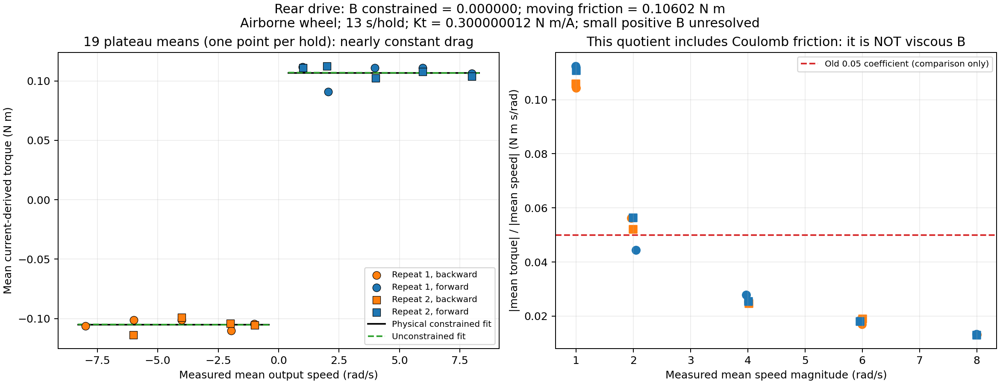
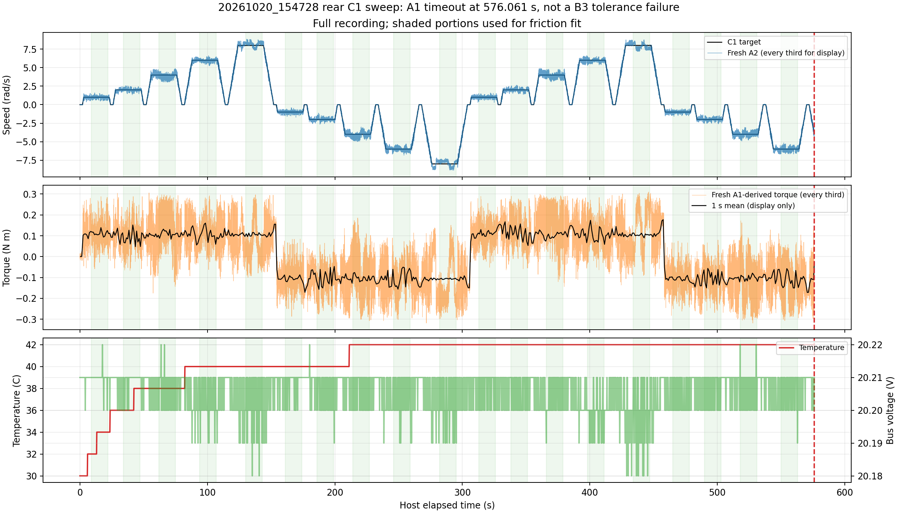

# Rear drive friction/damping identification — 2026-10-20

## Conclusion

The nonnegative viscous-plus-Coulomb fit gives **B = 0.000000 N m s/rad**, **moving-friction magnitude = 0.106025 N m**, and direction/bias offset = 0.000847 N m.

**B is not resolved as positive by this recording; this is NOT proof of exactly zero physical damping.** The main observed loss is approximately speed-independent over 1–8 rad/s. Do not assign all this drag to viscous friction or retain 0.05 as a measured passive coefficient.

Unconstrained slope **-0.000048667 N m s/rad**; its negative sign is an estimation result, not physical negative damping. Conditional 95% t interval **[-0.0012320, 0.0011347]** uses 19 plateau means and 16 residual degrees of freedom. Stratified plateau bootstrap (10,000 resamples, seed42) gives [-0.0009060, 0.0009529]. These are descriptive regression intervals, NOT calibrated physical bounds: one full repeat plus nine holds, thermal/order dependence, torque scaling uncertainty and systematic losses remain.

## Conditions and data contract

User confirms rear wheel completely airborne, unconstrained and free to rotate. Source: ../../logs/20261020_154728_360275_drive_speed_sweep.csv. 388,994 CSV rows / 576.066797 s; 19 complete 15 s holds (repeat1 all10, repeat2 first9). Third repeat and second repeat's -8 rad/s hold were not reached.

Raw A1/A2/B0/AE/CF bytes independently re-decoded and compared to logged units/signs. Use only record_type=rx, opcode_hex=A1 for current/torque and A2 for velocity. Other rows repeat cached state and are not independent samples. Native current and speed signs are both -1, protocol/output ratio1; no extra 8:1 scaling. A1 is signed 0.001 A, A2 signed 0.01 rpm, B0 float32 torque constant. AE bus current is unsigned protocol data and is NOT used as Q-axis current.

Kt=0.300000011921 N m/A; active B3 readback0.999 A; voltage 20.18–20.22 V, temperature 30–42 C. Motion AE status consistently mode3, fault0. Observed C1/A2/A1 rates approximately 49.77/92.93/92.93 Hz, not exactly50/100/100.

## Identification method

Model at output shaft: J*domega/dt = Kt*iq - B*omega - Tc*sign(omega) - offset. For average steady motion with no external contact load, fit mean(torque)=B*mean(omega)+Tc*sign(mean(omega))+offset. The offset can absorb direction asymmetry/current bias; it is not independently identified as one physical mechanism.

Discard ramps/settling/rest, the first and last1 s of each hold, and the interrupted -8 ramp. Retain 22,950 fresh A2 and 22,950 fresh A1 replies. Average each signal separately on the same13 s windows. One equally weighted point per plateau avoids pseudoreplication and duplicate cached rows. Do not select only individual at_target samples or discard large currents: that would bias a closed-loop average.

OLS fits all three terms. Physical fit enumerates the B>=0/Tc>=0 active sets, leaving offset free. No wheel inertia is assumed, but cancellation of the average inertial term is approximate, not exact. Residual speed ripple and finite-window endpoint motion contribute uncertainty.

Maximum plateau mean speed error 2.22%; within-window speed standard deviations 0.186–0.409 rad/s. There is substantial instantaneous speed/current ripple despite approximately correct mean speed. This is effective running drag, not an isolated bearing or rotor material coefficient.

## Evidence: pooled magnitudes

| Nominal speed magnitude (rad/s) | Complete plateaus | Mean torque magnitude (N m) |
|---:|---:|---:|
| 1 | 4 | 0.108209 |
| 2 | 4 | 0.104514 |
| 4 | 4 | 0.103451 |
| 6 | 4 | 0.108586 |
| 8 | 3 | 0.105424 |

Full per-plateau measured speeds, torques, ripple, temperature and current-ceiling fractions: [plateaus.csv](plateaus.csv).



## Sensitivity and limits

| Trim at EACH end (s) | Unconstrained B (N m s/rad) | Tc (N m) |
|---:|---:|---:|
| 0 | -0.000088226 | 0.105330 |
| 1 | -0.000048667 | 0.106219 |
| 2 | 0.000102322 | 0.106135 |
| 3 | 0.000398167 | 0.104168 |
| 4 | -0.000553143 | 0.108109 |
| 5 | -0.001693762 | 0.110931 |

Window sensitivity changes the tiny slope's sign; all estimates retain approximately0.10–0.11 N m moving drag. Repeat-only, direction-only, leave-one-plateau-out and bootstrap results are in [fit_summary.json](fit_summary.json). Forcing a viscous-only fit through the origin gives B=0.019209; that lumps Coulomb friction into B and is not the identified viscous coefficient.

The old B=0.05 hypothesis alone predicts0.4 N m at8 rad/s; the observed mean drag there is about0.105 N m. It does not match this free-wheel friction curve. This comparison concerns passive B, not whether an intentional controller Kd=0.05 should be kept.

Current-derived torque uses firmware Kt, not an independent shaft torque transducer. Absolute B/Tc estimates scale with its calibration and depend on how gearbox losses are represented. The test includes bearings/gearbox/wheel effects and cannot separate all losses, loaded tyre rolling resistance, static breakaway friction, motor electrical dynamics or a thermal/torque-speed envelope. Angle-dependent cogging/gear ripple or wheel imbalance can also bias finite windows that do not span an integer number of revolutions. This experiment does not isolate each contribution. Reported B3 is a configured ceiling, not proof that measured current never overshoots it; per-plateau excursions are retained in the CSV, not removed from the mean.

## Why recording stopped

One A1 query at 575.992113094 s timed out; the host checked the20 ms deadline at 576.060559939 s (68.447 ms after send). The A1 reply was then received during shutdown at 576.060743194 s (68.630 ms after send). This is NOT a B3 tolerance failure. Host timestamps cannot establish whether the delay occurred in the motor/CAN/USB path or the Pi's scheduler/logging; do not call it measured motor latency. The first two shutdown CF replies still reported mode3; a later CF plus AE confirmed mode0/fault0. Original B3/CD values were subsequently read back and final CF again reported mode0. The valid earlier holds remain usable.



## Simulation interpretation / next step

If a simple model must be tried, this dataset supports a PROVISIONAL B=0 baseline together with moving friction about0.106 N m, not a lossless rear wheel. B belongs in passive viscous friction; moving friction is a separate term. Static friction was not identified, and a negative fitted B must never be installed. Controller damping is a separate design decision. No Isaac Lab, MuJoCo, deployment or motor configuration was edited.

For a tighter small-B estimate, repeat in randomized speed/direction order at matched temperature, average longer intervals covering many ripple cycles, verify torque/current calibration, and collect A3 position if per-revolution/angle-synchronous averaging is desired, and compare the fitted law with an independent recording. A calibrated inertia/coast-down or transient-torque validation could test the approximation; do not infer J from the current steady data.

## Reproduce and artifacts

```bash
MPLCONFIGDIR=/tmp/drive-damping-matplotlib python3 \
  deploy/experiments/reports/drive_damping_20261020_154728/analysis.py
```

Requires numpy/pandas/matplotlib; no SciPy, ROS or CAN access. Original input and runtime sources are fingerprinted in JSON. The captured CSV is read-only. The environment's system SciPy has a NumPy ABI mismatch, so the analysis does not import it; the df16 t critical was independently obtained with Isaac Python SciPy.

[HTML](index.html) · [fit PNG](drive_friction_fit.png) · [fit SVG](drive_friction_fit.svg) · [fit PDF](drive_friction_fit.pdf) · [overview SVG](sweep_overview.svg) · [summary JSON](fit_summary.json) · [analysis source](analysis.py) · [tests](test_analysis.py)
