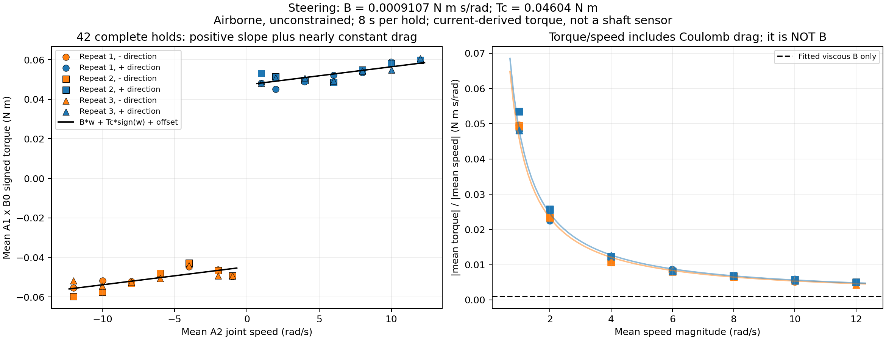
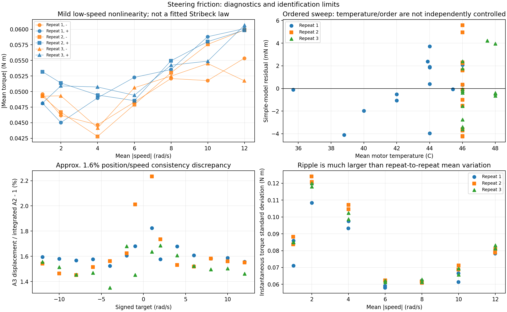
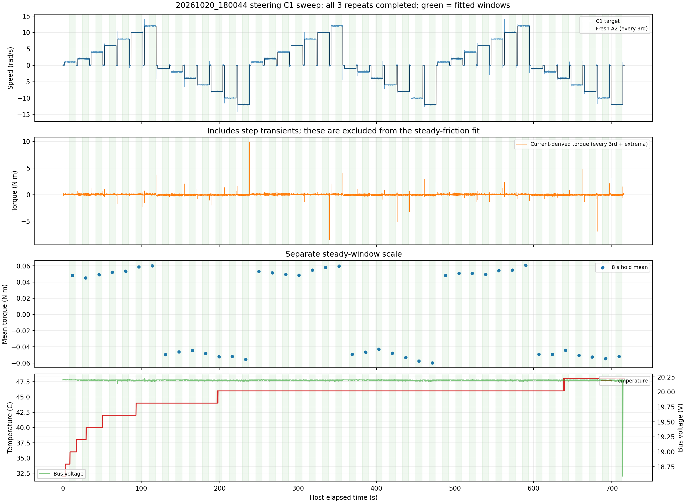

# Steering friction/damping identification — 2026-10-20

## Conclusion

Using the rear-wheel report's identical three-term model and nonnegative fit: **B = 0.000910713 N m s/rad**, **moving Coulomb-like friction Tc = 0.046036 N m**, and **signed offset = 0.001288 N m**.

Unlike the rear-wheel sweep, this steering dataset resolves a small positive viscous slope within the simple regression model. It does not establish one exact, load-independent intrinsic motor constant. These are effective losses of the tested, powered, unconstrained steering assembly, inferred from motor current.

```text
J * acceleration = signed(Kt * iq) - B * speed - Tc * sign(speed) - offset
steady torque estimate = 0.000910713 * speed + 0.046036 * sign(speed) + 0.001288
```

At 12 rad/s, the viscous component is only **0.01093 N m**, versus **0.04604 N m** moving friction. Constant-like drag dominates over the tested 1–12 rad/s range. The offset may absorb current bias, asymmetric losses or ordered-test effects; it is not a separately identified friction mechanism.

## Data and verified units

User explicitly confirms the front wheel was fully airborne and steering unconstrained throughout, without hand contact, cable tightening or mechanical stops. Source: [20261020_180044_997520_steering_speed_sweep.csv](../../logs/20261020_180044_997520_steering_speed_sweep.csv). **505,766 rows / 716.003679 s; all 42 ten-second holds completed**, three repeats of +1,+2,+4,+6,+8,+10,+12,-1,-2,-4,-6,-8,-10,-12 rad/s. Startup JSON confirms settle 5 / hold 10 / rest 2 s, C1 50 Hz, each A3/A2/A1 100 Hz, AE 5 Hz, B0 1 Hz. Final events report sweep completion and CF plus fresh AE disabled acknowledgement.

Every raw RX payload and outgoing C1 payload is independently decoded and compared to CSV units/signs. A1 is signed int32, 0.001 A; A2/C1 feedback is signed int32, 0.01 rpm; A3 is uint16 single-turn plus int32 multi-turn, 16384 counts/revolution; B0 is float32 bytes2–5. Encoder/current/command signs are -1, gear1. No extra gearbox factor is invented. All B0 replies agree on **Kt=0.779999971390 N m/A**. Torque is -A1_current*Kt, not AE bus current and not an independent shaft torque sensor. Raw byte definitions were checked against `tsinghua_bike_project/can_protocol.txt` and both sweep sources.

Observed C1 rate **49.81 Hz**, A2/A1 rates **99.09/99.09 Hz**. Maximum A2 host receipt gap **117.70 ms**. All sent read/command reply counts match over the complete recording; no logged CAN error, malformed RX, or kernel-drop rows. This is not proof of simultaneous samples or zero transport latency. AE temperature **32–48 C**, voltage **18.59–20.22 V**, fault0 throughout; mode3 during speed control, mode0 initially/after shutdown. B5 readback0 has no documented special-zero semantics. B3 current ceiling, CD watchdog and firmware gains were not read; their actual settings cannot be reconstructed here.

## Same identification method as rear drive

For each complete hold, discard its first and last1 s. Earlier5 s settling, speed steps and zero-speed rest are excluded. Average independent fresh A2 velocities and fresh A1-derived torques separately over the same [1,9) s window. Retain **33,305 fresh A2 / 33,301 fresh A1** samples; fit one equally weighted point per hold, not hundreds of thousands of cached CSV rows. No high-current/outlier/at-target filtering is used within selected windows. OLS fits B, Tc and an unconstrained signed offset; the physical fit enumerates B>=0/Tc>=0 active sets, exactly as in the rear report. Both fits coincide here because both fitted friction terms are positive. No inertia J is assumed: the steady-window average inertial term is neglected, not proven exactly zero.

Maximum mean A2 speed error **0.570%**; within-window speed SD **0.058–0.152 rad/s**. Largest end-minus-start one-second mean speed change **0.0209 rad/s**. This supports approximately steady averages, not ripple-free instantaneous motion.

## Evidence and comparison

| Parameter | Steering, this recording | Rear drive, previous recording |
|---|---:|---:|
| Passive viscous B (N m s/rad), constrained fit | 0.000910713 | 0.000000 (positive B unresolved) |
| Moving Coulomb-like Tc (N m) | 0.046036 | 0.106025 |
| Signed offset (N m) | 0.001288 | 0.000847 |
| Per-plateau fit RMSE (N m) | 0.002601 | 0.005491 |
| Static breakaway friction | Not identified | Not identified |

Different assemblies, torque constants, temperatures and test protocols: this is a descriptive comparison, not a controlled motor contest.

| Nominal speed magnitude (rad/s) | Holds | Mean torque magnitude (N m) |
|---:|---:|---:|
| 1 | 6 | 0.049599 |
| 2 | 6 | 0.048249 |
| 4 | 6 | 0.046799 |
| 6 | 6 | 0.049510 |
| 8 | 6 | 0.053386 |
| 10 | 6 | 0.055925 |
| 12 | 6 | 0.057930 |

[Full plateau statistics](plateaus.csv).



## Repeatability, uncertainty and nonlinear losses

| Repeat | B (N m s/rad) | Tc (N m) | Offset (N m) |
|---:|---:|---:|---:|
| 1 | 0.001009088 | 0.044865 | 0.001351 |
| 2 | 0.001007048 | 0.046138 | 0.001303 |
| 3 | 0.000716083 | 0.047106 | 0.001210 |

Conditional OLS 95% t interval for B: **[0.000688708, 0.001132719]** (42 plateau means,39 residual degrees of freedom). Stratified plateau bootstrap,10,000 draws/seed42,2.5–97.5%: **[0.000700142, 0.001132516]**. These are descriptive regression intervals, not calibrated physical bounds: current/Kt scaling, correlated ordered samples, angle ripple, torque bias and thermal dependence are not fully represented.

| Trim at EACH hold end (s) | B (N m s/rad) | Tc (N m) |
|---:|---:|---:|
| 0 | 0.000963967 | 0.045560 |
| 1 | 0.000910713 | 0.046036 |
| 2 | 0.000902789 | 0.046043 |
| 3 | 0.000953933 | 0.045519 |
| 4 | 0.000825469 | 0.046339 |

Time-weighted windows give B=0.000904531, Tc=0.046073; integer-A3-turn window sensitivity gives B=0.000890897, Tc=0.046097. Those extra windows are defined using the documented encoder conversion, not independent angular calibration.

Mean drag first decreases slightly from1 to4 rad/s, then increases. This can be compatible with Stribeck-like behavior, angle-dependent cogging/gearing, finite-revolution averaging, current-loop ripple or ordered heating; the recording cannot uniquely distinguish them or identify a trustworthy Stribeck/static-friction law. Using only |speed|>=4 gives B=0.001434693, Tc=0.041236. Therefore the simple coefficients depend on the fitted speed band. Never install all optional terms as additive losses without a joint identification. A forced viscous-only through-origin fit gives B=0.006336; that folds Coulomb friction into B and is not the separated viscous coefficient.

## Important additional observations

- **Position/speed consistency:** per-window A3 displacement divided by integrated A2 has median **1.015654**, mean 1.015911, range 1.013517–1.022345. Both signs agree, but documented A3 units imply about1.6% more rotation than A2. Raw decode checks pass; which feedback/scale/clock is physically more accurate is not established. Do not silently correct a gear ratio or count resolution. Replacing A2 means with A3 position-regression speeds gives B=0.000897226, Tc=0.046034; the central friction conclusion survives this small difference.
- **Step transients are not friction:** the largest sampled A1 magnitude is **12.649 A** at 238.004805 s (rest, leaving a -12 rad/s step), equivalent to **9.866 N m** under firmware Kt. The maximum within fitted windows is only 0.538 A. The full-record voltage minimum 18.59 V is also a transition sample, not a steady loss measurement. These are sampled current-derived values, not independently validated shaft torques, firmware current limits or safe continuous ratings. Abrupt C1 transitions are not recommended evidence of safe repeated stress. No new hardware tests were run here.
- **Not identified:** static/breakaway friction, very-low-speed friction, load/tyre-ground losses, separate rotor/gear/bearing friction, J, torque-speed envelope, peak-torque duration, electrical dynamics and true torque calibration. Enabled C1 zero-speed rest actively regulates current and jitters; it is not a passive breakaway test.



## Simulation interpretation / next verification

A provisional passive model over1–12 rad/s is **viscous_friction≈0.000911 N m s/rad** plus **dynamic/moving friction≈0.046 N m**. Static friction must remain explicitly unmeasured; using an equal static threshold to satisfy a simulator's static>=dynamic requirement would be a provisional modelling assumption, not a result of this test. The small offset should not automatically become a constant external torque.

These losses are separate from steering controller Kd=0.2. Do not replace the working MIT Kd with the fitted B, nor add passive resistance again on the real Pi. If adding passive friction in simulation, keep controller terms distinct and check that asset-native losses do not already duplicate the identified assembly losses. No Isaac Lab, MuJoCo, deployment, sweep runtime, firmware or progress-record settings were changed in this analysis.

For tighter identification: verify A3 counts and A2 RPM against independently observed rotations; verify Kt/current calibration; repeat randomized speed/direction tests at stable temperature with safe acceleration/current settings; add small near-zero steady speeds and a separately guarded slow breakaway test if static/Stribeck friction is needed. Validate the fitted model on an independent recording and, if J is known, a controlled coast-down/transient test. No commanded-speed latency or motor internal-loop frequency is inferred from these averages.



## Reproduce and artifacts

```bash
MPLCONFIGDIR=/tmp/steering-damping-matplotlib python3 \
  deploy/experiments/reports/steering_damping_20261020_180044/analysis.py

python3 -B -m unittest discover \
  -s deploy/experiments/reports/steering_damping_20261020_180044 -p 'test_analysis.py' -v
```

Requires numpy/pandas/matplotlib, no SciPy, CAN or ROS. Mathematical fit/bootstrap helpers are reused from the read-only rear report. Input CSV, helper, protocol and runtime source SHA256 fingerprints are retained in JSON; input and runtime file hashes are checked unchanged after analysis. Conditional df39 t critical was evaluated separately using the installed Isaac Python SciPy, not a hard-coded normal approximation.

[HTML](index.html) · [fit PNG](steering_friction_fit.png) · [SVG](steering_friction_fit.svg) · [PDF](steering_friction_fit.pdf) · [plateaus](plateaus.csv) · [numerical JSON](fit_summary.json) · [source](analysis.py) · [tests](test_analysis.py)
