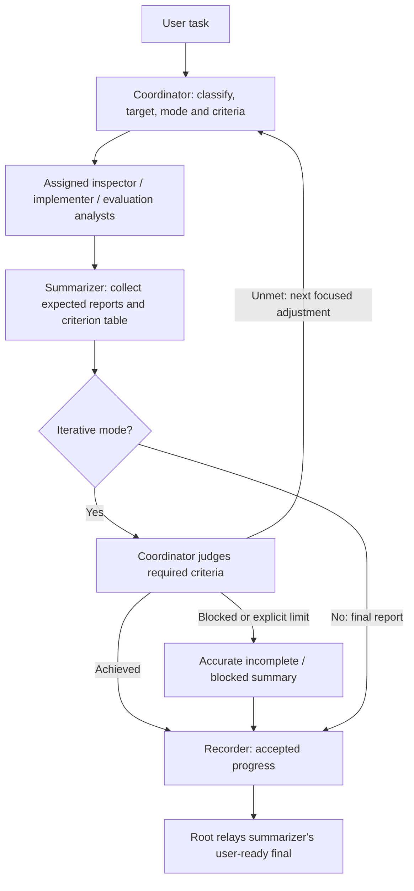

# Codex workflow for Trackstand

The main session coordinates seven subagent roles. Project settings live in
`.codex/config.toml`; instructions live in `.codex/agents/*.toml`. `AGENTS.md`
assigns the root coordinator behavior. `main_coordinator.toml` is also available
for an explicit coordination handoff; it does not start a second coordinator.

## Routing and ownership

| User task or responsibility | Role | Owned writes |
| --- | --- | --- |
| Classify work, define criteria, schedule and judge completion | `main_coordinator` | Assigned coordination documents; reviews changes |
| Code/config/protocol/data-methodology and validation audits | `inspector` | Assigned new audit reports/helpers; no production fixes |
| Implementation and focused tests | `implementer` | Assigned source/test/config files |
| Isaac Lab evaluation or analysis | `isaaclab_evaluation_analyst` | Assigned new `isaaclab_train/reports/<run_id>/` artifacts/helpers |
| MuJoCo evaluation or analysis | `mujoco_evaluation_analyst` | Assigned new `mujoco_sim2sim/reports/<run_id>/` artifacts/helpers |
| Deployment evaluation or analysis | `deploy_evaluation_analyst` | Assigned new `deploy/experiments/reports/<run_id>/` artifacts/helpers |
| Collect reports and synthesize criteria/conclusions | `summarizer` | Assigned summary/report paths; no ledger edits |
| Automatically record accepted material progress | `recorder` | Both root progress ledgers only |

A mixed request can create several tasks; do not force every category into every
request. The inspector owns all kinds of requested audit, while evaluation
analysts own their domain's evaluation and measurement analysis. An analyst who
finds a code defect reports it; coordinator can assign inspector verification and
implementer correction. Production changes remain with implementer.

These eight role definitions are reusable instructions, not always-running
processes. Spawned agents have separate conversation contexts and share the
checkout. Model, reasoning, tools and permissions are inherited. Ownership rules
are coordination instructions, not extra OS sandboxes or hardware authorization.

## Control flow



The diagram shows logical ordering, not mandatory simultaneous execution. Dependent
baseline/audit, implementation and revalidation steps stay ordered. Independent
analyses can run in parallel and all assigned workers report to summarizer.

## Assignment contract

Coordinator first identifies `single_pass` or `iterative` intent from the request.
Before workers start, register the following with summarizer and each worker:

- `task_id`, `iteration_id`, role, objective and expected report/delivery address.
- Mode, overall target, required criterion IDs and each acceptance condition.
  Use user-specified metrics/thresholds with units, or explicit observable
  qualitative checks. Do not invent numerical targets or arbitrary loop counts.
- Candidate/source revision or hashes, checkpoint/config/model identity when
  relevant, evidence inputs and known physical conditions. Unknown facts stay unknown.
- Owned output paths, allowed edits, dependencies, validation/run/sample budget,
  CPU/GPU allocation and any already authorized live hardware operations.
- Expected task/report set for this iteration, including which criteria each task
  supplies. Changes to the registry must be explicit and visible to summarizer.

Workers receive, parse and understand the assignment before doing the task. Missing
critical inputs are raised to coordinator; independent work can continue. Workers
must not silently redefine scope, criteria, candidate or operating conditions.

## Worker report contract and delivery

Each inspector, implementer and evaluation analyst sends a full report containing the fields below.
Recorder uses the same identity/evidence structure for its later finalization report:

| Field | Required contents |
| --- | --- |
| Identity | `task_id`, `iteration_id`, role, candidate/source revision or hashes |
| Task status | `completed`, `failed`, `blocked`, `cancelled` or `not_run`; reason |
| Criterion results | For each assigned criterion: ID, requirement, observed data/result and units, `pass` / `fail` / `unknown` / `not_run`, evidence and limitations |
| Work and validation | Changes/findings, exact commands/cwd/conditions, checks/results, completed samples where applicable, artifact paths |
| Conclusions | Supported result, uncertainty, failed/unrun checks, blockers and next focused action |

Use this contract for concise structured text or a report artifact; no separate
orchestration program or JSON service is required. A completed task can still have
failing criteria. Missing evidence and absent or unrun measurements are not passes.
Keep requested, implemented, offline-tested, evaluated and hardware-measured status
distinct. Revalidate results affected by changed code/config/model; do not reuse an
old pass as current without a justified unchanged/revalidated source identity.

Send the report directly to the designated summarizer with the available peer
messaging tool and send coordinator a short delivery receipt. Send blockers or
urgent findings to both promptly. Agent final responses also reach their parent,
so a short parent receipt must not replace the full summarizer report.

If peer delivery is unavailable, coordinator transparently relays the complete
report or accessible artifact path and verifies receipt. With fewer runtime slots,
workers can finish in waves and coordinator can resume summarizer after collecting
reports. Do not pretend a completed thread is continuously listening or reserve a
collector slot in a way that prevents required workers from running.

## Synthesis and loop decisions

Summarizer tracks the expected task/report registry and acknowledges each report.
It accounts for every expected task, including failed/blocked/cancelled/not-run
ones, before marking synthesis final. Missing reports remain missing until resolved
with coordinator; they are not silently omitted. Reconcile contradictions or retain
them as unknown/unresolved. A registry change cannot silently drop a required criterion.

For every required criterion, the synthesized table includes requirement, observed
result with units, status, evidence/candidate identity and limitations. Include
important changes since the previous iteration, failed checks, uncertainty and
recommended next action. A partial report is explicitly partial.

For **iterative** work:

1. Summarizer returns the iteration report and `continue`, `achieved` or `blocked`
   recommendation with criterion-based reasons to coordinator.
2. Coordinator independently judges the target. Only valid evidence establishing
   every required criterion for the accepted candidate permits achieved status.
   Failed, unknown, missing, stale, contradictory or unrun required evidence cannot pass.
3. If unmet and feasible, assign the next focused improvement and relevant
   revalidation, update iteration/candidate identity and expected reports, and
   repeat. Reuse agent threads where useful; this is iteration, not recursively
   spawning coordinators or delegating the whole task to another coordinator.
4. Retain diagnostics and source/criterion history. Do not lower acceptance
   standards to finish. If missing input, unavailable resources or an explicit
   user/runtime limit prevents further progress, report the unmet target and
   blocker/limit accurately. Do not claim success or repeat unchanged failures
   indefinitely. Do not introduce an arbitrary default iteration count.
5. After accepting completion or explaining an incomplete stop, coordinator asks
   summarizer for the final user-ready synthesis and passes accepted progress to recorder.

For **single-pass** work, summarizer authors the final user-ready report once all
expected reports are accounted for, including incomplete results where applicable.
No unnecessary loop is created. In this CLI only the root can deliver the final
user-facing response: it relays summarizer's substantive report after recording,
without writing a competing summary. This delivery detail applies the user's
single-pass final-summary rule within the available parent/subagent interface.

## Recording and shared resources

Recorder alone updates `progress_record.md` and `progress_record.txt`. Coordinator
automatically sends accepted substantive results, summarizer evidence and its
criterion/decision status at completion or useful completed milestones; no separate
record request is required. Recorder has no authority to decide technical acceptance
or continue/exit the loop. Summarizer never edits the ledgers. Keep recorder out of
the expected work-report set: work synthesis comes first, then coordinator accepts
its result/decision and schedules recorder. Recorder sends verification directly to
summarizer and a receipt to coordinator (or uses the same explicit relay fallback).
Summarizer can add completed/no-op/conflict/failure recording status to its final
user-ready report. A failed recording is disclosed without pretending the technical
result failed or passed because of it; a ledger change does not start another loop.
There is no circular wait for recorder before the work summary that supplies its inputs.

Recorder verifies disk evidence, deduplicates both ledgers, preserves existing
formats/history and returns a no-op when nothing material is new. Explicit user
no-record/read-only instructions override automatic recording. Backups/checks belong
outside the repository, such as `/tmp`; capture/recheck ledger hashes before writing
and report concurrent edits instead of overwriting. Updating ledgers does not
recursively trigger recording. No daemon, watcher or scheduled job is installed.

Keep one writer per source/output directory; parallel writers need disjoint ownership
or assigned worktrees. Worktrees do not isolate GPU/CAN. Coordinator schedules shared
CPU/GPU and exclusive already-authorized hardware operations; deployment analysis
is offline by default. Do not ask again for authorization already supplied.

Preserve raw logs, checkpoints and prior reports. Inspect current evaluator output
behavior: the Isaac role protects checkpoint-adjacent outputs using an isolated
hash-verified checkpoint copy; the MuJoCo role verifies actual loader/policy
compatibility. Read current source and matching metadata instead of freezing dated
rates, provisional motor gains/friction values or checkpoints. Distinguish policy,
target, controller and physics clocks, and commands, fresh feedback and execution.

## CLI use and configuration validation

Start normally from the repository, or use:

```bash
codex -C /path/to/trackstand_rl
```

Project config is discovered for trusted projects. Updated role instructions can
be read and applied in an existing conversation, including explicit task handoffs.
A new-process startup/discovery check verifies that process, not hot reload of an
already running CLI's role registry, tools or concurrency limit. Do not require a
restart merely to follow updated instructions, or claim a runtime reload without
checking it. Use `/subagents` to inspect threads where supported.

The configured limit is `agents.max_concurrent_threads_per_session = 7`, excluding
the primary coordinator; lower host/runtime limits still apply. Schedule in waves
and use transparent report relays when needed. Inherit model/settings/permissions;
no separate SDK, provider, daemon or service is required by this instruction workflow.

For example:

> Audit this change with inspector, implement the supported fixes with implementer,
> and use the relevant evaluation analysts. Repeat until the specified checks pass;
> have summarizer report each iteration's criteria to coordinator and recorder retain
> accepted material progress.

Validate TOML and paths, then inspect startup using the installed CLI:

```bash
codex --strict-config app-server --print-startup-config
```

Configuration checks do not establish evaluation or hardware performance. Confirm
role discovery for the process being tested without claiming every role has executed.
References: [official subagent documentation](https://learn.chatgpt.com/docs/agent-configuration/subagents)
and [project configuration/trust](https://learn.chatgpt.com/docs/config-file/config-basic).
