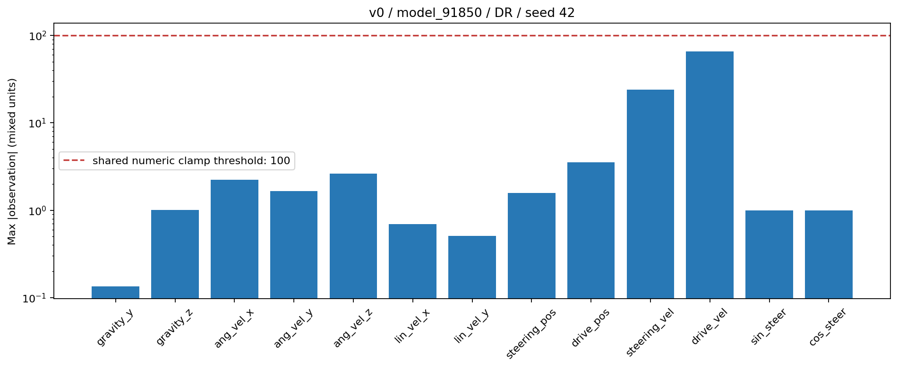

# V0 observation ±100 guard: one instrumented evaluation

Date: 2026-10-20. **No observation channel exceeded ±100 in this run.**
The guard and non-finite repair changed none of the recorded values.

## Evaluation

- Task: current `Trackstand-Balance-v0`, original13 observations and implicit actuators.
- Checkpoint: `2026-09-22_19-45-06/model_91850.pt`; source SHA256 is in the numerical summary.
- Full domain randomization enabled, seed42,64 environments x3,000 policy steps.
- Policy50Hz / physics400Hz; ordinary terminations, no `--pure_survival`.
- Deterministic Gaussian actor mean, observation normalization disabled, white noise retained.
- Standard unchanged `scripts/rsl_rl/play_eval.py` executed through a diagnostic wrapper.

This gives **192,000 policy-observation samples per channel**, or2,496,000 scalar
values across13 channels. The monitor also retained all3,004 ordinary observation
function calls, including setup/unused final observations:192,256 samples per
channel /2,499,328 scalar values. Both scopes have **zero values outside±100 and
zero NaN/Inf values**. All actual noisy policy-input channels also remain inside±100.

## Per-channel results

Maximum absolute values below are measured **before `nan_to_num` and the clamp**,
for observations actually used by the policy, including per-episode IMU bias
when enabled. They are not inferred from already-clipped observations.

| # | Observation | Unit | Maximum absolute pre-clamp value | Samples outside±100 |
| ---: | --- | --- | ---: | ---: |
| 1 | gravity_y | dimensionless | 0.134756 | 0 |
| 2 | gravity_z | dimensionless | 1.005912 | 0 |
| 3 | ang_vel_x | rad/s | 2.242180 | 0 |
| 4 | ang_vel_y | rad/s | 1.653020 | 0 |
| 5 | ang_vel_z | rad/s | 2.614164 | 0 |
| 6 | lin_vel_x | m/s | 0.696178 | 0 |
| 7 | lin_vel_y | m/s | 0.507984 | 0 |
| 8 | steering_pos | rad | 1.570826 | 0 |
| 9 | drive_pos | rad | 3.521434 | 0 |
| 10 | steering_vel | rad/s | 24.086283 | 0 |
| 11 | drive_vel | rad/s | **65.473000** | 0 |
| 12 | sin_steer | dimensionless | 1.000000 | 0 |
| 13 | cos_steer | dimensionless | 1.000000 | 0 |

The largest numeric magnitude is rear speed65.47299957rad/s. The gravity channels
include IMU-model bias and later noise, so their values need not stay strictly
within[-1,1]. This is unrelated to hitting the±100 guard.



The graph uses a logarithmic axis and mixed channel units; its purpose is to
compare each channel to the same numerical guard, not compare physical dimensions.

## Measurement integrity

The wrapper runs the **same observation function bytecode**, with a private
torch proxy that clones the argument to `nan_to_num` and the result of `clamp`,
then forwards the original operations unchanged. No extra observation-function
calls or random draws are introduced. The policy continues receiving the
original sanitized/clipped observations plus normal manager white noise.

Policy inputs are recorded at the actual inference call and linked to their
originating observation call. Noise-free channels6–13 match the corresponding
clamped values exactly. Independent saved-NPZ checks establish **raw == sanitized
== clamped for every entry**, not merely that clipped outputs are<=100.
The synthetic [monitor self-test](monitor_self_test.log) confirms detection of
+101/−102 and NaN/Inf while preserving exactly the original guard result and
excluding exact±100 boundaries.

[Source integrity](run/source_integrity.json): all116 protected runtime/script/
test/record/checkpoint files unchanged. Existing dirty v1 edits and both progress
records were preserved. The checkpoint is copied only into a temporary directory
so evaluator plots/eval.txt cannot overwrite the original training run; ordinary
evaluation outputs are then copied here and the temporary copy cleaned up.

Saved training YAML was compared with the effective configuration. Observation,
motor, reward, termination and DR parameters match after normalizing relocated
USD/noise-module paths. Pre-spawn metadata differences are environment count
4096→64, terrain count/spacing resolved at scene construction, unresolved prim/
spawn paths, video-recorder eye, temporary log path and the new explicit DR switch.
The agent differs only in the selected checkpoint path; `agent.max_iterations`
was set to the saved500,000. No task-source edits were needed for evaluation.

## Interpretation and limits

**For this checkpoint/seed/full-DR evaluation, the±100 clamp was inactive and
cannot explain its policy behavior.** This does not establish that100 is a
physically derived sensor limit or that removing the guard is safe during
unstable training, other checkpoints/seeds or more extreme states. Measurements
cover actual policy observation times, not all400-Hz physical states or discarded
pre-reset terminal states. V1 was not evaluated.

The standard evaluation completed129 episodes, mean27.38s, timeout58.9%, roll
RMS1.43°. Non-timeout terminations were yaw_deviation41.1%; fallen/diverged/
drifted/wheel_net were0%. The standard script's printed `fall_rate=0.411` is
the fraction of **all non-timeout terminations**, not a measured41.1% physical-fall rate.

## Artifacts and reproduction

- [Per-channel CSV](run/observation_ranges.csv) / [full numerical summary](run/observation_statistics.json).
- [Raw/sanitized/clamped/policy-input NPZ](run/observation_samples.npz).
- [Evaluation summary](run/eval.txt) / [complete run log](run.log).
- [Standard torque plot](run/torque_profile.png) / [torque samples](run/torque_profile.npz).
- [Effective environment](run/effective_env.yaml) / [agent configuration](run/effective_agent.yaml).
- [Instrumentation source](evaluate_observation_caps.py).

From `isaaclab_train/`, use a fresh output directory:

```bash
~/IsaacLab/_isaac_sim/python.sh -B \
  reports/20261020_v0_observation_caps/evaluate_observation_caps.py \
  --output /tmp/v0_observation_caps_fresh \
  --task Trackstand-Balance-v0 \
  --checkpoint logs/rsl_rl/trackstand_rl_rsl/2026-09-22_19-45-06/model_91850.pt \
  --num_envs 64 --num_steps 3000 --seed 42 --dr --headless --device cuda:0 \
  agent.max_iterations=500000
```
