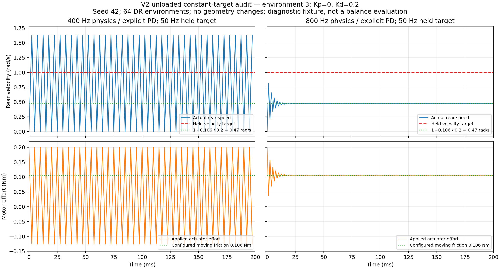

# Trackstand-Balance-v2 pretraining audit — 2026-10-27

**Recommendation: resolve the rear-loop numerical oscillation before a long training run.**
The task loads and PPO runs, and its core contracts pass. That does not establish
that the current 400 Hz explicit rear velocity controller is numerically suitable.
This audit found a repeatable constant-target oscillation, plus inherited wheel-net
bookkeeping and numerical-containment weaknesses. Production code was not changed.

## Findings, in priority order

### 1. High: the explicit rear velocity loop oscillates at 400 Hz when unloaded

An independent diagnostic used the actual v2 articulation and actuators, seed 42,
64 DR environments, fixed Kp=0/Kd=0.2, and a **constant 1 rad/s rear target** held at
50 Hz. All bodies were lifted to root z=3 m at runtime, with zero initial velocities.
The 0.2 s probe remained above 2 m, eliminating ground contact. Geometry, friction,
torque limits, mass/COM randomization, and controller gains were not edited.
Only physics/explicit-controller frequency and matching decimation changed between
the 400 and 800 Hz diagnostic configurations; policy target frequency stayed 50 Hz.

| Recorded quantity | 400 Hz | 800 Hz |
| --- | ---: | ---: |
| Maximum late peak-to-peak speed, across 64 envs | 1.629592 rad/s | 0.000001103 rad/s |
| Median late peak-to-peak speed | 1.346188 rad/s | 0.000000685 rad/s |
| Mean late absolute target error | 0.668590 rad/s | 0.530020 rad/s |
| Maximum applied torque | 0.20000005 Nm | 0.20000000 Nm |

For the matching worst-case environment, the last 20 samples at 400 Hz alternate
approximately **0 / 1.6296 rad/s**, while torque alternates **+0.2 / -0.1259 Nm**.
That is a 200 Hz oscillation under an unchanged target. Torque saturation is not
the explanation in this probe: the 6.28 Nm cap is never approached.
At 800 Hz, speed settles near **0.47 rad/s**, as expected from the configured
moving-friction model: `0.2 * (1 - 0.47) = 0.106 Nm`.



The native generalized mass matrices, sampled after physics applied the reset
randomization, imply unloaded effective rear inertia
`J_eff = 1 / (M^-1)[rear,rear]` of approximately **0.00014421–0.00021464 kg m²**.
For a reduced scalar explicit velocity loop, perturbations have pole
`1 - dt * Kd / J_eff`. The measured matrices give:

- 400 Hz: approximately **-2.467 to -1.329**; all 64 exceed unit magnitude.
- 800 Hz: approximately **-0.734 to -0.165**; all 64 are within unit magnitude.

This simplified calculation supports the recorded timestep sensitivity; it is
not an exact replacement for the full articulated PhysX/contact/friction solver.
The corresponding worst-case scalar stability threshold is about **694 Hz**.
The controlled replay demonstrates the problem without a learned policy or
changing policy targets. It does not prove the grounded bike is unstable in every
state, or that the real motor has the same response.

**Recommended next step:** validate 800 Hz or a smaller timestep with the existing
gains, 50 Hz policy, fixed targets, and then grounded DR evaluation; alternatively
use a suitably validated controller integration/substep implementation. Do not
invent armature or change measured inertia to mask the issue. A higher simulated
internal controller rate does not require the Pi to send MIT packets at that rate;
hardware internal-loop behavior remains a separate validation task.

Evidence: [400 Hz summary](rear_stability_400/summary.json),
[800 Hz summary](rear_stability_800/summary.json), their substep captures/run logs,
[probe source](audit_rear_stability.py), [plot source](plot_rear_stability.py).

### 2. Medium: wheel-net termination is delayed and uses a coarse integral

Inherited [environment step](../../source/trackstand_rl/trackstand_rl/tasks/manager_based/trackstand/trackstand_bike/trackstand_rl_env.py:44)
calls the parent physics/termination/reset step first, then adds
`last_rear_speed * 0.02` to wheel_net_angle. Thus the termination reads the previous
policy step's value, and the integral uses only the final speed rather than all
eight physics samples or continuous unwrapped angle increments.

The live 64-environment probes verified the delay:

| Boundary stimulus | No DR | DR |
| --- | ---: | ---: |
| Initial wheel-net angle | 7.19 rad | 7.19 rad |
| Integrated angle after first step | 7.513362 rad | 8.276897 rad |
| First-step wheel-net termination | False | False |
| Following-step wheel-net termination | True | True |

The boundary stimulus used an initial rear speed and target of 20 rad/s. During
the separate 256-step random-target stress runs, the absolute error between one
policy-step accumulator increment and the actual native angle increment reached
**0.434113 rad without DR / 1.543316 rad with DR**; RMS errors were
**0.082139 / 0.526721 rad**. Reset samples were excluded. Native angle differences
were resolved on the installed PhysX 4pi branch; each one-step motion is small
enough to identify its branch in these captures.

These are aggressive synthetic actions, not a trained-policy error distribution.
The explicit rear-loop oscillation can increase the coarse-integral error, so the
two findings should not be interpreted as independent causes of the same error.
Nevertheless, integration order/sampling is an inherited bookkeeping weakness.
Integrate at physics rate before termination evaluation, or maintain a correctly
unwrapped per-episode angle there. Preserve failure and timeout reset handling.

Evidence: [nominal live summary](no_dr/summary.json), [DR live summary](dr/summary.json),
their wheel_net_boundary_probe.json files and capture.npz increment-error arrays.

### 3. Medium: non-finite containment does not directly cover positions

The inherited [divergence check](../../source/trackstand_rl/trackstand_rl/tasks/manager_based/trackstand/mdp/stationary/terminations.py:81)
checks body/joint velocities, but does not directly test root position, root
quaternion, or joint position. A CPU mock with **NaN root position, valid identity
quaternion, and finite zero velocities** returns diverged=False; the active drift
reward then returns NaN. Sanitizing observations alone cannot protect PPO rewards.

This is a demonstrated coverage gap, **not a live simulation NaN observed in this
audit**. A non-finite quaternion may also be caught indirectly through non-finite
derived body-frame velocities; the finding does not claim that it always escapes.
Add explicit finite-pose/joint-state containment and ensure non-finite rewards
cannot be submitted to PPO. The exact handling should preserve v0/v1 if changed
only for v2.

Evidence: [CPU probe source](audit_cpu.py), [CPU results](cpu_summary.json).

### 4. Low: --arp_w does not override the active reward term

[train.py](../../scripts/rsl_rl/train.py:154) maps --arp_w to action_rate, but v2's
active term is named rate_penalty. The helper warns and skips a missing term.
The ordinary training command still uses the correct configured **0.1** weight;
this bug matters when requesting an override. Repair the name mapping before
using that flag. No CLI or shared-task code was edited in this audit.

### 5. Known test maintenance issue

The full Trackstand suite ran **56 test methods**, with **two failing subcases of
one unchanged legacy v0/v1 comparison**. It omits the intended rear
viscous_friction change from None to 0.0. All **13 v2 tests passed**. The same
legacy failures were previously reproduced without the new v2 task; see the
[isolated baseline log](../20261027_v2_velocity_control/baseline_beta_tests.log).
The full suite is not represented as entirely passing.

## Contracts verified

| Area | Current v2 behavior and evidence |
| --- | --- |
| Registration | Independent v2 config, inherited v1 environment bookkeeping, Beta runner; separate trackstand_rl_v2_rsl logs. |
| Observations | 11 channels: gravity Y/Z, body gyro XYZ, steering/rear native angles, steering/rear speeds, sin/cos steering. No linear velocity terms. |
| Math/units | xyzw root quaternion; independently constructed rotation matrix matches live pre-noise observations within 9.54e-7. Gravity is dimensionless; joint angles rad and velocities rad/s. Literal positive/negative roll CPU probes verify gravity signs. |
| Observation processing | No finite +-100 clamp, no observation-manager clipping/scaling/history or actor normalization. NaN/Inf observation entries become zero. No added +-pi rear-angle wrap; simulator-native branch remains. |
| Sensor model | Episode-constant biases only with DR; measured white-noise std matches configured .001 gravity / .0012 gyro. Other six channels have no added noise; white noise also remains without DR. |
| Policy | Two bounded Beta actions; four internal shape outputs. Initial mean zero, raw std .4774755. Actor/critic [32,32], ELU, RSL-RL 5.0.1. Wrapper clip_actions=None. |
| Frequency | Per normal step: one observation, one action processing, eight computes per motor; policy 50 Hz, physics/explicit PD 400 Hz. Reset-time staging writes are counted separately. |
| Steering | raw *1.57 -> +-1.57 clip -> +-.478 rad per 20 ms slew -> held target -> IdealPD 10*(target-q)-.2*qdot -> +-5.6 Nm. Target velocity and feedforward are zero. |
| Rear | raw *61.6 -> +-61.6 rad/s clip -> held target -> .2*(target-speed) -> +-6.28 Nm; Kp and feedforward zero. No extra rear slew or default-speed offset. |
| Passive losses | Steering Coulomb/static .046036056104 Nm, viscous .000910713492 Nm s/rad; rear Coulomb/static .106 Nm, viscous zero. Static values remain provisional. Native PhysX controller gains are zero, avoiding duplicate PD. |
| DR | Gain event absent; steering 10/.2 and rear 0/.2 remain fixed through resets. Other mass/inertia, COM, contact-material, initial-state and IMU-bias terms remain active only as configured. |
| Rewards | dt*(5*alive + 2*exp(-distance²/(2*.25²)) - .1*norm(raw_action-prev_raw_action)); independently matched before every reset. Equal normalized action-rate weights. |
| Terminations | All six forced causes verified: 30 s timeout, lateral lean/inversion, divergence, .5 m drift, 30 deg yaw deviation, 7.2 rad wheel net. Lean rule uses projected gravity, not an arbitrary 3D tilt cone. |
| Resets | Failure and timeout both clear wheel net; refresh spawn yaw; restore joint positions and speeds to zero; prime steering target. Post-reset observations use fresh raw pose. No retained previous-episode steering target is applied on the next physics step. |
| PPO bootstrapping | is_finite_horizon=False; wrapper passes time_outs to the standard RSL-RL timeout-bootstrap path. |

The 256-step live stress run per mode used 64 environments, with **622 nominal /
896 DR automatic resets**. All six forced termination cases and their resets
also passed. Each mode performed 259 normal steps including boundary probes,
2,072 physics controller updates, and two additional explicit reset-time staging
writes per controller. No live non-finite observations/rewards were observed.

## Limits and interpretation

Targets and effort caps were enforced, but solver state limits were soft. The
stress runs recorded substep speed maxima **24.8338 / 27.6941 rad/s steering** and
**62.0294 / 84.8441 rad/s rear** (nominal / DR). These maxima exclude the deliberate
out-of-envelope termination stimuli. Including those stimuli gives a rear DR
maximum of **158.2769 rad/s**; the divergence stimulus starts the root at 30 m/s,
so that number must not be attributed to ordinary policy operation.
Within the bounded-action stress capture, the returned observation rear-speed
maximum was **64.7605 rad/s**, below the recorded substep maximum; none of the
recorded policy observations exceeded 100 rad/s.
This illustrates why only inspecting 50 Hz observations can miss faster motor
oscillation. The unloaded comparison establishes timestep sensitivity of the
velocity loop; it does not attribute every grounded stress spike to that loop.

IdealPD still uses constant effort caps, not a calibrated torque-speed envelope,
current-loop delay, peak-torque duration, battery sag or thermal model. Removing
gain DR makes gains repeatable; it does not establish exact real-motor tracking.
Static friction thresholds and IMU residual-bias spreads remain estimates.

Initial exploration is intentionally broad: a 100,000-sample initial Beta probe
has rear target std **29.4125 rad/s**; **34.864%** would request clipped torque
from rest. This is an exploration property, not an out-of-range raw-action bug.
No exploration setting was changed.

## Actual training entry-point smoke test

The real Hydra/CLI train.py completed **three PPO iterations, 64 environments,
seed 42, --dr**, totaling **3,072 transitions**. Value losses were
**0.9698 / 0.5378 / 0.3842**, all finite. It saved a Beta checkpoint and config
with 11 observations, fixed gains, gain DR=None, raw action-rate weight .1 and
clip_actions=None. This proves the command path runs; it does not resolve the
numerical findings or establish trained balancing performance.

All trial artifacts are isolated in [cli_training/](cli_training/), outside the
normal training log namespace. **model_0.pt/model_2.pt there are smoke-test
artifacts, not trained policies recommended for evaluation or deployment.**
The configured production defaults remain 4,096 environments and 15,000
iterations. Existing checkpoints were not loaded, resumed or modified.

## Reproduction and artifacts

From repository root, use a fresh --output directory:

```bash
~/IsaacLab/_isaac_sim/python.sh -B isaaclab_train/reports/20261027_v2_pretraining_audit/audit_cpu.py
~/IsaacLab/_isaac_sim/python.sh -B isaaclab_train/reports/20261027_v2_pretraining_audit/audit_live.py \
  --headless --device cuda:0 --output /tmp/v2_audit_nominal
~/IsaacLab/_isaac_sim/python.sh -B isaaclab_train/reports/20261027_v2_pretraining_audit/audit_live.py \
  --headless --device cuda:0 --dr --output /tmp/v2_audit_dr
~/IsaacLab/_isaac_sim/python.sh -B isaaclab_train/reports/20261027_v2_pretraining_audit/audit_rear_stability.py \
  --headless --device cuda:0 --physics_hz 400 --output /tmp/v2_rear_probe_400
~/IsaacLab/_isaac_sim/python.sh -B isaaclab_train/reports/20261027_v2_pretraining_audit/audit_rear_stability.py \
  --headless --device cuda:0 --physics_hz 800 --output /tmp/v2_rear_probe_800
```

Full CPU suite: [unit_tests.log](unit_tests.log); additional evaluation-option
tests: [evaluation_tests.log](evaluation_tests.log); focused probes and four CLI
tests: [cpu_probes.log](cpu_probes.log); real training: [cli_training.log](cli_training.log).
The summaries include exact GPU command arguments and native NPZ captures.
[verification.json](verification.json) records preservation and artifact checks.

harness_attempts/ preserves corrected diagnostic attempts: JSON serialization
of slice objects; overly strict reset-time buffer matching when no physics step
occurs; an insufficient speed stimulus to cross the wheel-net boundary; and
pre-step cached mass matrices superseded by native post-step samples; and early
summaries superseded by maxima separated between stress and forced stimuli. These are
audit-harness corrections, not production fixes or additional successful tests.

All **75 protected Python source/test/script and root progress-ledger files**
remained byte-identical during this audit. V0/v1, model geometry, controller gains,
production frequencies, MuJoCo, deployment, and existing training runs were not
edited. Only this new audit directory and its isolated trial outputs were added.
