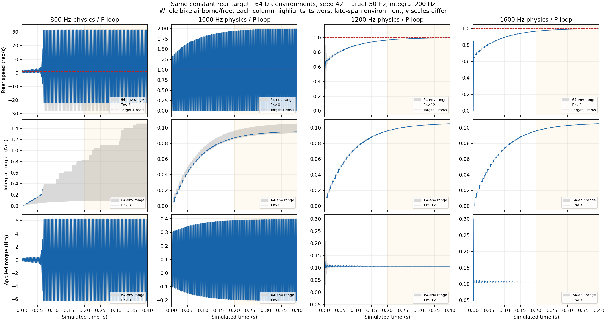

# V2 PI physics-rate sweep: 800 / 1000 / 1200 Hz

**1200 Hz is the lowest tested rate that tracks cleanly across this 64-environment
DR probe.** 800 Hz is strongly oscillatory; 1000 Hz still has several oscillatory
environments. 1200 and the previously tested 1600 Hz perform essentially alike
on the constant 1-rad/s target. The task default remains **1600 Hz**; this sweep
does not edit training/controller configuration.

## Conditions and scope

- Reused the unchanged [live validator](../validate_live.py), rear velocity P
  **0.30 Nm/(rad/s)**, external Ki **3.3 Nm/rad**, torque cap **±6.28 Nm**.
- **64 environments, seed 42, DR enabled** for each new 800/1000/1200-Hz case.
  Identical configured randomization and seed; the captures do not independently
  record every sampled DR parameter to certify draw-by-draw identity.
- Policy/action processing stays **50 Hz**, I updates **200 Hz**. Physics and
  IdealPD P evaluation alone change. Policy decimation is 16/20/24 for the three
  new rates; I decimation is 4/5/6.
- Entire bicycle starts upright at root z=3 m, all body/joint velocities zero,
  and is **free to fall/move under gravity**, without a fixed frame or ground
  contact. Geometry, inertia and passive friction are retained. Root height is
  checked above 2 m after **0.4 simulated seconds**.
- Rear target is exactly **1 rad/s**, steering target 0. This is a prescribed
  constant action, **not neural policy inference or a balancing evaluation**.
- Late metrics below use **[0.2, 0.4) s**. Mean absolute error averages time and
  all 64 environments. Maximum span is the largest within-environment late
  speed maximum-minus-minimum. At successful rates, the small span includes
  remaining settling and must not all be called steady-state oscillation.
- Each run additionally performs **100 grounded random-action policy steps**,
  automatic-reset checks, a selected-environment reset and a forced timeout.
  These validate command/reset contracts, not policy survival performance.

## Results

| Physics / P rate | Mean late absolute speed error, rad/s | Maximum late speed span, rad/s | Environments with late span >0.1 rad/s | Interpretation |
|---:|---:|---:|---:|---|
| 400 Hz, previous | 43.90504 | 107.92946 | 64/64 | Severe numerical oscillation |
| **800 Hz, new** | **10.78213** | **53.69592** | **44/64** | Still strongly oscillatory |
| **1000 Hz, new** | **0.07462** | **1.99491** | **4/64** | Most track, several retain substantial oscillation |
| **1200 Hz, new** | **0.01293** | **0.03113** | **0/64** | Close tracking throughout this sample |
| 1600 Hz, previous | 0.01303 | 0.03113 | 0/64 | Essentially the same tracking as 1200 Hz |

The 0.1-rad/s span cutoff is an explicit descriptive comparison measure, **not**
a physical limit, a new abort threshold or a universal mathematical stability
test. No test is stopped for crossing it.

Direct samples corroborate the problematic cases:

- At **800 Hz**, worst-span environment 3 ends alternating between approximately
  **−22.29 and +31.41 rad/s**. Applied torque alternates **+6.28 / −6.28 Nm**,
  even though the target never changes.
- At **1000 Hz**, worst-span environment 0 ends alternating between approximately
  **0 and 1.995 rad/s**, with torque about **+0.395 / −0.204 Nm**. It does not
  approach the 6.28-Nm cap, so torque saturation is not necessary for this
  remaining timestep artifact.
- At **1200 Hz**, maximum applied torque is **0.3000 Nm** and maximum absolute
  I is **0.105081 Nm**. At 1600 Hz those are **0.3000 / 0.105010 Nm**. The I
  value is consistent with compensation for the modeled moving friction.

An additional **1200-Hz nominal/no-DR** run also passes: mean late absolute error
**0.013104 rad/s**, maximum span **0.031074 rad/s**, peak applied torque
**0.3000 Nm**, peak I **0.105014 Nm**. The corresponding prior 1600-Hz nominal
values were **0.013100 rad/s / 0.031069 rad/s**.



[Vector figure](pi_rate_comparison.svg) · [PDF](pi_rate_comparison.pdf).
Each column highlights the environment with that rate's largest late speed span;
the grey range covers all 64 environments. Columns can therefore highlight
different environment IDs, explicitly labelled. Curves are raw samples without
smoothing/time shifts. Axes use independent vertical scales for readability.

## Contract checks and preserved state

All four new runs complete the actual IdealPD P+I/clipping, finite-observation/
reward, automatic-I-reset, partial-reset and timeout-reset assertions. Grounded
random-action reset counts are **331 / 325 / 334** for 800/1000/1200-Hz DR and
**229** for 1200-Hz nominal. Those counts are not learned survival scores.

[analyze.py](analyze.py) independently recomputes late metrics, verifies every
captured applied torque against `clip(0.30*(1-speed)+I, ±6.28)`, and verifies I
is held between its 200-Hz updates. It exports each rate's worst-environment raw
trace, [comparison.csv](comparison.csv), [comparison.json](comparison.json), and
[verification.json](verification.json). Minor final-digit differences from saved
single-precision summary reductions are floating-point roundoff.

The original 400/1600-Hz captures, validator, PI/configuration code, deployment
experiment, progress records, and other protected files remain unchanged.
[preservation_before.json](preservation_before.json) contains 23 pre-existing
file hashes; the analysis verifies them. No fresh policy evaluation, training,
firmware setting or CAN operation occurs. All new artifacts stay in this folder.
Git HEAD advanced concurrently from `c7ff96d` to `61f439e`; all 23 protected
file hashes still match. This task issued no Git staging, commit or reset.

## Conclusion and next choice

For this probe, **1200 Hz provides the tested tracking quality of 1600 Hz with
24 instead of 32 physics steps per policy update**, or 25% fewer physics steps.
Actual training wall-clock speedup was not measured. The true minimum stable
frequency is not identified; untested intermediate rates may also work.

1200 Hz is the better lower-rate candidate from these tests. This short,
free-falling constant-target probe does not guarantee every velocity waveform,
loaded contact state, DR draw or learned policy. Neither result establishes the
motor's internal-loop rate or requires the Pi to transmit at 1200 Hz. Policy
and host I remain 50/200 Hz. **No default frequency was changed in this task.**

## Reproduce

From repository root, use a new output directory for each rate:

```bash
~/IsaacLab/_isaac_sim/python.sh -B \
  isaaclab_train/reports/20261102_v2_external_pi/validate_live.py \
  --headless --device cuda:0 --physics-hz 800 --dr --output /tmp/v2_pi_800_new
```

Repeat with `--physics-hz 1000` and `1200`, using separate output directories.
Omit `--dr` for the extra nominal check. The validator overrides frequency only
for that process. The default task configuration is not edited.
