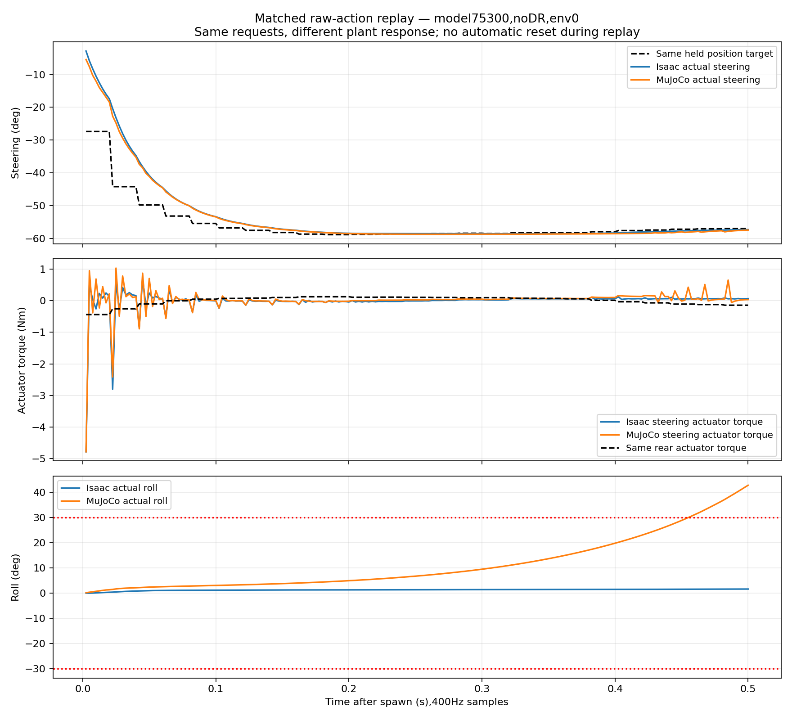

# Trackstand-Balance-v1 / MuJoCo alignment — 2026-10-22

## Outcome and scope

The old v0/NewBike runtime has been replaced by the current v1 **task-side
contract**. Viewer and evaluator now use 11 observations, deterministic bounded
Beta means, the same command ordering/timing, measured passive joint losses,
all six terminations, v1 rewards and corrected episode bookkeeping.

**This does not establish identical simulator dynamics or successful transfer.**
The final model75300 evaluations still fail rapidly in nominal MuJoCo. Native
PhysX/MuJoCo contact, velocity-constraint and some rigid-body behaviors remain
different; those are explicitly listed below, not silently declared fixed.

The reference is current on-disk **Trackstand-Balance-v1**, not the older v0
configuration. The [complete pre-change comparison](COMPARISON.md) covers
observations, actions, every motor setting, scheduling, resets, all task terms,
DR sampling, collision filtering, inference/export and evaluation/reporting.
No verified XML/USD geometry, meshes, mass/inertia tensors or joint axes were
retuned. Isaac task/runtime code and the real-bike deployment were not changed.

## Main corrections

- **Policy and observations:** remove linear XY velocities; repair nonfinite
  values before white noise, with no finite±100 clamp. Correct PT inference:
  four shape logits→softplus+1→two Beta means. Reject13-input Gaussian
  checkpoints instead of treating logits or v0 actions as valid v1 outputs.
- **Rear angle:** remove the unsupported±π adapter. A new live v1 probe confirms
  crossings through±π and a **4π-period branch with jumps near±2π**, in both
  directions. The adapter affects only the policy observation; MuJoCo's physical
  hinge coordinate and the separate wheel-net accumulator are not conflated.
- **Motors:** explicit steering PD at400Hz, then±5.6Nm; rear pure feedforward
  torque at400Hz, then±6.28Nm; no rear−.05*qdot. Steering clip±1.57rad and
  slew23.9rad/s update **once at50Hz**, not eight times. Separate native joint
  losses: steering friction.046036056104Nm/B.000910713492Nms/rad; rear
  friction.106Nm/B0. Equal static/moving thresholds remain provisional as in v1.
- **Episode contract:** rootz−.016m, zero joints, fresh targets/actions/yaw/wheel
  state after failure **or timeout**. Restore six independent termination flags
  and the exact three-term dt-weighted reward. Preserve the wheel-net term's
  existing one-policy-step integration lag deliberately.
- **DR:** shared32-bucket material bank, physical-body-only mass/inertia draws,
  noncompounding defaults and refreshed MuJoCo model constants. Convert the
  shared Isaac-local CoM offset into each rotated CAD body frame. Rear gains
  stay zero. Preserve IMU bias/white-noise ordering and avoid unused extra
  terminal noise draws before automatic resets.
- **Root velocity semantics:** installed Isaac `write_root_velocity_to_sim_index`
  writes **COM** velocity; its `root_lin_vel_b` alias also reads COM velocity.
  MuJoCo's free-joint linear velocity is at the origin. DR resets now use
  `v_origin=−omega_world×(COM−origin)` so initial COM velocity is zero; the
  divergence guard uses the same COM convention.
- **Runtime integrity:** in-memory model augmentation, no hidden XML writes;
  disable robot self-collisions without removing floor contacts. Ground1/tire.65
  matches the configured individual coefficients; tire priority makes MuJoCo's
  effective pair equal the tire, equivalent to PhysX min(1,tire) for these ranges.
  Independent model/data/RNG per bike; a randomized env0 cannot become the
  nominal DR baseline of newly cloned bikes.
- **Tools/docs:** common viewer/headless implementation, relocatable75300
  default, working horizon flag, accurate global maxima/step-weighted means,
  overlapping term counts, cumulative torque-plot time axis, raw capture and
  non-overwriting output names. Root/component documentation updated; the
  original component README is preserved in ../../docs/LEGACY_NEWBIKE.md.

## Verification

| Check | Result |
|---|---|
| System Python suite | 45 tests;39 passed,6 Isaac-only tests skipped |
| Isaac Python suite | 45 tests;44 passed,ONNX Runtime-only test skipped |
| Combined coverage | Every one of the45 tests executed successfully in at least one interpreter |
| Actual task-function comparison | 1,000 matched states: real v1 observation function; real reward/termination functions and resolved nominal/DR configurations |
| Actual Beta mapping | Exact equality with v1 `BetaMean` on1,024 actor inputs |
| ONNX export | Existing exporter, original75300; ONNX checker passes; reference-evaluator error5.96e−8 |
| ONNX Runtime vs PT | Maximum error3.5762787e−7 on1,024 random11-input samples; bounded outputs |
| Native angle / link-frame probe | Actual headless GPU v1, direct states plus2,400physics steps of continuous±rotation |
| Full MuJoCo evaluation | Each mode64env×3,000policy steps, seed42,50/400Hz, default six terminations |
| Capture checks | Per mode192,000policy frames and1,536,000physics frames/motor; finite inputs/actions/rewards/torques; reconstructed slew and rear torque pass |
| Original-file preservation | 144 protected files unchanged; hashes in protected_files.json |

Logs: [system tests](unit_tests_system.log), [Isaac tests](unit_tests_isaac.log),
[GPU probe](isaac_angle_probe.log), [export](export.log),
[numeric validation](validation_results.json).
Ruff/Black were not installed; Python syntax, whitespace and120-column checks
were performed. No real GUI interaction/hardware/CAN or new training was run.

### Probe limits

[isaac_angle_probe.json](isaac_angle_probe.json) retains every measured value.
Writes±3.5 remain±3.5;6.293185 reads−6.273186 after physics;−6.293185 reads
+6.273186. Continuous rotation crosses the±2π branch twice in each direction.
V1's zero-joint body orientations are identity within float precision, validating
the CoM-frame conversion rather than assuming CAD body frames are identical.

An extreme manual100-rad state injection returned0, not the ordinary modulo
value. That anomaly is preserved and **not** presented as a globally certified
coordinate formula. It does not invalidate the observed normal continuous
crossings, but arbitrary extreme state injection is outside the proven adapter.

## Final learned-policy results

Both modes use the **same no-DR-trained**75300 checkpoint,
SHA256`04729b3f49c5167ac6886f72a5a5efa4b79531873851bf18bacc0b1c386388b4`.
No mode selects the separate October21 DR training run. Exact captures and
invocations are in [no_dr/](no_dr/) and [dr/](dr/); full terminal logs are
[no_dr_run.log](no_dr_run.log) / [dr_run.log](dr_run.log).

| Platform/condition | Completed episodes | Mean episode(s) | Timeouts |
|---|---:|---:|---:|
| Saved Isaac75300 nominal evaluation | 128 | 30.000 | 128/128=100% |
| Current MuJoCo nominal | 15,721 | 0.243831 | 0/15,721 |
| Current MuJoCo fullDR | 3,185 | 0.976873 | 46/3,185=1.44427% |

All nominal MuJoCo completions fire fallen; length range.20–.30s. DR has2,576
fallen activations and584 yaw activations; flags can overlap, so their sum is
not an exclusive death count. Incomplete final episodes are excluded. Both
MuJoCo modes observe only bounded raw actions. Peak applied steering/rear motor
torque: **5.6/3.793589Nm** nominal, **5.6/4.545480Nm** DR. Reconstructed held
steering targets match exactly; no captured motor command exceeds its effort
cap. Passing those contracts is **not** evidence that the policy transfers.

The saved Isaac nominal evaluation is existing evidence, not a new full Isaac
policy evaluation in this turn. MuJoCo metrics include terminal states before
caller reset; some older Isaac summary metrics sample after automatic reset.
Episode survival definitions match, but do not treat every reported roll/speed
aggregate as an identically sampled cross-platform benchmark.

### Matched-action plant check



[NPZ](matched_action_replay.npz), [SVG](matched_action_replay.svg),
[PDF](matched_action_replay.pdf). Replay the saved Isaac env0 first25raw actions
into MuJoCo, starting upright at the same root height, with **no automatic reset
for this .5s diagnostic**. This is an open-loop fixed-action replay, not another
closed-loop survival evaluation.

- Maximum held-target difference: **1.4781952e−8rad**.
- Rear motor command difference: **exactly0Nm**.
- First physics-step steering torque: Isaac−4.779999733 / MuJoCo−4.780000000Nm.
- First steering position after2.5ms: Isaac−.049271632 / MuJoCo−.094486341rad.
- Peak roll during the same .5s action replay: Isaac1.615310° / MuJoCo42.736010°.

Thus a different *plant/constraint response* remains even with the same
requests. Steering feedback torques subsequently differ because the measured
states differ. This does not isolate one contact parameter, prove a geometry
defect, or prove the entire remaining gap belongs to a single engine feature.

## What is not identical and was not invented

1. **Speed constraints:** PhysX has soft solver limits23.9/61.6rad/s and measured
   overshoot. MuJoCo has no corresponding native joint-velocity-limit field.
   Default `project` is the previous hard qvel projection **after** each step;
   position has already advanced, so this is neither a consistent PhysX impulse
   nor a guarantee `abs(delta_q)<=limit*dt`. `--velocity_limit_mode none` removes
   it for diagnostics, but then omits the speed constraint. Neither is claimed
   exact. A calibrated/custom constraint implementation is unresolved.
2. **Contact friction:** MuJoCo has one contact sliding coefficient. DR samples
   both PhysX-style static/dynamic values, retaining both in runtime `env.dr`, but only static
   defines the MuJoCo friction cone. Static→dynamic behavior is not implemented
   by a guessed speed threshold. Nominal coefficients.65/.65 match numerically.
   These captures do not persist the per-episode material-draw history. The
   metadata limitation text was corrected from “archived only” to this explicit
   runtime-only meaning; no arrays, episode measurements or outcomes changed.
3. **Contact/integration:** PhysX TGS/SDF versus existing MuJoCo mesh/solver
   behavior, passive-friction solve, stabilization and penetration recovery are
   not numerically equivalent. Solver iteration counts are not interchangeable.
4. **Rigid-body defaults:** live USD root PhysxRigidBodyAPI resolves angular
   damping.050000000745, linear damping0 and max-depenetration velocity1.
   Child links have no applied API and return no authored values. Their native
   defaults and exact solver treatment were not established; no guessed losses
   were folded into motor Kd or the measured passive-friction coefficients.
5. **Precision/RNG and API:** MuJoCo double state vs Torch/PhysX float32;
   independent NumPy vs Torch streams. Same seed is not identical random draws.
   The small MuJoCo API leaves reset to its caller, retaining terminal telemetry;
   caller logic delivers a fresh post-reset observation before the next policy.

The goal “every smallest aspect identical” cannot honestly be certified with
two different backends and the verified models kept fixed. Task/control
differences with a known mapping were corrected; the above residuals remain
visible rather than being hidden by arbitrary gains, inertia scaling, artificial
stabilization, motor-envelope assumptions or deleting failing termination terms.
Next useful work is controlled engine/constraint/contact-response identification,
not another unsupported real-bike attempt based on these software fixes alone.

## Reproduction and artifacts

From repository root:

```bash
python3 -B -m unittest discover -s mujoco_sim2sim/tests -v
~/IsaacLab/_isaac_sim/python.sh -B -m unittest discover -s mujoco_sim2sim/tests -v
python3 -B mujoco_sim2sim/scripts/run_deploy_eval.py \
  --num_envs 64 --num_steps 3000 --seed 42 --output_dir /tmp/v1_mujoco_fresh_no_dr
python3 -B mujoco_sim2sim/scripts/run_deploy_eval.py \
  --num_envs 64 --num_steps 3000 --seed 42 --dr --output_dir /tmp/v1_mujoco_fresh_dr
```

GUI: `cd mujoco_sim2sim && python3 scripts/run_deploy_viewer.py --num_envs 64 --seed 42`.
Both defaults select75300; supply `--pt`/`--onnx` for another v1 policy. Checkpoints
are not assumed present in every clone. No v0 artifact is overwritten.

`analyze.py` validates the final captures and regenerates the replay/validation
files; it is report-local, not production control. `probe_isaac_angle.py` is an
isolated GPU experiment with gravity/gains/losses disabled only in its temporary
configuration. It saves real engine angle/link-frame/default evidence and does
not edit the training task. Export artifacts model_75300_v1.onnx/.onnx.data are
verification copies, not a change to the Raspberry Pi's selected policy.

Only final captures are retained here (about90MiB). Intermediate runs generated
during this task were moved, not deleted, to
`/tmp/trackstand_v1_alignment_intermediate.qYK72K/`; they are recoverable while
that temporary directory exists and are not the authoritative final results.
Original ledgers, checkpoints, earlier reports and staged user work were preserved.

## Source references

- [v1 configuration](../../../isaaclab_train/source/trackstand_rl/trackstand_rl/tasks/manager_based/trackstand/trackstand_bike/trackstand_rl_env_cfg_v1.py)
  and inherited v0 scene/events/termination configuration.
- [Observations](../../../isaaclab_train/source/trackstand_rl/trackstand_rl/tasks/manager_based/trackstand/mdp/stationary/observations.py),
  [steering action](../../../isaaclab_train/source/trackstand_rl/trackstand_rl/tasks/manager_based/trackstand/mdp/stationary/actions.py),
  [episode bookkeeping](../../../isaaclab_train/source/trackstand_rl/trackstand_rl/tasks/manager_based/trackstand/trackstand_bike/trackstand_rl_env.py).
- [MuJoCo runtime](../../src/newbike_mujoco/env.py), [policy](../../src/newbike_mujoco/policy.py),
  [model augmentation](../../src/newbike_mujoco/model.py), [contract constants](../../src/newbike_mujoco/contract.py).
- Installed Isaac `actuator_pd.py`, `manager_based_rl_env.py`, `events.py`,
  `articulation.py`, `base_articulation_data.py`: post-PD clipping, actual reset
  order, DR and COM-velocity aliases, not inferred from old task comments.
- Official [MuJoCo joint attributes](https://mujoco.readthedocs.io/en/stable/XMLreference.html#body-joint),
  [friction loss](https://mujoco.readthedocs.io/en/stable/computation.html#friction-loss),
  [simulation pipeline](https://mujoco.readthedocs.io/en/stable/programming/simulation.html#simulation-loop).
- Root progress_record.md §§94–107 and139–158 / progress_record.txt, including
  the correction to historical±π comments and measured-friction limitations.
