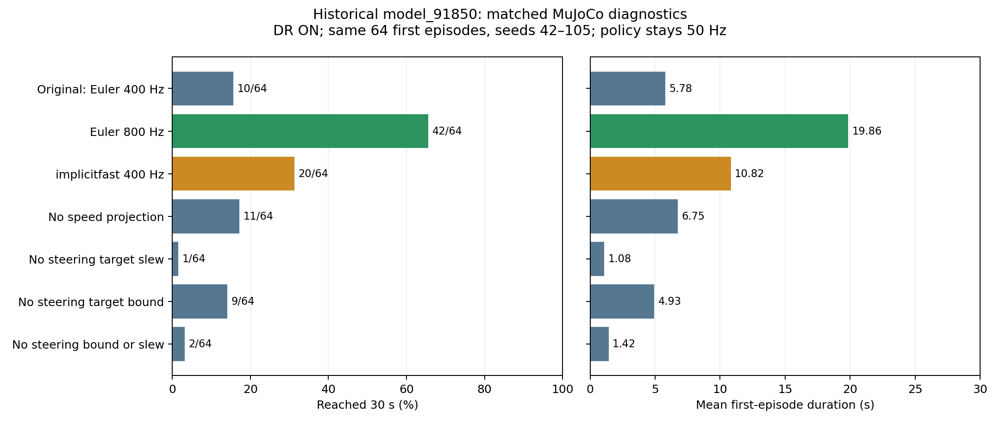
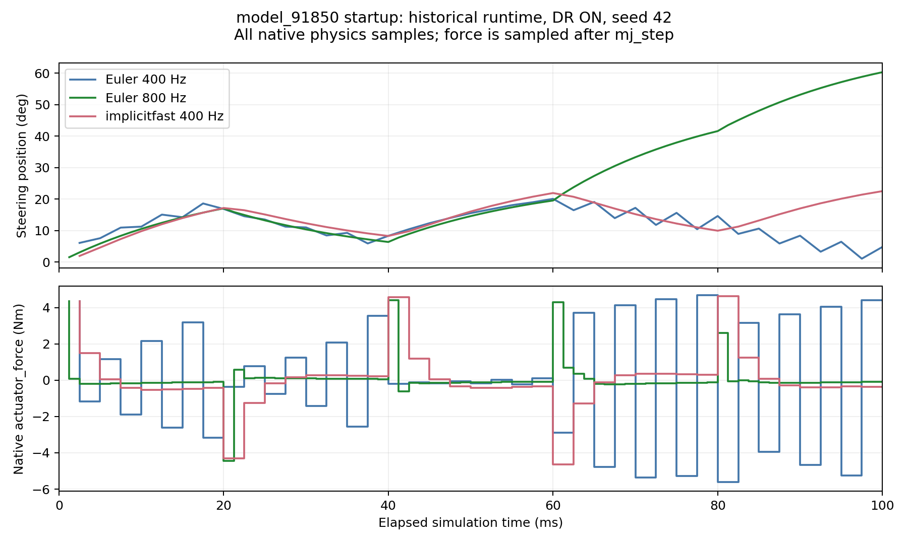

# Why the first model_91850 MuJoCo histogram failed

Audit date: 2026-10-29. This report reconstructs the **October 15 v0 / Gaussian
91850** run. It does not substitute current v1/v2 controllers or the later Beta
2500/75300 policies for the policy that made the original histogram.

**Strongest supported explanation:** the learned controller faced different
actuator processing and different discrete motor/contact dynamics in MuJoCo.
Fresh tests on the actual historical loader show a particularly large timestep
effect. The evidence does not identify one exclusive cause, prove perfect
cross-engine equivalence, or establish a real-bike control frequency requirement.

## 1. Identify and verify the original graph

- [Original histogram](../../logs/202610151708_91850_dr_epi_len_histogram.png)
- [Original bin counts](../../logs/202610151708_91850_dr_epi_len_histogram.csv)
- [Original summary](../../logs/202610151708_91850_dr_summary.log)
- Original raw torque/reset archive: `../../logs/202610151708_91850_dr_torque.npz`.

The labeled graph contains **6,057 completed episodes**, model_91850, DR ON:
**4,510 / 6,057 = 74.4593%** ended before 3 seconds. Reconstructing every episode
from the archive's **1-based** reset events gives exactly the published ten bins:

`4510, 281, 111, 72, 64, 32, 36, 22, 18, 911`.

There are **891 exact 30-second timeouts = 14.7103%**, not 911. The last bin also
contains 20 late falls. The exact mean is **6.0040449 s**. See
[reconstruction](original_histogram_reconstruction.json) and
[all reconstructed episodes](original_episodes.json).

Earlier unlabeled prototype graphs also exist. The 16:29 prototype has 7,281
episodes, 2,398 in the first bin, and no saved model/DR label. Its source policy
must not be inferred. This report concerns the labeled 17:08 graph matching the
description that most episodes occupy 0–3 s.

Histogram samples are episodes across 64 respawning seed streams, not 6,057
independent bicycles. Fast-failing streams can contribute more episodes within
the common time budget. That affects the interpretation of proportions; it does
not erase the physical-fall gap. The controlled tests below use exactly one first
episode from every stream to avoid that weighting issue.

## 2. Which historical source was reconstructed?

The snapshot is **c4b2df7d63bf978ff784f909f872c7545e10ea58**, committed October 12,
before the first histogram. The October 19 commit `f2019de` adds histogram/naming
code; its environment, policy, group and XML blobs are identical to this snapshot.
The augmentation function's physical settings are unchanged. October 21's
`e5f5d7f` retains the same v0 MuJoCo environment/policy/group/XML blobs too.

Frozen source copies and SHA256/Git blob IDs are in
[historical_sources](historical_sources/) and
[historical_source_manifest.json](historical_source_manifest.json). The original
XML and ONNX are read from the repository without modification.

**Important loader detail:** the viewer called `spec.to_xml()`, wrote the result,
then loaded that XML. Direct `spec.compile()` does not produce identical
trajectories. The final audit preserves the serialization/reload in memory, so it
does not write the old loader's hidden XML into the model directory.

With the unchanged 91850 ONNX and seeds 42–105, this reconstructs:

- **All 64 original first-episode lengths exactly.**
- **160 original startup torque values exactly** (two motors, first ten policy
  samples, first eight streams; maximum absolute difference **0 Nm**).

Preliminary direct-compile experiments were performed in `/tmp` and are excluded
from this report's comparison figures/tables. Their simpler baseline instead
matches the separate October 16 observation-audit capture, which also compiled
the model directly. This distinction explains the differing preliminary numbers;
the final results here use the original histogram's viewer loader.

The original interactive invocation and package metadata were not saved in its
summary. Exact first-episode/torque reproduction provides stronger evidence for
this reconstruction than guessing the invocation. It does not assert a fresh
bitwise rerun of all 6,057 episodes.

## 3. Isaac really balanced, but its success was narrower than perfect trackstand

The saved 91850 DR evaluation has 129 completed episodes, mean **27.38 s**, roll
RMS **1.43 degrees**, **zero physical-fall terminations**, and 58.9% timeouts. The
remaining 41.1% terminate on yaw deviation. Thus staying upright was good; complete
stationary-heading success was not 100%.

See the [original checkpoint evaluation](../../../isaaclab_train/logs/rsl_rl/trackstand_rl_rsl/2026-09-22_19-45-06/evaluations/2026-09-27_91850_vs_22850_seed42/README.md)
and [measured-actuation follow-up](../../../deploy/experiments/reports/20261015_deployment_failure_analysis/isaac_actuation/README.md).
MuJoCo used only timeout/fallen, a weaker termination envelope; its worse survival
cannot be explained by having stricter yaw/drift terminations.

## 4. Fresh matched historical tests

The [evaluator](evaluate_historical.py) loads historical code with `git show`,
then makes explicit, experiment-local changes. Every condition has **64 first
episodes**, seeds **42–105**, at most 30 s each. Initial observations, physical
q/qdot and DR draws match exactly across conditions. Policy inference remains
**50 Hz**; the original gains, noise, geometry, inertias and checkpoint are held
fixed. No retraining or new Isaac/hardware run is involved.

Runtime: MuJoCo 3.12.0, ONNX Runtime recorded in
[serialized_experiment.json](serialized_experiment.json); CPU, four independent
worker processes, one inference thread per worker.

| Condition, DR ON | Mean first episode | Reach 30 s |
|---|---:|---:|
| Original Euler, 400 Hz | **5.7847 s** | **10/64 = 15.625%** |
| Only physics/native actuator evaluation changed to 800 Hz | **19.8597 s** | **42/64 = 65.625%** |
| Only integrator changed to implicitfast, still 400 Hz | **10.8238 s** | **20/64 = 31.25%** |
| Remove post-step speed projection only | 6.7472 s | 11/64 |
| Remove steering-target slew only | 1.0800 s | 1/64 |
| Remove steering-target bound only, including engine ctrl bound | 4.9300 s | 9/64 |
| Remove steering-target bound and slew | 1.4241 s | 2/64 |
| Remove rear input-control clip, retain final torque saturation | 4.8284 s | 8/64 |
| Remove rear input/final saturation | 0.0791 s | 0/64 |
| Remove rear saturation only during the first 20 ms | 0.0788 s | 0/64 |
| Refresh MuJoCo derived constants after the original DR | 5.0825 s | 6/64 |

Nominal/no-DR original versus 800 Hz: **11.5275 s / 9 of 64** versus
**28.1884 s / 60 of 64**. This supports a numerical effect independently of DR.
For the DR frequency comparison, **35** formerly failing first episodes reach
30 s and **3** formerly successful ones fail. The improvement is not universal.



[CSV](comparison.csv), [full summaries](serialized_summary.json),
[per-seed results and reset draws](serialized_runs/),
[execution log](serialized_run.log), [verification](verification.json).

The separate combined-unbounded stress case produces one native numerical
failure/reset. It is retained and flagged in raw results, excluded from the main
plot, and is not treated as an ordinary physical fall. Sixteen conditions tested
1,024 endpoints in total, including that invalid physical-survival endpoint.
All ordinary table cases have zero native bad-state warnings and correct elapsed
simulation time. Relaxing torque caps is a diagnostic only, not a proposal for
hardware or a faithful emulation of PhysX's implicit effort/velocity constraints.
The [native warning log](native_warning_log.txt) contains the same warning from
the preliminary and final stress passes. MuJoCo wrote it to the shell working
directory; it was moved here, leaving no generated warning log at repository root.

## 5. Mechanism: different inner-loop dynamics feed different states to the actor

Both original simulators use **50 Hz policy / 400 Hz physics**. The gap was not
simply caused by different numeric rate settings. Isaac's implicit drives run
inside its constraint solver. The MuJoCo port uses native affine actuators under
Euler integration, additional target processing, force limits and manual velocity
projection. Equal nominal gains do not give the same discrete closed-loop plant.

The [new per-physics-step startup capture](startup_traces.json), original DR seed
42, finds during the first 100 ms:

| Condition | Steering torque sign reversals | Steering speed projections | Maximum pre-projection steering speed |
|---|---:|---:|---:|
| Euler 400 Hz | **34** | **14** | **42.2661 rad/s** |
| Euler 800 Hz | **9** | **5** | **31.2568 rad/s** |
| implicitfast 400 Hz | **5** | **0** | **18.8600 rad/s** |

These are sampled force-reversal counts, not measured mechanical oscillation
frequencies. They support startup ringing and repeated numerical braking as part
of the mismatch. Step-size changes also affect contact solving, so this does not
isolate the exact contribution of servo integration versus contact constraints.



The port directly overwrites joint velocity after every physics step. This is
different from a solver constraint and does not undo the position change already
integrated in that step. Its removal gives only a small benefit here; it is not
the sole explanation.

MuJoCo's [integration documentation](https://mujoco.readthedocs.io/en/3.12.0/computation/index.html#numerical-integration)
distinguishes Euler's implicit treatment of joint damping from the broader
velocity-dependent force treatment of implicitfast. Isaac's
[actuator documentation](https://isaac-sim.github.io/IsaacLab/main/source/concepts/actuators.html)
explains why explicit and implicit drives can differ with identical gains.
These explain the problem class, not a universal 800-Hz requirement.

## 6. Different action contracts are genuine, but removing limits is not a cure

Historical Isaac action processing sends unbounded `1.57*a_steer` and
`6.28*a_rear`. MuJoCo instead clips/slews steering targets and imposes both
rear control-input and final-force saturation. See the frozen
[Isaac task config](historical_sources/isaaclab_train/source/trackstand_rl/trackstand_rl/tasks/manager_based/trackstand/trackstand_bike/trackstand_rl_env_cfg.py)
and [MuJoCo environment](historical_sources/mujoco_sim2sim/src/newbike_mujoco/env.py).

Archived Isaac data show first-action rear demands **63.9–132.0 Nm**. A later
solver-effort measurement gives about **13.13 Nm** peak under DR, confined to the
first action interval. The 132 Nm target is **not** 132 Nm of measured motor output;
the projected solver joint effort is also not an isolated motor-only shaft sensor.
MuJoCo's actuator force stays within **6.28 Nm** under the historical port.

Therefore training and testing used different effective actuator paths. But the
fresh ablations above show that allowing the huge raw torque literally, or
removing steering restrictions, makes this frozen controller worse. Startup-impulse
dependence is not established as the unique reason for transfer failure. An
unlimited MuJoCo actuator does not reproduce PhysX's implicit/contact/velocity
response. New training should use the intended bounded, validated motor contract.

## 7. Other historical discrepancies and what they do not establish

- **Rear-angle observation:** MuJoCo explicitly wraps to +/-pi; the tested PhysX
  backend can cross +/-pi and has a 4pi branch. Equal physical wheel orientation
  can therefore produce different network inputs. Earlier controlled wrapping
  changes did not consistently improve 91850; it is not a proven sole cause.
- **DR:** the old port includes a massless wrapper in draw indexing, applies shared
  CoM offsets in rotated CAD frames without converting the Isaac-local offsets,
  lacks a derived-constant refresh, uses per-environment material banks and only
  one sliding-friction coefficient. These are concrete implementation mismatches.
  Refreshing derived constants alone does not fix this frozen policy in the new
  tests. Their combined exact contribution is not identified here.
- **Contact:** the historical physics asset has cylinder wheel colliders, while
  the MuJoCo export uses mesh collision geoms. Their contact solvers and effective
  contact geometry differ. Old September SDF self-righting observations predate
  the cylinder 91850 training and cannot simply be reused as its diagnosis. No
  geometry or inertia is retuned by this audit, and the timestep improvement
  occurs without any geometry edit.
- **Body velocity on the real bike:** wheel-speed-derived vx/zero vy severely
  damaged 91850 in earlier controlled tests, but the historical MuJoCo policy
  receives true simulated root-body velocity, not that deployment proxy. It
  cannot explain this MuJoCo histogram by itself.
- **Export/frames:** earlier actual-function and ONNX/PT parity tests found no
  gross actor-export gain, observation-order, degree/radian or quaternion-order
  fault within their tested domain. The frozen policy genuinely produces large
  actions when its input state diverges. Small numerical differences can still
  propagate through a sensitive closed-loop/contact system.
- **Retired explanation:** the old NewBike 24.5x rear torque-underdelivery story
  was explicitly refuted for Trackstand with external forces applied every solver
  iteration. The saved 91850 config has that option enabled. Do not inflate
  inertia or multiply torque by 24.5 to explain this histogram.

Sources: [motor-model audit](../../../deploy/experiments/reports/20261015_deployment_failure_analysis/01_motor_model_comparison.md),
[observation audit](../../../deploy/experiments/reports/20261015_deployment_failure_analysis/03_observation_contract_comparison.md),
[v1 port comparison of the previous implementation](../20261022_v1_alignment/COMPARISON.md),
and root [progress_record.md](../../../progress_record.md), especially sections 6,
69–79, 94–107 and 159–176. Later v1/75300 frequency experiments are not used as
substitutes for the fresh 91850 ablations above.

## 8. Practical conclusion and reproduction

The strongest new causal evidence favors **numerical inner-loop/contact response**
as a major contributor. Model_91850 works well on the Isaac closed loop it learned;
the historical MuJoCo port does not implement that same closed loop, and its 400-Hz
startup response can ring strongly. Action/observation/DR mismatches add further
differences, without a defensible percentage attribution to each cause.

First validate fixed-target and matched-action motor/contact response across the
engines with the intended limits and a converged integration/controller timestep.
Then evaluate a newly trained policy under the aligned contract. The 800-Hz
diagnostic is useful evidence, not proof of full hardware fidelity or a requirement
to send Pi CAN commands at 800 Hz. Do not use larger networks, invented inertia,
or unbounded hardware commands to conceal a demonstrated plant mismatch.

Replot and independently verify the saved evidence from the repository root:

```bash
python3 -B mujoco_sim2sim/reports/20261029_91850_first_histogram_audit/verify_and_plot.py
```

For new evaluations, copy `evaluate_historical.py` and
`original_histogram_reconstruction.json` into a **new empty directory**, then run
the copied evaluator **from that new working directory**, with the repository
and historical Git object available at its recorded ROOT. This also confines any
native MuJoCo warning log to the new directory. The evaluator refuses to overwrite
per-case results. The exact script
hash, source/input hashes, versions and saved raw evidence are retained.

Only this new report directory is added to the repository. Existing records,
histograms/logs/checkpoints, runtime source, models and Git staging are preserved.
No new Isaac run, training, deployment, ROS or CAN/hardware operation was started.
