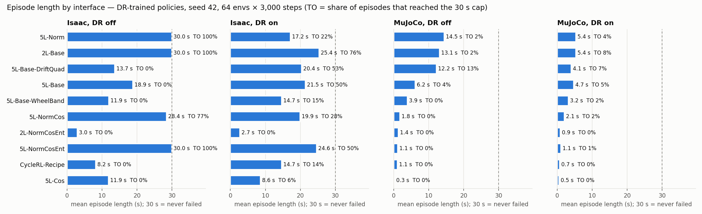
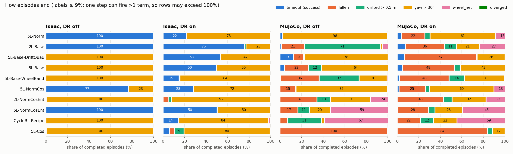
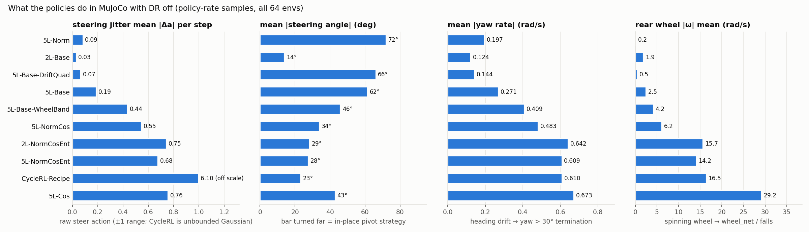
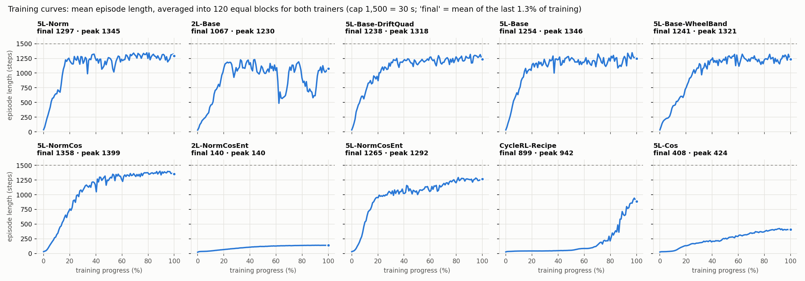
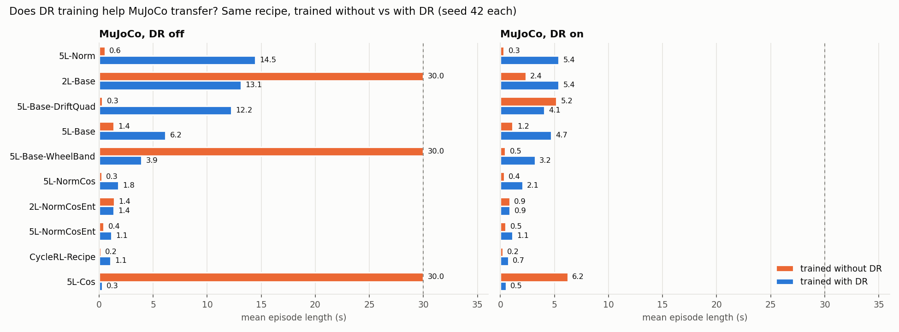

# Trackstand DR training ablation: results in figures

- **Summary written:** 2026-11-03 22:36 HKT
- **Covers:** the same data as [15:01 results](2026-11-03_1501_trackstand_dr_training_ablation.md) and
  [15:06 failure diagnostics](2026-11-03_1506_trackstand_dr_ablation_failure_diagnostics.md), drawn as charts.
  No new training or evals.
- **Training:** 2026-11-02 16:48 → 2026-11-03 03:10 HKT · **Evals finished:** 2026-11-03 03:54 HKT
- **Figures:** [`figures/2026-11-03_dr_ablation/`](figures/2026-11-03_dr_ablation/). Every plotted number is
  also in [`figures_data.csv`](figures/2026-11-03_dr_ablation/figures_data.csv).
- **Generator:** `~/bike_test/trackstand_rl_test_layer/isaaclab_train/logs/ablation_queue_dr/plot_summary.py`.
  Rerun with
  `~/IsaacLab/_isaac_sim/python.sh plot_summary.py --out <dir>`; system python's matplotlib won't import
  under numpy 2.

Setup, unchanged from the 15:01 summary: `Trackstand-Balance-v1` plant, every run trained with `--dr`,
seed 42, 4096 envs, 7,500 PPO updates; final checkpoint; evals of 64 envs × 3,000 steps with seed 42;
episodes cap at 30 s. CycleRL-Recipe-best is left out because it has the same weights as the final
checkpoint. In every bar chart, runs are sorted by MuJoCo DR-off episode length, best first.

---

## 1. Episode length in each interface

**Reading it:** each bar is the mean episode length; 30 s (dashed line) means the run never failed.
"TO" is the share of episodes that reached the cap.

- **Isaac:** DR training works there. With DR on, 2L-Base lasts **25.4 s (TO 76%)**, 5L-NormCosEnt 24.6 s
  and 5L-Base 21.5 s.
- **MuJoCo:** nothing transfers. The best runs are 5L-Norm **14.5 s**, 2L-Base **13.1 s** and
  5L-Base-DriftQuad **12.2 s**, with DR off. The best timeout rate is DriftQuad's **13%**.
  With MuJoCo DR on, every run is at or below **5.4 s**.
- **Order changes between simulators:** 5L-NormCosEnt is 30.0 s in Isaac with DR off but 1.1 s in
  MuJoCo. A good Isaac score does not predict transfer.

## 2. How episodes end

**Reading it:** each row splits the completed episodes by the term that ended them. Numbers are shown
on segments of 9% or more; the CSV has all values.

- **Yaw (yellow) is the main failure in Isaac.** Seven of ten runs end **100%** of their Isaac DR-off
  episodes on yaw > 30°. The v1 reward has no yaw term.
- **In MuJoCo, the failure shows how each run balances:**
  - Yaw: 5L-Norm **98%**, DriftQuad 78%, 5L-Base 64%.
  - Drift: 2L-Base **71%**.
  - wheel_net (the wheel spins up): CycleRL 67%, 5L-NormCosEnt 59%.
  - Falls: 5L-Cos **100%**.
- With MuJoCo DR on, falls (orange) grow in every run, for example DriftQuad **67%** and 5L-Base 48%.

## 3. What the policies do in MuJoCo (DR off)

- **Steering jitter splits the good runs from the bad ones.** The runs that last longest have a
  per-step |Δa| of **≤ 0.09** (2L-Base 0.03, DriftQuad 0.07, 5L-Norm 0.09). The failing runs are at
  **0.44–0.76**, and CycleRL reaches **6.10**: its Gaussian actions are unbounded, and the bar is cut off
  at 1.0 on the chart.
- **Two ways of balancing:**
  - Bar turned far, **62–72°** (5L-Norm 72°, DriftQuad 66°, 5L-Base 62°). The bike pivots in place,
    which balances it but rotates the heading, so the run ends on yaw.
  - Bar near straight, **14°** (2L-Base). The bike rolls forward and back to balance and ends on drift.
- **Yaw rate and wheel speed rise together with failure.** The best runs turn at 0.12–0.20 rad/s,
  the failing ones at 0.41–0.67 rad/s. Mean rear |ω| goes from **0.2–2.5 rad/s** (good) to
  **14–29 rad/s** (failing), which leads to wheel_net terminations and falls.

## 4. Training curves

**Reading it:** both trainers are averaged into 120 equal blocks so the curves compare fairly (see
[15:24](2026-11-03_1524_tensorboard_noise_rsl_vs_skrl.md)). "Final" is the mean over the last 1.3% of
training; "peak" is the highest block.

- **Seven runs level off at 1,067–1,358 of 1,500 steps** by about 40% of training. 5L-NormCos is
  highest at **1,358**.
- **2L-Base dips** at about 60% (to about 490) and again at about 85%, and ends at **1,067**, below its
  peak of 1,230.
- **Three runs did not learn:** 2L-NormCosEnt reaches **140** and 5L-Cos **408**. Their cosine learning
  rate decays to about 0 before they can learn. CycleRL rises only at the end of training and finishes
  at **899**, with a peak of 942.

## 5. Without DR vs with DR training (MuJoCo)

- **MuJoCo, DR off:** DR training helps most runs, for example 5L-Norm **0.6 → 14.5 s** and DriftQuad
  **0.3 → 12.2 s**. Three runs trained without DR lasted the full **30.0 s** (5L-Cos, WheelBand,
  2L-Base), and their DR-trained versions don't (0.3 / 3.9 / 13.1 s).
- **MuJoCo, DR on:** those three runs trained without DR drop to **6.2 / 0.5 / 2.4 s**, so their 30 s
  did not survive a randomized plant. All runs are within 0.2–6.2 s either way.
- With one seed per run, results can change a lot between batches (5L-Cos: 30.0 → 0.3 s). The
  differences between single factors need more seeds.

---

## Correction to an earlier output

- **What was wrong:** `failure_report.txt` gave CycleRL-Recipe's end-of-training episode length as
  **217** steps. It averaged the last 100 logged values, which covers about 83% of the 120 points that
  skrl logs.
- **Fix:** `failure_report.py` now averages the last 1.3% of training for both trainers. CycleRL's
  value is **899**. The RSL-RL values didn't change, and `failure_report.txt` was regenerated.
- **Effect on the earlier summaries:** neither cites the 217.
- **Why 15:01 differs from this file:** the "end of training" table in 15:01 used the single last
  logged value (for example 5L-Norm 1,192), not a mean. This file uses the 1.3% mean (5L-Norm 1,297).

## Caveats

- One seed per run.
- Isaac torque traces cover only 3 envs, so they're left out here.
- Isaac drive speed comes from `eval.txt` and MuJoCo from `*_summary.json`; both are means over steps.

## Next steps (unchanged, not started)

- Add a yaw or heading term to the reward, then retrain 5L-Norm, 2L-Base and DriftQuad with `--dr` and
  1–2 more seeds.
- Find the cause of the steering chatter and rear spin-up in MuJoCo for the failing runs.
