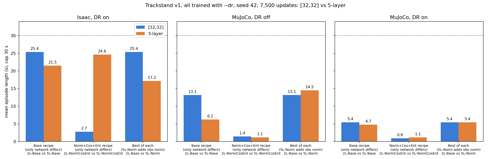

# Trackstand: does the 5-layer network beat [32,32]?

- **Summary written:** 2026-11-03 23:03 HKT
- **Data:** no new runs. Re-reads the DR ablation in [22:36 figures](2026-11-03_2236_trackstand_dr_ablation_figures.md)
  and [15:01 results](2026-11-03_1501_trackstand_dr_training_ablation.md).
  Training ran 2026-11-02 16:48 → 2026-11-03 03:10 HKT; evals finished 2026-11-03 03:54 HKT.
- **Setup:** `Trackstand-Balance-v1`, every run trained with `--dr`, seed 42, 4096 envs, 7,500 PPO updates,
  final checkpoint; evals 64 envs × 3,000 steps, seed 42, episodes cap at 30 s.
- **Figure:** [`figures/2026-11-03_5L_vs_2L/`](figures/2026-11-03_5L_vs_2L/) (`plot.py`, `figures_data.csv`).

## Answer

No. On this plant, the 5-layer network does not beat [32,32] in any case where we compare like with like.
The only pair where 5-layer wins outright is one where [32,32] never learned at all.

Mean episode length (s):

| Comparison | Isaac DR on | MuJoCo DR off | MuJoCo DR on |
|---|---|---|---|
| **2L-Base** vs 5L-Base (only the network differs) | **25.4** vs 21.5 | **13.1** vs 6.2 | **5.4** vs 4.7 |
| 2L-NormCosEnt vs 5L-NormCosEnt (only the network differs) | 2.7 vs **24.6** | 1.4 vs 1.1 | 0.9 vs 1.1 |
| 2L-Base vs 5L-Norm (best run of each size) | **25.4** vs 17.2 | 13.1 vs 14.5 | 5.4 vs 5.4 |

- **Network is the only change (Base recipe):** [32,32] scores higher in all three interfaces. In MuJoCo
  with DR off it lasts 2× as long, and its steering is calmer: per-step |Δa| 0.03 vs 0.19, mean bar angle
  14° vs 62°.
- **Norm + cosine + entropy recipe:** 5-layer wins in Isaac (24.6 vs 2.7 s), but only because the
  [32,32] run failed to train. Its cosine learning rate fell to about 0 before it learned anything (final
  training episode 140 steps). That is a learning-rate schedule failure, not evidence about capacity.
  Neither network transfers to MuJoCo (≤ 1.4 s).
- **Best run of each size:** 5L-Norm and 2L-Base land within single-seed noise in MuJoCo (14.5 vs 13.1 s
  with DR off, 5.4 vs 5.4 s with DR on). 5L-Norm also uses obs normalization, so it is not a pure network
  comparison.
- **Training-curve scores don't predict the eval.** The 5-layer runs end training with higher episode
  lengths (5L-Base 1,254 vs 2L-Base 1,067 of 1,500 steps), yet they score lower in evals and transfer
  worse to MuJoCo.

## Why capacity isn't the limiting factor

- With DR on in MuJoCo, every run of either size stops at **≤ 5.4 s**. The cap is the same for both
  sizes, so it comes from something they share: the reward, the sim-to-sim gap, or the plant.
- The way runs fail is behavioural, not a lack of fitting power. The v1 reward has no yaw term, so runs
  end on yaw > 30° (bar turned far and pivoting) or on drift. A larger network fits that same reward
  without changing what it rewards.
- The trackstand control law is low-dimensional: roll, roll rate and steering in, steering and wheel
  torque out, close to a linear feedback law. [32,32] has enough capacity for it. Extra layers mainly add
  room to fit Isaac-specific detail, which matches the bigger Isaac→MuJoCo drop for 5L-Base (21.5 → 6.2 s)
  than for 2L-Base (25.4 → 13.1 s).

## Caveats

- One seed per run. Earlier batches moved by up to 30 s between seeds, so a 1–2 s gap is not a result.
- Final checkpoints only; the best intermediate checkpoint could rank differently.
- This compares network depth, not width. The 5-layer runs share one depth/width setting.

## Next steps (not started)

- Keep [32,32] as the trackstand default.
- Put the effort into the reward first: add a yaw or heading term, then retrain 2L-Base and 5L-Norm with
  `--dr` on 2–3 seeds each. That also gives a clean seeded answer to the depth question.
- If the cosine schedule stays, raise its floor (e.g. a minimum lr of 1e-5) so small networks don't stall.
