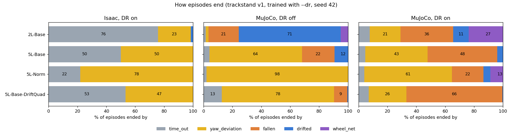

# Trackstand: checking "the failures come from the reward" (correction)

- **Summary written:** 2026-11-03 23:32 HKT
- **Corrects:** the chat explanation given with [23:03 5L vs 2L](2026-11-03_2303_trackstand_5L_vs_2L.md):
  "The failures come from the reward: it has no yaw term, so policies turn the bar far and pivot until
  the yaw > 30° limit ends the episode, or they drift." That sentence claims too much. 23:03 itself is not
  rewritten.
- **Data:** no new runs. Same DR ablation as [22:36](2026-11-03_2236_trackstand_dr_ablation_figures.md)
  (training 2026-11-02 16:48 → 2026-11-03 03:10 HKT, evals finished 03:54 HKT; v1, `--dr`, seed 42,
  7,500 updates, 64 envs × 3,000 steps).
- **Reward source:** `trackstand_rl_env_cfg.py:116-122` (survival 5.0, drift_gauss 2.0) and
  `trackstand_rl_env_cfg_v1.py:57` (rate_penalty 0.1). Yaw appears only as the termination at line 152.
- **Figure:** [`figures/2026-11-03_yaw_claim/`](figures/2026-11-03_yaw_claim/) (`plot.py`, `figures_data.csv`).

## Each part of the claim

| Part | Verdict | Evidence |
|---|---|---|
| v1 reward has no yaw term | True, but incomplete | Rewards are survival, drift and action rate. Crossing 30° yaw ends the episode, which forfeits the remaining survival reward. So heading is penalized only at the 30° limit, with no gradient before it. |
| Policies turn the bar far and pivot until yaw > 30° | Supported, correlational | MuJoCo DR off: runs ending mostly on yaw hold a mean bar angle of 62–72° (5L-Norm 72°, DriftQuad 66°, 5L-Base 62°) vs 14° for 2L-Base, which ends on drift. Not shown by a heading-vs-time trace. |
| Yaw is the main failure | True in Isaac DR on and MuJoCo DR off; **not** in MuJoCo DR on | Isaac DR on, yaw: 5L-Norm 78%, 5L-Base 50%, DriftQuad 47%, 2L-Base 23%. MuJoCo DR on, falls: DriftQuad 66%, 5L-Base 48%, 2L-Base 36% (2L-Base also 27% wheel_net). |
| "…or they drift" is also the reward's fault | **Wrong** | Drift has a reward term (drift_gauss, σ 0.25 m). 2L-Base's 71% drift endings in MuJoCo DR off mean it balances by rolling back and forth, a trade the current reward allows. A missing yaw term doesn't explain it. |
| The reward explains the ≤ 5.4 s cap in MuJoCo DR on | **Wrong** | That condition is dominated by falls, which point to transfer and robustness, not to heading. |

## Corrected statement

- **Yaw endings (Isaac and MuJoCo DR off):** most likely caused by the reward. These happen even in
  Isaac, the plant the policy trained on, so they are not a transfer artefact. A small dense yaw or
  yaw-rate penalty should help. This is a hypothesis; no run has tested it yet.
- **MuJoCo DR on, the ≤ 5.4 s cap:** mostly falls, plus wheel spin-up for 2L-Base. That is a sim-to-sim
  or robustness gap, not a heading problem, and a yaw term is not expected to fix it.
- **Unchanged:** both network sizes fail the same ways, so the 23:03 conclusion that depth is not the
  bottleneck stands.

## Caveats

- One seed per run.
- Bar angle and termination share are means over episodes; per-episode traces were not checked.

## Next steps (not started)

- Plot heading vs time for yaw-ending episodes, to tell steady creep from one large swing during a
  recovery. The v0 cfg comment at line 257 records that a 0.5 rad initial roll caused 41% yaw deaths
  during recovery.
- Retrain with `--dr`, adding a dense yaw or yaw-rate term: 2L-Base and 5L-Norm, 2–3 seeds each.
- Separately, investigate the MuJoCo DR-on falls (which DR factor drives them; see
  `mujoco_sim2sim/scripts/dr_sensitivity.py`).
