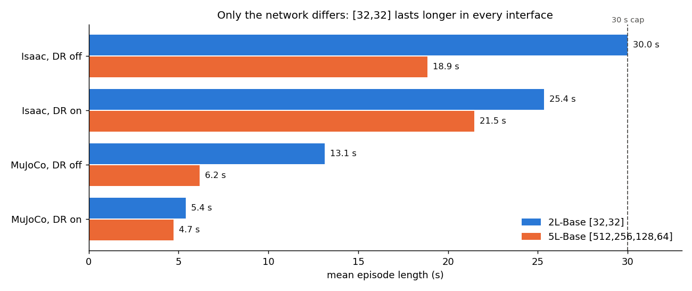
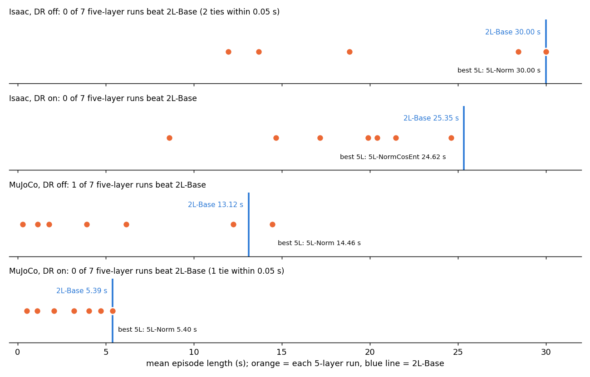
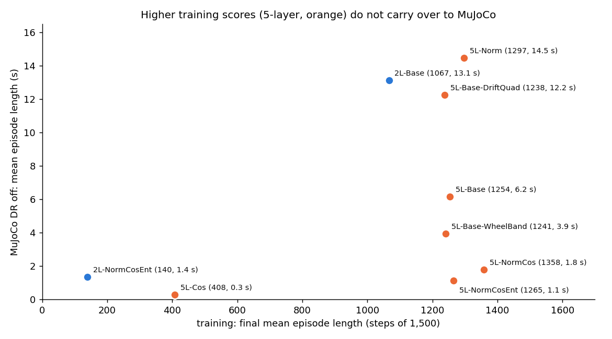
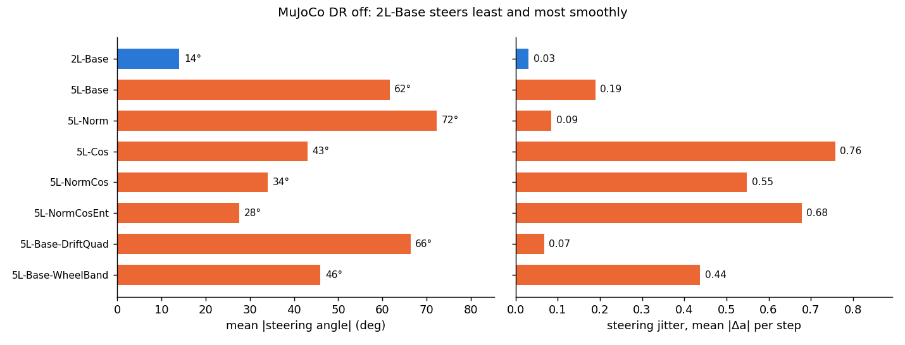

# Trackstand: the 5-layer network gave no improvement over [32,32]

- **Summary written:** 2026-11-04 00:09 HKT
- **Extends:** [2026-11-03 23:03, 5L vs 2L](2026-11-03_2303_trackstand_5L_vs_2L.md), which compared the matched pairs
  only. This report adds every 5-layer variant, the training-vs-transfer relationship, steering behaviour and model
  size. No new runs.
- **Data:** DR training ablation, `~/bike_test/trackstand_rl_test_layer/isaaclab_train/logs/ablation_eval_dr/`, via
  [figures_data.csv](figures/2026-11-03_dr_ablation/figures_data.csv). Training ran 2026-11-02 16:48 → 2026-11-03
  03:10 HKT; evals finished 2026-11-03 03:54 HKT.
- **Setup:** `Trackstand-Balance-v1`, every run trained with `--dr`, seed 42, 4096 envs, 7,500 PPO updates, final
  checkpoint (`model_7499.pt`). Evals: 64 envs × 3,000 steps, seed 42, all six v1 terminations, episodes capped at 30 s.
- **Figures:** [`figures/2026-11-04_5L_no_gain/`](figures/2026-11-04_5L_no_gain/) (`plot.py`, `figures_data.csv`).

## Runs compared

| Group | Runs | Network |
|---|---|---|
| [32,32] | **2L-Base** (v1 recipe), 2L-NormCosEnt | 1,572 actor weights |
| 5-layer | 5L-Base, 5L-Norm, 5L-Cos, 5L-NormCos, 5L-NormCosEnt, 5L-Base-DriftQuad, 5L-Base-WheelBand | [512,256,128,64], 178,884 actor weights (114×) |

All share the v1 Beta actor, v1 plant and the PPO core (16 steps/env, 5 epochs, 4 mini-batches). Norm = obs
normalization, Cos = 1e-4 cosine lr, Ent = entropy 0.01; DriftQuad and WheelBand change one reward term.

## 1. With only the network changed, [32,32] lasts longer everywhere

| Interface | 2L-Base | 5L-Base | Difference |
|---|---|---|---|
| Isaac, DR off | **30.0 s** | 18.9 s | −11.2 s |
| Isaac, DR on | **25.4 s** | 21.5 s | −3.9 s |
| MuJoCo, DR off | **13.1 s** | 6.2 s | −7.0 s |
| MuJoCo, DR on | **5.4 s** | 4.7 s | −0.7 s |

## 2. No 5-layer variant clearly beats 2L-Base

| Interface | 2L-Base | Best 5-layer run | 5-layer runs above 2L-Base |
|---|---|---|---|
| Isaac, DR off | 30.0 s | 5L-Norm / 5L-NormCosEnt 30.0 s (tie) | 0 of 7 |
| Isaac, DR on | 25.4 s | 5L-NormCosEnt 24.6 s | 0 of 7 |
| MuJoCo, DR off | 13.1 s | 5L-Norm 14.5 s | 1 of 7 (+1.3 s) |
| MuJoCo, DR on | 5.39 s | 5L-Norm 5.40 s (tie) | 0 of 7 |

- Tuning the 5-layer run (normalization, cosine lr, entropy, reward changes) moves it around but never clearly past
  the plain [32,32] recipe.
- The single win, 5L-Norm in MuJoCo with DR off, is +1.3 s on one seed. Earlier batches moved by up to 30 s between
  seeds, and 5L-Norm also adds obs normalization, so it is not a network-only effect.

## 3. Higher training scores did not mean better transfer

- Every 5-layer run that learned finished training higher than 2L-Base: 1,238–1,358 vs 1,067 of 1,500 steps.
- In MuJoCo with DR off they range from 1.1 to 14.5 s. Five of six are below 2L-Base's 13.1 s.
- Among the seven runs that learned (training ≥ 1,000 steps), the correlation between training score and MuJoCo
  episode length is **r = −0.48**: in this batch, fitting Isaac better went with transferring worse.

## 4. 2L-Base steers least and most smoothly in MuJoCo

| Run | Mean \|steering angle\| | Steering jitter (mean \|Δa\| per step) |
|---|---|---|
| **2L-Base** | **14°** | **0.03** |
| 5-layer runs | 28–72° | 0.07–0.76 |

- The 5-layer runs that last longest (5L-Norm, DriftQuad) hold the bar at 66–72° and pivot, which ends them on yaw.
- The others jitter 6–24× more than 2L-Base, which matches their spin-up and falls.

## Findings

- **No measurable benefit from the 5-layer network on this task.** Matched against [32,32], it is worse in all four
  interfaces. Across seven variants it never clearly wins.
- **It costs 114× more actor weights,** which matters for 50 Hz inference on the Raspberry Pi.
- **Capacity is not the bottleneck.** Both sizes fail the same ways (yaw endings in Isaac, falls in MuJoCo with DR on;
  see [23:32](2026-11-03_2332_trackstand_yaw_claim_check.md)), so the limits come from the reward and the
  sim-to-sim gap.
- **Keep [32,32]** as the trackstand network.

## Caveats

- One seed per run; gaps of 1–2 s are within seed noise.
- Final checkpoints only; a best intermediate checkpoint could rank differently.
- One 5-layer shape, so depth and width are changed together.
- All evals use v1 rewards and terminations; the depth result has not been rechecked under v3.

## Next steps

- Running now: `Trackstand-Balance-v3` ([32,32], heading penalty instead of the yaw termination), with the 2L-Base
  re-evaluated without the yaw termination as a reference.
- If depth is revisited, run 2–3 seeds per size and keep the reward fixed.
