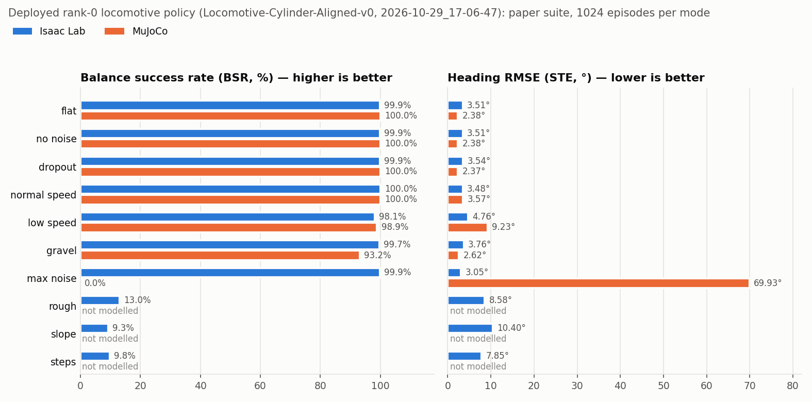
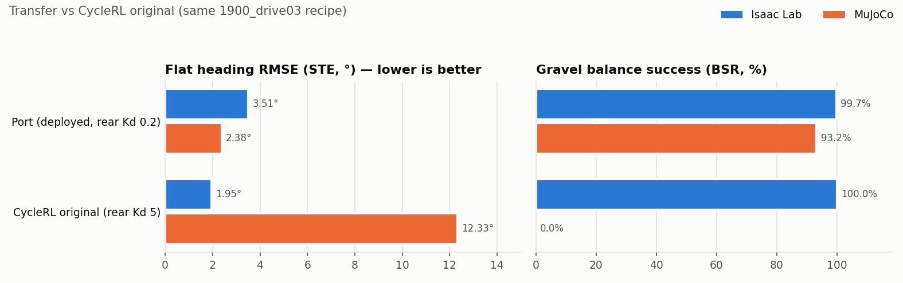

# Locomotive stack deployed to the Pi; alignment re-check and best-model eval recap

- **Written:** 2026-11-04 00:21 HKT
- **Deployed:** 2026-11-04 ~00:15 HKT, Pi `smallbike` (Ubuntu 24.04.5, aarch64, ROS 2 Jazzy, onnxruntime 1.30.0, numpy 1.26.4), Tailscale `100.99.110.117`
- **Model trained:** run `2026-10-29_17-06-47_ppo_torch_locomotive_ppo` (started 2026-10-29 17:06 HKT)
- **Eval finished:** Isaac paper suite 2026-10-29 20:31 HKT; MuJoCo paper suite 2026-10-29 20:48 HKT (1024 episodes per mode, both)
- **Sources:** `isaaclab_train/logs/skrl/locomotive/Locomotive-Cylinder-Aligned-v0/2026-10-29_17-06-47_ppo_torch_locomotive_ppo/{transfer_report.json,transfer_report.md,paper_score.txt,params/env.yaml}`, `isaaclab_train/logs/locomotive_ablation/summary.md`, `deploy/source/trackstand_deploy/{config/locomotive.yaml,models/locomotive_policy_manifest.json,trackstand_deploy/locomotive_*.py,trackstand_deploy/motor_mit_velocity_io.py,launch/locomotive.launch.py}`

## 1. Alignment re-check (desktop, commit `9773e1d`, before deploying)

| Check | Result |
|---|---|
| `best_agent.pt` SHA vs manifest `checkpoint_sha256` | match `7af4036d…` |
| ONNX SHA vs manifest / `locomotive.yaml` / controller default | match `ec3ccae9…` (all three) |
| `locomotive_env_cfg.py` changed after the run trained? | no (last change `ce49cad`, 2026-10-29 18:55; `9773e1d` only added ablation/terrain files) |
| Saved `params/env.yaml` vs current cfg | same: dt 0.0025 × 8, 64 s, steer IdealPD 10/0.2/±5.6 + friction 0.046/0.00091, rear IdealPD 0/0.2/±6.28 + 0.106, scales 0.349 rad / 42.857 rad/s, lean 45° |
| Observation order (Isaac `imu_orientation_and_velocity` + `command_tracking_error`) vs `locomotive_contracts.OBSERVATION_NAMES` | same 8 channels, same order; steer wrapped with atan2 on both sides |
| Action scaling/clip | ×20° clip ±20° → position; ×3/0.07 clip ±45 rad/s → velocity, applied once in deploy (ONNX emits raw means; obs scaler embedded) |
| Rear law | `rear_control_mode: mit`, Kd 0.2, host-bounded 6.28 N·m = trained `IdealPDActuator` Kp 0 / Kd 0.2 |
| Command ranges | v* 0.5 → min(2.5, `max_speed_cmd_m_s` 1.5) m/s, yaw rate ±0.5 rad/s (inside trained ranges) |
| Local deploy tests (system python) | 692 passed, 5 skipped, 5 failed: all 5 are `ModuleNotFoundError: onnxruntime` on this desktop (trackstand ONNX tests), not code |

**Known sim/deploy differences, carried over unchanged:**
- Deploy `speed` is the no-slip rear-wheel estimate (r·ω). Isaac uses body vx.
- Two stale docstrings in `locomotive_controller.py`: the module docstring says "C1 rear speed" (the default is MIT), and the rate error message says "0.01 s x 2" (the actual setting is 0.0025 × 8). Both are cosmetic.

## 2. Deployment (Pi)

1. Pi checkout `~/trackstand_rl` was `main` @ `f1b1ff1` (trackstand only, no locomotive files). `git fetch origin locomotive` → `git switch -c locomotive --track origin/locomotive` → **`9773e1d`** (fast-forward; the user's moved 2026-10-29 rosbag, a local deletion plus an untracked copy, was preserved).
2. `colcon build --symlink-install --packages-select trackstand_deploy` (Jazzy, `/usr/bin/python3`). The first attempt failed because the old install tree held copied files; the immediate rebuild succeeded. The installed `share/` now symlinks to the source `config/`, `launch/` and `models/`.
3. On-Pi SHA: aligned ONNX `ec3ccae9…` and trackstand default `d9701945…` both match.
4. **On-Pi tests: 702 passed (full package), including `test_locomotive.py` 52 passed.** The ONNX reference-I/O tests skipped on the desktop run here.
5. Smoke: `locomotive_controller` started **alone** with `params.yaml` + `locomotive.yaml` (no motor, IMU, kickstand or RC nodes; CAN down). It loaded the rank-0 model, passed SHA and reference I/O, reported `v* 0.5-1.5 m/s, wake 1 m/s, trained rear IdealPDActuator Kd 0.2`, and started disabled. `/locomotive/status` was published. The stop traceback is from SIGTERM during shutdown (`RCLError` on an invalid context), not a startup fault.
6. **Not done:** no live launch, no CAN up, no motor writes, no commissioning steps.

## 3. Best (deployed) model: Isaac vs MuJoCo paper suite

The deployed rank-0 model is `locomotive_aligned_1900_drive03_2026-10-29_17-06-47.onnx`.

| Mode | Isaac BSR | MuJoCo BSR | Isaac STE° | MuJoCo STE° |
|---|---:|---:|---:|---:|
| flat | 99.9% | 100.0% | 3.51 | 2.38 |
| no noise | 99.9% | 100.0% | 3.51 | 2.38 |
| dropout | 99.9% | 100.0% | 3.54 | 2.37 |
| normal speed | 100.0% | 100.0% | 3.48 | 3.57 |
| low speed | 98.1% | 98.9% | 4.76 | 9.23 |
| gravel | 99.7% | 93.2% | 3.76 | 2.62 |
| max noise | 99.9% | **0.0%** (mean episode 3.6 s) | 3.05 | 69.93 |
| rough / slope / steps | 13.0% / 9.3% / 9.8% | not modelled | 8.58 / 10.40 / 7.85 | — |

Table II (flat) vs the Froude-scaled CycleRL targets, Isaac: BSR 0.999 ✓, VTE 0.010 m/s ✓ (≤ 0.09), BRT 0.37 s ✓, MSS 0.30 m/s ✓, MNT 0.50 ✓. **STE 3.51° ✗** (target ≤ 1.15) and **CAT 10° ✗** (target ≥ 27.8).

## 4. Why it is still the deployment choice

- Compared with CycleRL's own run of the same recipe (100 Hz, implicit rear Kd 5): MuJoCo flat STE **2.38° vs 12.33°**, MuJoCo gravel BSR **93.2% vs 0.0%**. In Isaac, CycleRL's run tracks heading more tightly (1.95° vs 3.51°), but that advantage does not survive the move to MuJoCo.
- Port ablation (2026-11-03): rear Kd 5 → 0.2 explains the transfer gap. Some Implicit-actuator Kd 0.2 variants have a lower MuJoCo flat STE (1.02–1.27°), but the bike runs the IdealPD/MIT law, and the differences are within the ~3–4° seed noise. No ablation run is a better deployable candidate.

## 5. Caveats

- All results are simulation only. MuJoCo locomotive has no passive joint friction; terrain modes are Isaac-only.
- MuJoCo max-noise collapses (0% BSR) while Isaac stays at 99.9%. Expect sensitivity to IMU noise well above the trained ρ range.
- Hardware items still unverified (from `deploy/docs/LOCOMOTIVE.md` / CLAUDE.md):
  - rear MIT Kd 0.2 has never run on the bike;
  - whether B3 actually bounds the MIT current;
  - the RC stick channels CH3/CH4 and their signs;
  - rolling with the stands down;
  - IMU latency and rear sim-vs-real response.
- `locomotive.launch.py` is **live** (`dry_run: false`).

## 6. Next steps

1. On the Pi, follow the commissioning order in `deploy/docs/LOCOMOTIVE.md`. Start with nodes individually and `-p dry_run:=true` on `motor_mit_velocity_io`, then check `/locomotive/rc_sticks` (stick up/right → +1).
2. Run the bike-stand rear MIT Kd 0.2 check before any rolling launch.
3. Only then run `ros2 launch trackstand_deploy locomotive.launch.py`. It records every session to `~/trackstand_logs/locomotive_<ts>/`.

Every plotted number is in `figures/2026-11-04_locomotive_pi_deploy/figures_data.csv`. The plotting script is `plot_summary.py`, in the same folder.
