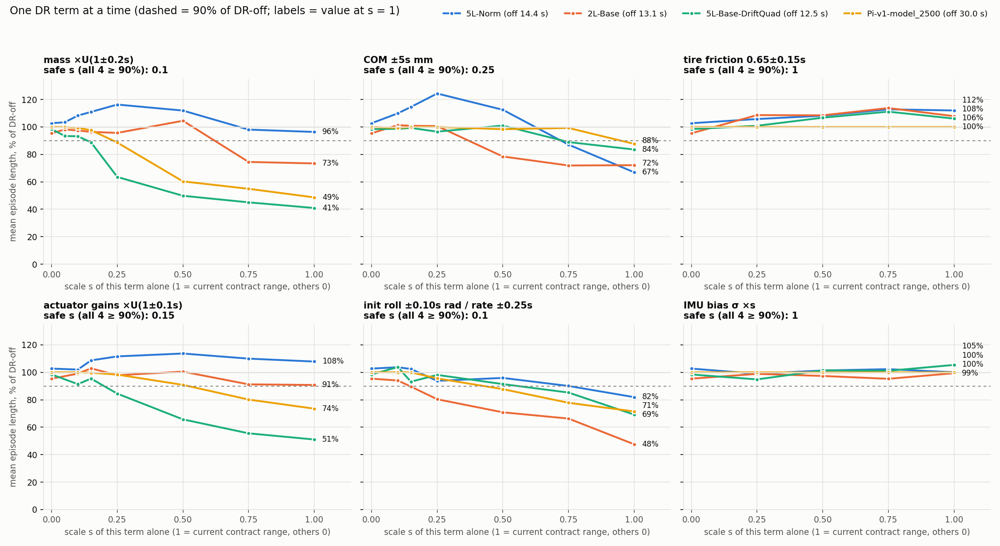
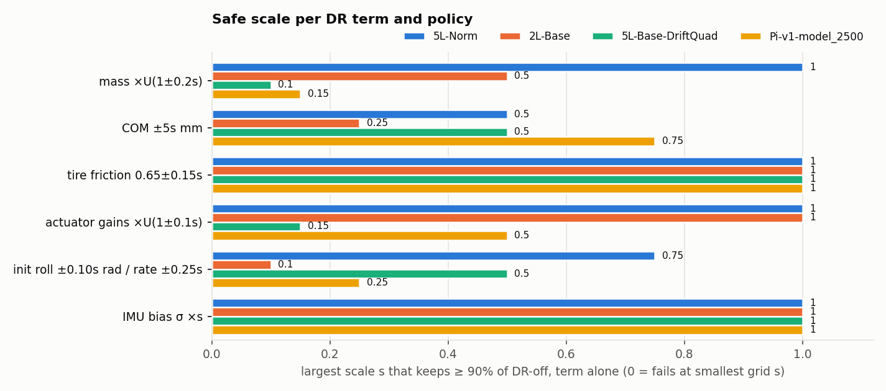
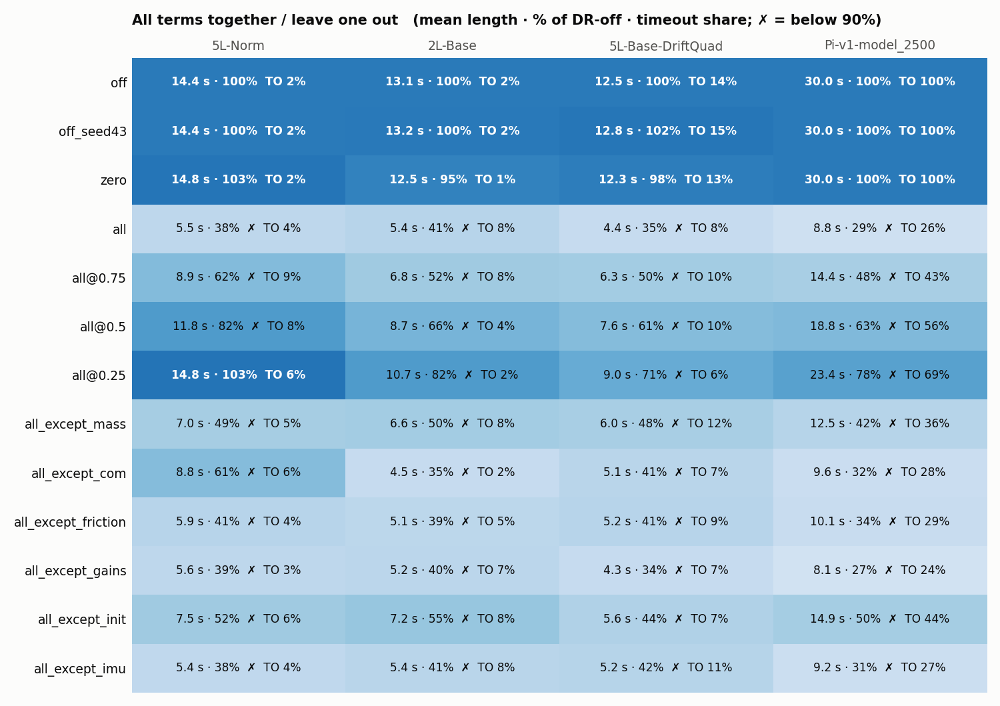
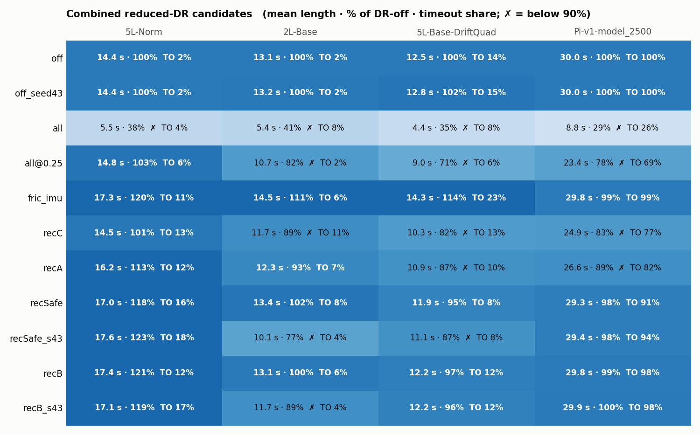
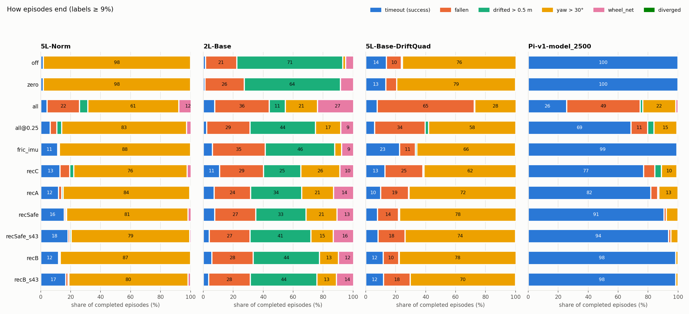

# MuJoCo DR sensitivity: how much each DR term must shrink to match DR off

- **Written:** 2026-11-04 01:05 HKT
- **Question (user):** MuJoCo DR-on results are always much worse than DR off. How much should each DR
  parameter be reduced to reach DR-off performance?
- **Runs (all MuJoCo, headless, Isaac python):**
  - Main sweep (148 jobs): started 2026-11-03 23:16 with 5 workers. It stopped at 120/148 when the
    session ended, was resumed 2026-11-04 00:27:15 and finished 00:36:45.
    (An earlier 22-worker launch at 23:04 ran out of RAM and was stopped with 0 results.)
  - Fine grid + combined candidates (52 jobs): 00:38:28 → 00:55:58.
  - Verification of recSafe at seed 42 and recSafe/recB at seed 43 (12 jobs): 00:57:42 → 01:03:12.
  - Lowest MemAvailable seen: 25 GB.
- **Sources:**
  - Script: `mujoco_sim2sim/scripts/dr_sensitivity.py`.
  - Results: `mujoco_sim2sim/reports/2026-11-03_dr_sensitivity/results.jsonl` (212 rows).
  - Logs: `mujoco_sim2sim/reports/2026-11-03_dr_sensitivity{,_fine,_verify}.log`.
  - Charts: `mujoco_sim2sim/scripts/plot_dr_sensitivity.py` → `figures/2026-11-04_mujoco_dr_sensitivity/`
    (all plotted numbers are in `figures_data.csv`).

## Setup

- **Policies.** All four were trained in Isaac with `--dr`. The first three are from the DR ablation
  ([15:01](2026-11-03_1501_trackstand_dr_training_ablation.md)):
  - `5L-Norm`, `2L-Base` and `5L-Base-DriftQuad`: `trackstand_rl_test_layer/.../ablation_eval_dr/<name>/policy.onnx`.
  - `Pi-v1-model_2500`: the Pi default ONNX.
- **Eval.** Same env, `ViewerEnvGroup`, `DeployedPolicy` and six terminations as `run_deploy_eval.py`
  (v1 policies, so yaw termination stays on). 64 envs × 3000 steps (60 s), seed 42.
- **What was varied.** Each DR term gets a scale s (1 = current `contract.py` range, 0 = off):

  | Term | Range at scale s | s = 1 (current) |
  |---|---|---|
  | mass | × U(1 ± 0.2 s), each body drawn on its own, inertia scaled too | 0.8–1.2 |
  | COM | ± 5 s mm | ± 5 mm |
  | friction | tire friction 0.65 ± 0.15 s | 0.5–0.8 |
  | gains | actuator Kp/Kd × U(1 ± 0.1 s) | 0.9–1.1 |
  | init | initial roll ± 0.10 s rad, roll rate ± 0.25 s rad/s | — |
  | imu | IMU turn-on bias σ × s | gyro 0.0002, accel 0.002 |

  DR stays enabled in every scaled config, so all configs draw the same random-number stream. `off` is
  the real `enable_dr=False` run.
- **Metric.** Mean completed-episode length as a % of the same policy's DR-off run.
  - A scale "passes" if it keeps **≥ 90 %** of DR off.
  - A term's **safe scale** is the largest grid s where that s and every smaller s pass with the term
    applied alone.
  - Grid: s = 0.25 / 0.5 / 0.75 / 1 for every term, plus 0.05 / 0.1 / 0.15 for mass, gains, init and COM.
- **Same ranges as Isaac `--dr`.** Isaac DR-on episode lengths for these policies are 17.2 / 25.4 /
  20.4 s (5L-Norm / 2L-Base / DriftQuad). The MuJoCo DR-on equivalents are 5.5 / 5.4 / 4.4 s.

## Answer

| DR term | Safe scale (min over the 4 policies) | Equivalent range | Weakest policy | Pi-default alone |
|---|---|---|---|---|
| tire friction | **1, no cut needed** | 0.5–0.8 | — (100–114 % at every s) | 1 |
| IMU bias | **1, no cut needed** | current σ | — (94.8–105 % at every s) | 1 |
| COM | **0.25** | ± 1.25 mm | 2L-Base (78 % at 0.5) | 0.75 |
| actuator gains | **0.15** | × U(0.985, 1.015) | DriftQuad (84 % at 0.25) | 0.5 |
| mass | **0.1** | × U(0.98, 1.02) | DriftQuad (89 % at 0.15, 64 % at 0.25) | 0.15 |
| init roll / rate | **0.1** | ± 0.01 rad / ± 0.025 rad/s | 2L-Base (89.6 % at 0.15, 80 % at 0.25) | 0.25 |

**These single-term limits don't combine.** When the reduced terms run together, the effects add up.
The combination that matched DR off for all four policies on both seeds is **recB**:

> **mass 0.05 (×U(0.99, 1.01)), COM 0.1 (± 0.5 mm), gains 0.1 (×U(0.99, 1.01)),
> init 0.1 (± 0.01 rad / ± 0.025 rad/s), friction 1, IMU 1**
>
> It scores 89–121 % of DR off; the only result under 90 % is 2L-Base at seed 43 (89 %).

That means cutting mass, COM, gains and init to **5–10 % of their current ranges**, which is
effectively off. Friction and IMU bias can stay at full range. MuJoCo DR on matches DR off only when the
four plant terms are nearly switched off.

## 1. One term at a time

- **Mass hurts most.** At full range it leaves the Pi policy at **49 %** and DriftQuad at **41 %**.
  DriftQuad already drops to 64 % at s = 0.25.
  - Each body's mass is scaled independently, so mass DR also moves the overall COM and changes the
    split between wheels and frame.
- **Gains and init come next.** At s = 1, gains leave DriftQuad at 51 % and Pi at 74 %; init leaves
  2L-Base at 48 % and Pi at 71 %.
- **COM** costs 12–33 % at s = 1.
- **Friction and IMU bias don't hurt** (IMU lowest 94.8 %, within seed noise). Friction even lengthens episodes for the three ablation
  policies, to 106–112 %.
- **Results above 100 % aren't better balance.** 5L-Norm and DriftQuad end DR-off episodes mainly on
  yaw > 30° (98 % / 76 %). A perturbation that slows the heading drift lengthens the episode without
  improving balance. The Pi policy is the cleanest signal: 100 % timeouts with DR off.

- The policies differ a lot. 5L-Norm tolerates full-range mass and gains, but DriftQuad tolerates only
  0.1 / 0.15. No single policy is weakest on every term (2L-Base: COM and init; DriftQuad: mass and
  gains), so the minimum across policies combines limits from different policies.

## 2. All terms together, and leaving one out

- **Noise floor (DR off).** Changing the seed (`off` vs `off_seed43`) moves results by ≤ 2 %. DR
  switched on with every range at 0 (`zero`) lands at 95–103 %.
- **No single term explains the gap.** With any one term left out, three policies stay at **≤ 55 %**
  and 5L-Norm at ≤ 61 %. The term whose removal helps most differs by policy: init for 2L-Base (55 %)
  and Pi (50 %, mass next at 42 %), mass for DriftQuad (48 %), COM for 5L-Norm (61 %).
- **Scaling every term together** (all@s) recovers slowly. At all@0.25, 5L-Norm is at 103 %, but Pi
  is at 78 %, 2L-Base at 82 % and DriftQuad at 71 %.

## 3. Combined candidates

| Candidate | mass | COM | gains | init | friction, IMU | Result |
|---|---|---|---|---|---|---|
| fric_imu | 0 | 0 | 0 | 0 | 1 | Passes all 4 (99–120 %) |
| recC (Pi's per-term limits) | 0.15 | 0.5 | 0.5 | 0.25 | 1 | Fails 3: Pi 83 %, DriftQuad 82 %, 2L-Base 89 % |
| recA | 0.1 | 0.25 | 0.25 | 0.25 | 1 | Fails 2: DriftQuad 87 %, Pi 89 % |
| recSafe (per-term minimums) | 0.1 | 0.25 | 0.15 | 0.1 | 1 | Seed 42 passes all (95–118 %); seed 43 fails 2L-Base (77 %) and DriftQuad (87 %) |
| **recB** | **0.05** | **0.1** | **0.1** | **0.1** | **1** | **Seed 42: 97–121 %; seed 43: 89–119 % (Pi 99 % / 100 %)** |

- **Even for the Pi policy alone, its own per-term limits add up.** recC scores 83 %; recSafe scores
  98 % on both seeds. For the Pi policy, recSafe is enough.
- **Seed noise is larger with DR on than off.** recSafe for 2L-Base gives 102 % at seed 42 and 77 % at
  seed 43. With about 250 episodes, DR-on means for 2L-Base and DriftQuad vary by roughly ±10 % between
  seeds, so any single-seed point near 90 % is uncertain by about one grid step.

## 4. How episodes end

- **The loss with full DR is mostly falls.** In the `all` config, falls account for 49 % of Pi
  episodes, 65 % for DriftQuad and 36 % for 2L-Base (plus 27 % wheel_net). This agrees with the
  [23:32 yaw-claim check](2026-11-03_2332_trackstand_yaw_claim_check.md).
- **recB brings the DR-off pattern back.** Pi times out in 98 % of episodes, 5L-Norm and DriftQuad
  mostly end on yaw again, and 2L-Base mostly on drift.

## Findings

1. **To match DR off, mass, COM, gains and init must shrink to about 5–10 % of their current ranges
   (recB). Friction and IMU bias can stay at full range.** Mass matters most, then gains and init,
   then COM.
2. The effects add up, so single-term limits are not enough on their own. The per-term minimums
   (recSafe) pass on one seed and fail on the other.
3. **Don't read this as a recommendation to shrink MuJoCo DR.** The same ranges are tolerated in Isaac
   (17–25 s DR-on episodes versus 4–6 s in MuJoCo). Shrinking them in MuJoCo makes the test easier
   without fixing anything. The gap is MuJoCo-plant sensitivity to mass, gains and init: the same
   policy and the same parameter ranges do much worse in MuJoCo than in Isaac.

## Caveats

- One seed per grid point (two for the verification rows). DR-on seed noise is about ±10 % for 2L-Base
  and DriftQuad.
- Mean length is a mix of balance and heading for the three ablation policies, which end mostly on yaw
  or drift even with DR off.
- The grid is coarse between 0.25 and 1, and mass, gains, init and COM were not tested below 0.05 / 0.1.
- v1 terminations, no `--no_yaw_termination` (none of these are v3 policies).

## Next steps

- Find out why MuJoCo is more sensitive than Isaac to mass and gains. Run the same mass draw in both
  engines, for example per-body mass versus one shared total mass scale, and check whether per-body
  scaling moves the COM differently in each engine.
- To narrow the uncertainty, repeat recB/recSafe and the mass/gains fine points at 2–3 more seeds.
- No contract change was made. `contract.py` DR ranges are unchanged.
