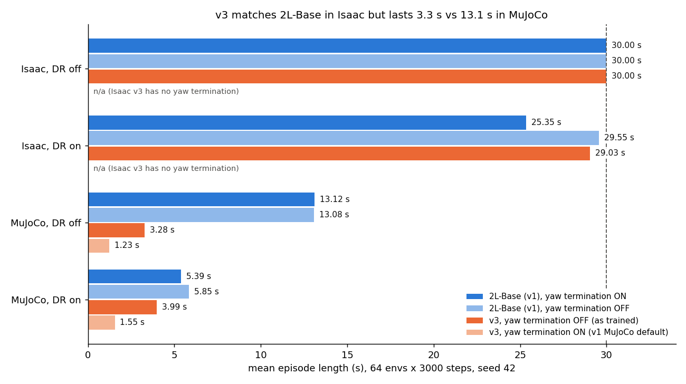
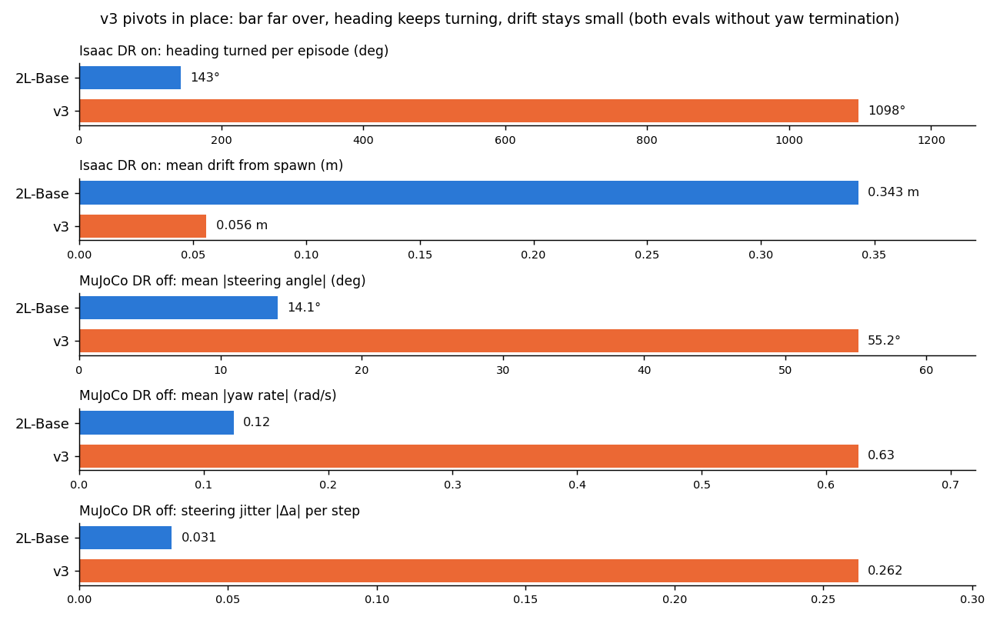
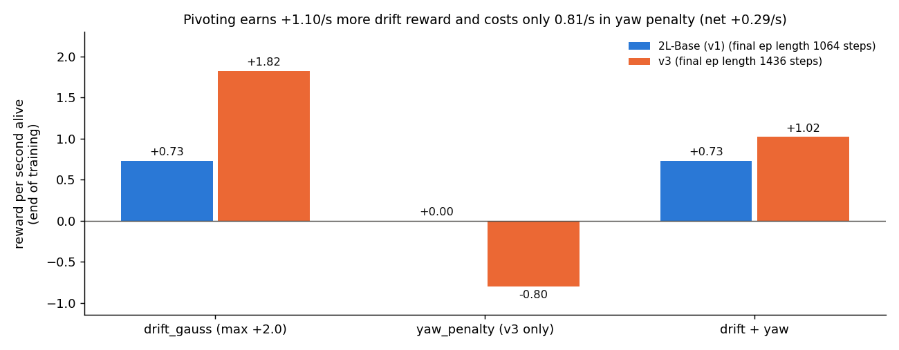
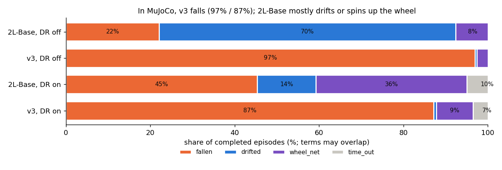

# Trackstand-Balance-v3 (heading penalty instead of yaw termination): first training run and evals

- **Summary written:** 2026-11-04 01:32 HKT
- **Training:** 2026-11-04 00:03 → 01:19 HKT (7,500 PPO updates, 76 min) · **Evals finished:** 01:28 HKT
- **Run:** `isaaclab_train/logs/rsl_rl/trackstand_rl_v3_rsl/2026-11-04_00-03-22_dr/model_7499.pt` (final checkpoint)
- **Pipeline and raw outputs:** `isaaclab_train/logs/v3_queue/` (`run.sh`, `queue.log`, `v3/`, `ref_2L-Base/`)
- **Figures:** [`figures/2026-11-04_v3_heading_penalty/`](figures/2026-11-04_v3_heading_penalty/). Generator `plot.py`
  (run with `~/IsaacLab/_isaac_sim/python.sh plot.py`); every plotted number is in
  [`figures_data.csv`](figures/2026-11-04_v3_heading_penalty/figures_data.csv), with more in `report_data.json`.
- **Task definition:** progress_record §308–309, `trackstand_rl_env_cfg_v3.py`.

## Setup

- **v3** = v1 plant, 11-obs contract and Beta PPO ([32,32]), with the `yaw_deviation` (30°) termination
  removed and a dense heading penalty `yaw_penalty` added (weight 2.0; 0 within 0.1 rad, linear to −1 at 180°,
  heading wrapped to ±180°).
- **Training:** same recipe as the DR ablation's 2L-Base: `--dr`, 4096 envs, 7,500 updates, seed 42.
- **Reference:** the DR ablation's **2L-Base** (v1 task, same network and PPO, `--dr`, seed 42,
  `trackstand_rl_abl_2l_base/2026-11-02_20-57-25_dr/model_7499.pt`). This is the matched comparison: only the
  heading term differs. The reference was re-evaluated **without** the yaw termination (Isaac:
  `env.terminations.yaw_deviation=null`; MuJoCo: `--no_yaw_termination`), so both policies are scored by the same
  rules. Its ablation numbers, which used the yaw termination, are shown alongside.
- **Evals:** 64 envs × 3,000 steps, seed 42. Isaac `play_eval.py` with DR off and on. MuJoCo `run_deploy_eval.py`
  on the exported ONNX, DR off and on, with `--no_yaw_termination` (v3's own rules) and, for v3 only, also
  without it (v1's MuJoCo default).

## Results

| Mean episode length (s) | Isaac DR off | Isaac DR on | MuJoCo DR off | MuJoCo DR on |
|---|---|---|---|---|
| 2L-Base, yaw termination on (ablation) | 30.00 | 25.35 | 13.12 | 5.39 |
| 2L-Base, yaw termination off | 30.00 | **29.55** | **13.08** | **5.85** |
| **v3**, yaw termination off (as trained) | 30.00 | 29.03 | 3.28 | 3.99 |
| v3, yaw termination on | n/a | n/a | 1.23 | 1.55 |

**1. In Isaac, v3 adds nothing over removing the termination at eval.** The yaw termination was the main
Isaac failure. Without it, the existing v1 2L-Base policy goes from 25.35 s to **29.55 s** (98% timeouts) with
DR on. v3 reaches **29.03 s** (96%), about the same.

**2. In MuJoCo, v3 transfers much worse.** Without the yaw termination it lasts **3.28 s vs 13.08 s** with DR
off and **3.99 s vs 5.85 s** with DR on. With the v1 MuJoCo rules (yaw termination on) it lasts 1.23 s and
1.55 s, because yaw > 30° ends 88% and 55% of its episodes. 2L-Base scores the same in MuJoCo with or without
the yaw termination (13.12 vs 13.08 s), so heading was never what limited it there.

### What v3 learned: pivot in place

**3. v3 balances by turning the bar far over and spinning on the spot.**
- In Isaac with DR on, its heading turns **1,098° per episode** (about 3 full turns in 30 s), against 143° for
  2L-Base. Its mean |heading error| is 67° with DR on and 92° with DR off. About 90° is what continuous rotation
  gives once the heading is wrapped.
- Its drift from spawn is **0.056 m vs 0.343 m**.
- In MuJoCo with DR off, the mean |steering angle| is **55° vs 14°**, with a constant bias (mean raw steering
  action −0.57). Yaw rate is 0.63 vs 0.12 rad/s, and steering jitter is **0.262 vs 0.031** per step (8×).
- This is the same large-angle pivot the 5-layer runs used (62–72°). A [32,32] network finds it too once the
  yaw termination is gone. So the 30° termination, not the small network, was what kept 2L-Base near straight.

### Why the penalty did not stop it

Reward per second alive at the end of training (RSL-RL `Episode_Reward` × 1500 / mean episode length;
survival is 5.0 for both, which checks the scaling):

| | drift_gauss | yaw_penalty | drift + yaw | final ep length (steps) |
|---|---|---|---|---|
| 2L-Base (v1) | +0.73 | – | +0.73 | 1,064 |
| v3 | **+1.82** | **−0.80** | **+1.02** | 1,436 |

**4. Pivoting pays.** Spinning on the spot keeps the bike near its spawn point, so it earns **+1.10/s** more
drift reward. The yaw penalty costs only **0.80/s**, a net gain of **+0.29/s**. Because the penalty is on the
*wrapped* heading, continuous rotation costs a bounded average of about −0.4 × weight per second, however many
turns the bike makes. At the observed cost, weight 2.0 is below break-even (≈ 2 × 1.10 / 0.80 = **2.75**).

### How v3 fails in MuJoCo

**5. The pivot doesn't survive the simulator change.** In MuJoCo without the yaw termination, v3 episodes end
in a **fall 97%** of the time with DR off and **87%** with DR on. 2L-Base mostly ends on drift (70%) with DR off,
and on falls (45%) or wheel spin-up (36%) with DR on. A pivot at a 55° bar angle depends on tyre scrub and
contact at large steering angles, where Isaac and MuJoCo differ most.

## Findings

1. Replacing the 30° yaw termination with a weight-2 heading penalty makes PPO switch from a near-straight
   rocking balance to a **spin-in-place pivot**. This scores equally in Isaac (29.0 s vs 29.6 s) and
   **transfers 4× worse to MuJoCo** (3.3 s vs 13.1 s, DR off).
2. The heading penalty as built (wrapped, weight 2) is weaker than the drift reward that pivoting earns, so it
   cannot prevent spinning.
3. The yaw termination was acting as a useful constraint for transfer: it kept policies out of the pivot
   regime. In Isaac it costs 2L-Base about 4 s with DR on; in MuJoCo it costs nothing.
4. This adds to the 5L-vs-2L reading ([00:09 report](2026-11-04_0009_trackstand_5L_no_gain_report.md)):
   the pivot is reachable by [32,32] as well. 5L found it under the termination; 2L finds it once the
   termination is removed. Large-angle pivoting is the common cause of poor transfer.

## Caveats

- One seed; this is a single run.
- Isaac v3 was not evaluated with the yaw termination added back (the v3 cfg has no such term). Its MuJoCo
  v1-rules row shows the effect.
- Isaac turn/drift are from `eval.txt` and MuJoCo steering angle / yaw rate / jitter from the evaluation
  `.npz` (observation channels 5 and 4, which carry obs noise; negligible at these values).
- The 2L-Base row uses `model_7499.pt` copied into `v3_queue/ref_2L-Base/ckpt/`, so the ablation's `eval.txt`
  was not overwritten.

## Next steps (proposed, not started)

Options for v4, each a one-term change from v3, trained with `--dr` and ideally 2 seeds:

- **Penalize spinning directly:** add |yaw rate| (`ang_vel_z`) or the unwrapped accumulated heading, so the cost
  grows with each turn instead of averaging out.
- **Penalize steering angle** (|steer|): this targets the large-angle pivot, which is what fails in MuJoCo.
- **Keep the yaw termination and add the penalty on top:** v1's transfer, with a gradient below the wall.
- Raising the weight alone needs > 2.75, and at 5.0 the worst step (−5) cancels survival. That makes ending the
  episode cost-neutral, so this is the least attractive option.
